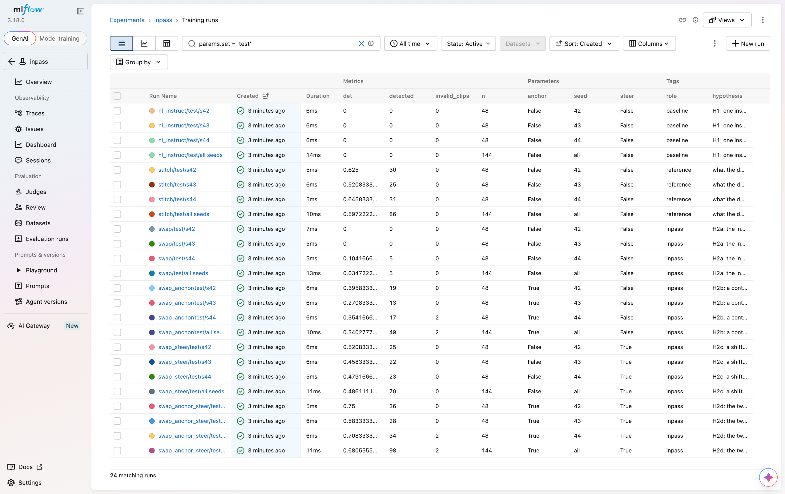
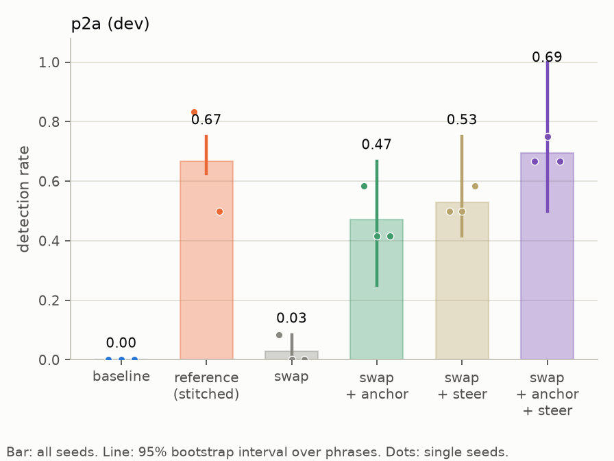
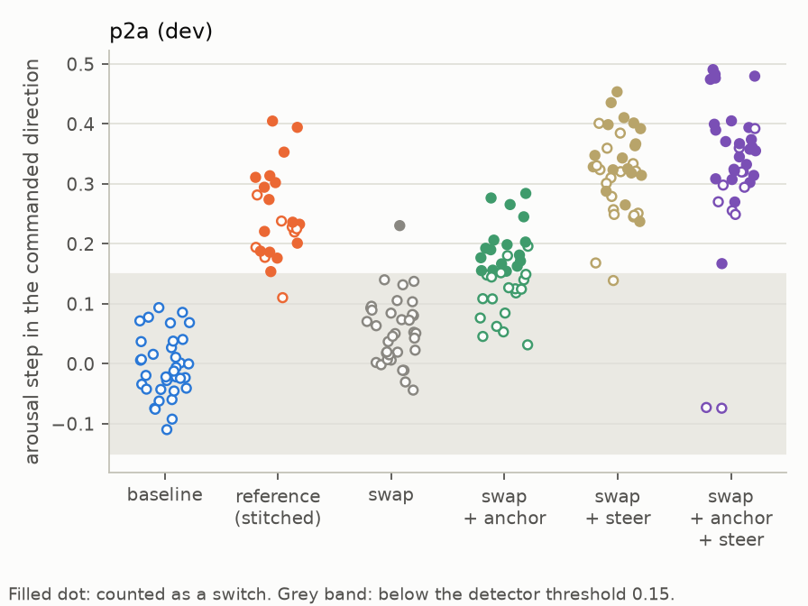
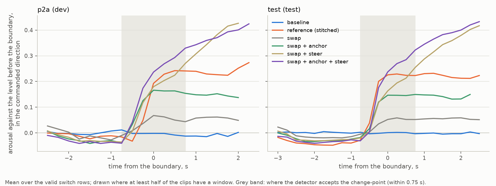
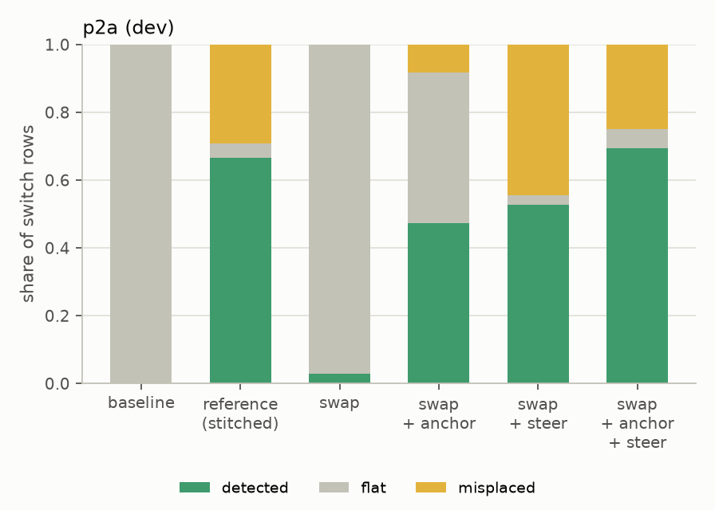
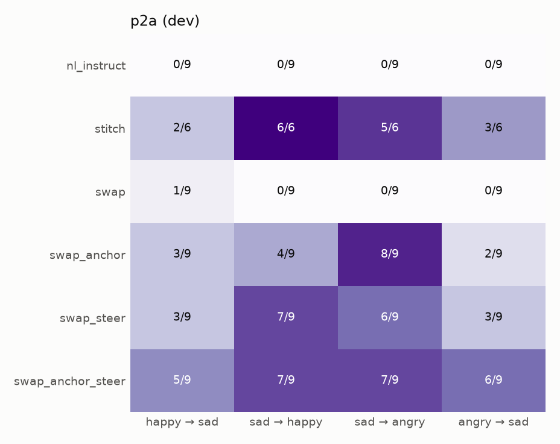

# ДЗ2. Смена эмоции в одном проходе декодера: два улучшения baseline и абляции

ДЗ2 курса «Исследования и разработка в ML», тема №33. Продолжение [ДЗ1](README.md): та же модель R,
те же фразы, тот же измеритель.

В ДЗ1 baseline (одна инструкция, называющая обе эмоции) не сменил уровень возбуждения ни в одном из
144 тестовых высказываний. Здесь проверены два изменения генерации, оба поверх смены инструкции на
границе предложений внутри одного прохода декодера: подмена начала контекста (`anchor`) и сдвиг
скрытого состояния (`steer`). Измерены все четыре сочетания. На тестовом наборе (12 фраз, 3 сида,
144 высказывания на систему):

| система | det на тесте |
|---|---|
| baseline, ДЗ1 | 0 из 144 |
| смена только инструкции (`swap`) | 5 из 144 (0.035) |
| + подмена контекста (`swap_anchor`) | 49 из 144 (0.340) |
| + сдвиг скрытого состояния (`swap_steer`) | 70 из 144 (0.486) |
| + оба компонента (`swap_anchor_steer`) | 98 из 144 (0.681) |
| референс-склейка, ДЗ1 | 86 из 144 (0.597) |

Гипотезы, пороги и тесты закоммичены до рендера тестовых клипов
([docs/prereg_inpass.md](docs/prereg_inpass.md)). Три из четырёх гипотез выполнены. Не выполнена
половина H2b, она же гипотеза H2 из ДЗ1: одна подмена контекста порога 0.50 не достигает.

Содержание: [1. От чего отталкиваемся](#1-от-чего-отталкиваемся) · [2. Что изменено](#2-что-изменено) ·
[3. Системы и гипотезы](#3-системы-и-гипотезы) · [4. Трекинг](#4-трекинг-экспериментов) ·
[5. Результаты](#5-результаты) · [6. Абляции](#6-абляции) · [7. Честность сравнения](#7-честность-сравнения) ·
[8. Что здесь шум](#8-что-здесь-шум) · [9. Выводы](#9-выводы) · [10. Ограничения](#10-ограничения) ·
[11. Запуск и артефакты](#11-запуск-и-артефакты)

Термины ДЗ1, которые здесь используются без изменений (полные определения — в
[README, «Термины»](README.md#термины) и в разделе 5 README):

- **R** — дообученная авторегрессионная TTS-модель с каналом инструкции; **судья** — модель, которая
  оценивает возбуждение (arousal) речи в окне 1 с и даёт профиль по времени.
- **Шаг** — разность среднего уровня судьи после границы предложений и до неё; **точка смены** —
  лучшее разбиение профиля на два уровня.
- **det** — доля высказываний, где шаг имеет нужный знак, не меньше 0.15 и точка смены лежит не
  дальше 0.75 с от границы. Основная метрика.
- **Нулевые строки** — высказывания без смены эмоции (`swap_null`: та же процедура, обе инструкции
  одной эмоции); по ним считается доля ложных шагов.
- **Годность клипа** — WER не выше 0.20, инструкция не произнесена, клип не зациклен; **гейт
  системы** — средний WER не выше 0.10 и ни одного зацикленного клипа.
- **dev** — набор `p2a`, 3 фразы; **test** — 12 фраз, написанных в ДЗ1.

## 1. От чего отталкиваемся

Из ДЗ1 известны два факта о модели R.

1. Когда второе предложение продолжает первое в одном проходе, уровень не меняется: у baseline
   0 из 144, и 142 строки из 144 имеют исход `flat` (шаг меньше порога).
2. Когда второе предложение рендерится отдельно, та же модель выдаёт нужный уровень: склейка двух
   рендеров даёт 86 из 144.

Отсюда предположение ДЗ1 (п. 7 README): стиль второго предложения держит уже сгенерированное аудио
первого, которое авторегрессионная модель продолжает; инструкция против него слаба. Из этого следуют
два способа вмешаться, не склеивая волну:

- **изменить то, что модель видит как своё прошлое** (подмена контекста);
- **изменить то, как модель из этого прошлого делает следующий кадр** (сдвиг скрытого состояния).

Оба взяты из исходного проекта, из которого вышла модель R; там они измерялись на dev и val
предыдущей версией детектора. Здесь они перенесены в этот репозиторий, заново отрендерены и впервые
измерены на тестовом наборе.

## 2. Что изменено

Код: [src/emoswitch/inpass.py](src/emoswitch/inpass.py), рендер в
[src/emoswitch/generate.py](src/emoswitch/generate.py) (`--kind inpass`).

**Общий механизм (`swap`).** Фаза 1: обычный проход по всему тексту под инструкцией первой эмоции.
По его аудио принудительным выравниванием находится граница: середина паузы перед первым словом
второго предложения. Кадры кодека до границы сохраняются. Фаза 2: вход модели собирается заново с
инструкцией второй эмоции, сохранённые кадры подаются как уже сгенерированный контекст, и декодер
продолжает до конца текста. Кодек декодирует всю последовательность один раз, стыка волны нет.

**Улучшение 1, подмена контекста (`anchor`).** Первые K кадров контекста, который видит модель в
фазе 2, берутся из рендера того же текста во второй эмоции; в выходное аудио по-прежнему идут
настоящие кадры фазы 1. K = 0.6 от числа сохранённых кадров, но не меньше 8 настоящих кадров
остаётся прямо перед границей. На тесте в среднем подменяется 24 кадра из 40 (1.9 с из 3.2 с).

**Улучшение 2, сдвиг скрытого состояния (`steer`).** На выходе слоя декодера с индексом 20 (счёт с нуля, слоёв 28) состояние,
из которого рождается каждый новый кадр фазы 2, сдвигается: `h += 0.15·‖h‖·d`, где `d` — единичное
направление от первой эмоции ко второй. Направление — нормированная разность средних выходов слоя
между двумя эмоциями на 24 предложениях ([configs/phrases/steer.json](configs/phrases/steer.json)),
которых нет ни в одном оценочном наборе ([scripts/estimate_steer.py](scripts/estimate_steer.py),
результат в [data/steer/](data/steer/)). Кадры до границы не затрагиваются.

**Откуда параметры.** Доля 0.6, слой 20 и α = 0.15 выбраны в исходном проекте на dev и val. Здесь они
не подбирались: один набор значений, один рендер.

**Цена.** «Один проход» здесь означает, что выходное аудио получено одним продолжением декодера и
одним декодированием кодека. Вычислений больше, чем у baseline: фаза 1 рендерит весь текст, чтобы
найти границу, подмена контекста требует ещё одного полного прохода во второй эмоции.

## 3. Системы и гипотезы

<!-- table: experiments.md#Systems -->
| system | role | what is changed against the baseline | hypothesis |
|---|---|---|---|
| nl_instruct | baseline | none (the baseline of homework 1) | H1: one instruction naming both emotions gives no step |
| stitch | reference | two separate renders joined as a waveform (the reference of homework 1; not a single pass) | what the detector reads on audio that switches by construction |
| swap | inpass | the instruction is replaced at the sentence boundary inside one pass | H2a: the instruction alone does not move the level, the generated context holds it |
| swap_anchor | inpass | swap + the head of the context is taken from a render in the second emotion | H2b: a context that already sounds like the second emotion lets the level move |
| swap_steer | inpass | swap + the emitting hidden state is shifted towards the second emotion | H2c: a shift of the hidden state moves the level against an unchanged context |
| swap_anchor_steer | inpass | swap + anchor + steering | H2d: the two components add up; det reaches 0.50 without a waveform join |
<!-- /table -->

`nl_instruct` и `stitch` заново не измерялись: их строки взяты из
[results/baseline/rows.jsonl](results/baseline/rows.jsonl) ДЗ1.

Гипотезы в том виде, в каком они закоммичены до рендера ([docs/prereg_inpass.md](docs/prereg_inpass.md)):

- **H2a.** det `swap` < 0.20.
- **H2b.** `swap_anchor` выше `swap` (знаковый тест по фразам) и det `swap_anchor` ≥ 0.50. Порог 0.50
  записан в ДЗ1; после dev (0.47) я ожидал значение около порога.
- **H2c.** `swap_steer` выше `swap` (знаковый тест).
- **H2d.** det `swap_anchor_steer` ≥ 0.50, и полная система выше каждой из двух абляций.

Единица вывода — фраза (12). Четыре подтверждающих сравнения образуют одно семейство с поправкой
Холма, α = 0.05. Контроль: ложные шаги на нулевых строках `swap_null` не чаще 0.10, доля негодных
клипов у каждой системы не больше 0.10.

## 4. Трекинг экспериментов

Запись экспериментов лежит в git и строится одной командой из построчных измерений
(`python -m emoswitch.experiments`), руками не редактируется.

| что | где |
|---|---|
| конфигурация: системы, гипотеза каждой, параметры компонентов, прогоны, сравнения | [configs/inpass.yaml](configs/inpass.yaml) (наследует [configs/baseline.yaml](configs/baseline.yaml)) |
| таблица экспериментов: строка на систему × набор × сид с колонками «что изменено» и «гипотеза» | [results/inpass/experiments.csv](results/inpass/experiments.csv), то же таблицами в [experiments.md](results/inpass/experiments.md) |
| предсказания: строка на клип (шаг, ошибка точки смены, решение, исход, годность, WER) | [results/inpass/predictions.csv](results/inpass/predictions.csv), 1686 строк |
| список запусков в том виде, в каком его держит MLflow: имя, теги, параметры, метрики | [results/inpass/mlflow_runs.csv](results/inpass/mlflow_runs.csv), 47 запусков |
| сырые измерения клипа: профиль судьи, слова с таймкодами, гипотеза ASR | [results/inpass/rows.jsonl](results/inpass/rows.jsonl) |
| сравнения, абляции, взаимодействие, нулевые строки машинно | [results/inpass/experiments.json](results/inpass/experiments.json) |
| что и как рендерилось для каждого клипа: граница, число сохранённых и подменённых кадров | [data/manifest_inpass.jsonl](data/manifest_inpass.jsonl), поле `render` |
| окружение и время измерения, отпечаток настроек измерителя | [results/inpass/measure_meta.json](results/inpass/measure_meta.json) |
| журналы рендера | [data/reference/render_inpass_dev_log.txt](data/reference/render_inpass_dev_log.txt), [render_inpass_log.txt](data/reference/render_inpass_log.txt) |
| графики | `results/inpass/fig_*.png`, показаны ниже |

**Сиды.** Генерация: 42, 43, 44, те же, что у baseline. Продолжение в фазе 2 использует сид + 1000.
Направления сдвига оценены один раз с сидом 42. Бутстреп: сид из `stats` конфига.

**MLflow.** [scripts/log_mlflow.py](scripts/log_mlflow.py) копирует те же записи в локальное хранилище
MLflow 3.18: запуск на систему × набор × сид (параметры, метрики, теги с ролью и гипотезой) и запуск на
систему × набор по всем сидам, к которому приложены конфиг, таблицы, графики и предсказания.
Хранилище (`mlflow.db`, `mlruns/`) в git не лежит: MLflow пишет в него абсолютные пути. В git лежит
выгрузка списка запусков, [mlflow_runs.csv](results/inpass/mlflow_runs.csv). Источник истины — файлы
выше; MLflow нужен, чтобы фильтровать и сравнивать запуски в его интерфейсе.



Снимок интерфейса: 24 запуска тестового набора (фильтр `params.set = 'test'`), колонки выбраны вручную.
Хранилище для снимка собрано заново из закоммиченных записей двумя командами из раздела 11, поэтому
время создания запусков на снимке — время сборки хранилища, а не рендера.

**Хронология запусков, 2026-11-23 (UTC).**

| время | что | исход |
|---|---|---|
| 06:57–07:05 | оценка направлений сдвига; первый рендер dev, сид 42 | рендер упал по нехватке памяти на общей карте, ничего из него не выложено |
| 07:05–07:19 | рендер dev, сиды 42–44, 171 клип | выложен; между попытками выравниватель границы перенесён на CPU, код декодера, конфиг и направления не менялись |
| после рендера | измерение dev на CPU, 27 мин | dev-таблица вошла в предрегистрацию |
| 08:00:04 | коммит `c083d20`: код, конфиг, направления, предрегистрация | — |
| 08:00:17 | ветка `hw2` с этим коммитом появилась на GitHub (время из activity API репозитория) | — |
| 08:00:35–08:56:42 | рендер теста из клона этого коммита, сиды 42–44, 684 клипа | все три прогона с первой попытки, выложен каждый клип |
| до 11:07 | измерение теста на CPU, 127 мин | таблицы ниже |

Таблица экспериментов, строка на систему, набор и сид:

<!-- table: experiments.md#Experiments: one line per system, set and seed -->
| system | set | seed | detected | det | invalid clips | WER mean | mean commanded step |
|---|---|---|---|---|---|---|---|
| nl_instruct | p2a (dev) | 42 | 0/12 | 0.000 | 0 | 0.000 | -0.013 |
| nl_instruct | p2a (dev) | 43 | 0/12 | 0.000 | 0 | 0.000 | 0.005 |
| nl_instruct | p2a (dev) | 44 | 0/12 | 0.000 | 0 | 0.000 | -0.009 |
| nl_instruct | test (test) | 42 | 0/48 | 0.000 | 0 | 0.001 | 0.005 |
| nl_instruct | test (test) | 43 | 0/48 | 0.000 | 0 | 0.000 | -0.008 |
| nl_instruct | test (test) | 44 | 0/48 | 0.000 | 0 | 0.001 | 0.001 |
| stitch | p2a (dev) | 42 | 10/12 | 0.833 | 0 | 0.024 | 0.262 |
| stitch | p2a (dev) | 43 | 6/12 | 0.500 | 0 | 0.000 | 0.231 |
| stitch | test (test) | 42 | 30/48 | 0.625 | 0 | 0.000 | 0.214 |
| stitch | test (test) | 43 | 25/48 | 0.521 | 0 | 0.000 | 0.226 |
| stitch | test (test) | 44 | 31/48 | 0.646 | 0 | 0.003 | 0.238 |
| swap | p2a (dev) | 42 | 1/12 | 0.083 | 0 | 0.000 | 0.064 |
| swap | p2a (dev) | 43 | 0/12 | 0.000 | 0 | 0.006 | 0.037 |
| swap | p2a (dev) | 44 | 0/12 | 0.000 | 0 | 0.000 | 0.068 |
| swap | test (test) | 42 | 0/48 | 0.000 | 0 | 0.000 | 0.051 |
| swap | test (test) | 43 | 0/48 | 0.000 | 0 | 0.000 | 0.035 |
| swap | test (test) | 44 | 5/48 | 0.104 | 0 | 0.000 | 0.074 |
| swap_anchor | p2a (dev) | 42 | 7/12 | 0.583 | 0 | 0.006 | 0.166 |
| swap_anchor | p2a (dev) | 43 | 5/12 | 0.417 | 0 | 0.000 | 0.144 |
| swap_anchor | p2a (dev) | 44 | 5/12 | 0.417 | 1 | 0.013 | 0.153 |
| swap_anchor | test (test) | 42 | 19/48 | 0.396 | 0 | 0.001 | 0.147 |
| swap_anchor | test (test) | 43 | 13/48 | 0.271 | 0 | 0.001 | 0.131 |
| swap_anchor | test (test) | 44 | 17/48 | 0.354 | 2 | 0.014 | 0.150 |
| swap_steer | p2a (dev) | 42 | 6/12 | 0.500 | 0 | 0.000 | 0.338 |
| swap_steer | p2a (dev) | 43 | 6/12 | 0.500 | 0 | 0.006 | 0.307 |
| swap_steer | p2a (dev) | 44 | 7/12 | 0.583 | 0 | 0.000 | 0.316 |
| swap_steer | test (test) | 42 | 25/48 | 0.521 | 0 | 0.000 | 0.326 |
| swap_steer | test (test) | 43 | 22/48 | 0.458 | 0 | 0.000 | 0.297 |
| swap_steer | test (test) | 44 | 23/48 | 0.479 | 0 | 0.000 | 0.326 |
| swap_anchor_steer | p2a (dev) | 42 | 8/12 | 0.667 | 1 | 0.038 | 0.318 |
| swap_anchor_steer | p2a (dev) | 43 | 9/12 | 0.750 | 0 | 0.000 | 0.344 |
| swap_anchor_steer | p2a (dev) | 44 | 8/12 | 0.667 | 1 | 0.045 | 0.321 |
| swap_anchor_steer | test (test) | 42 | 36/48 | 0.750 | 0 | 0.000 | 0.376 |
| swap_anchor_steer | test (test) | 43 | 28/48 | 0.583 | 0 | 0.001 | 0.338 |
| swap_anchor_steer | test (test) | 44 | 34/48 | 0.708 | 2 | 0.014 | 0.364 |
<!-- /table -->

## 5. Результаты

<!-- table: experiments.md#Results, all seeds -->
| system | set | seeds | detected | det | 95% CI (Wilson, rows) | 95% CI (bootstrap over phrases) | invalid clips | WER mean | mean commanded step |
|---|---|---|---|---|---|---|---|---|---|
| nl_instruct | p2a (dev) | 3 | 0/36 | **0.000** | [0.00, 0.10] | [0.00, 0.00] | 0 | 0.000 | -0.006 |
| nl_instruct | test (test) | 3 | 0/144 | **0.000** | [0.00, 0.03] | [0.00, 0.00] | 0 | 0.001 | -0.001 |
| stitch | p2a (dev) | 2 | 16/24 | **0.667** | [0.47, 0.82] | [0.62, 0.75] | 0 | 0.012 | 0.247 |
| stitch | test (test) | 3 | 86/144 | **0.597** | [0.52, 0.67] | [0.53, 0.67] | 0 | 0.001 | 0.226 |
| swap | p2a (dev) | 3 | 1/36 | **0.028** | [0.00, 0.14] | [0.00, 0.08] | 0 | 0.002 | 0.056 |
| swap | test (test) | 3 | 5/144 | **0.035** | [0.01, 0.08] | [0.00, 0.07] | 0 | 0.000 | 0.054 |
| swap_anchor | p2a (dev) | 3 | 17/36 | **0.472** | [0.32, 0.63] | [0.25, 0.67] | 1 | 0.006 | 0.155 |
| swap_anchor | test (test) | 3 | 49/144 | **0.340** | [0.27, 0.42] | [0.27, 0.42] | 2 | 0.006 | 0.143 |
| swap_steer | p2a (dev) | 3 | 19/36 | **0.528** | [0.37, 0.68] | [0.42, 0.75] | 0 | 0.002 | 0.320 |
| swap_steer | test (test) | 3 | 70/144 | **0.486** | [0.41, 0.57] | [0.41, 0.56] | 0 | 0.000 | 0.316 |
| swap_anchor_steer | p2a (dev) | 3 | 25/36 | **0.694** | [0.53, 0.82] | [0.50, 1.00] | 2 | 0.028 | 0.327 |
| swap_anchor_steer | test (test) | 3 | 98/144 | **0.681** | [0.60, 0.75] | [0.60, 0.76] | 2 | 0.005 | 0.359 |
<!-- /table -->





**Вердикты по предрегистрации (тест).**

| гипотеза | условие | получено | вердикт |
|---|---|---|---|
| H2a | det `swap` < 0.20 | 0.035 (5 из 144) | выполнена |
| H2b | `swap_anchor` выше `swap` | впереди на 12 фразах из 12, p = 0.0020 с поправкой Холма | выполнено |
| H2b | det `swap_anchor` ≥ 0.50 | 0.340, интервал по фразам [0.27, 0.42] | **не выполнено** |
| H2c | `swap_steer` выше `swap` | впереди на 12 из 12, p = 0.0020 | выполнена |
| H2d | det `swap_anchor_steer` ≥ 0.50 | 0.681, интервал [0.60, 0.76] | выполнено |
| H2d | полная система выше `swap_steer` | впереди на 10 фразах, позади на 1, p = 0.012 | выполнено |
| H2d | полная система выше `swap_anchor` | впереди на 12 из 12, p = 0.0020 | выполнено |
| контроль | ложные шаги `swap_null` ≤ 0.10 | 1 из 108 (0.009) | выполнено |
| контроль | доля негодных клипов ≤ 0.10 | 0, 2, 0 и 2 из 144 | выполнено |

Гипотеза H2 из ДЗ1 состояла из двух частей. Часть про одну инструкцию (det ниже 0.20) подтвердилась.
Часть про подмену контекста (det не ниже 0.50) отвергнута: 0.340. Мой прогноз «около порога» после
dev тоже оказался завышен: на трёх dev-фразах было 0.472, на двенадцати тестовых 0.340.

Гейт системы из ДЗ1 на тесте проходят все четыре системы. На dev системы с подменой его не проходят:
три клипа из 72 зациклились (16–32 с).

## 6. Абляции

Четыре системы — это полный план 2×2 по двум компонентам, поэтому каждая абляция полной системы
одновременно является отдельным экспериментом.

Подтверждающими являются четыре знаковых теста с поправкой Холма и пороги из раздела 5. Всё
остальное в разделах 6–8 разведочное, в предрегистрации этого нет: взаимодействие, положение точки
смены, профили, исходы, переходы, сетка констант детектора, согласие сидов, сравнение с референсом.
Строка `swap` против `nl_instruct` в таблице помечена H2a, но тестом H2a не является: H2a — это порог.

<!-- table: experiments.md#Contrasts and ablations -->
| question | A vs B | set | paired rows | det A vs B | difference, 95% CI over phrases | detected by A only / B only | McNemar p (rows) | phrases where A / B is ahead | sign test p (phrases) | Holm-adjusted, confirmatory tests |
|---|---|---|---|---|---|---|---|---|---|---|
| does replacing the instruction at the boundary help? (H2a) | swap vs nl_instruct | p2a (dev) | 36 | 0.028 vs 0.000 | +0.028 [0.00, 0.08] | 1 / 0 | 1 | 1 / 0 of 3 | 1 |  |
| the anchor on its own (H2b) | swap_anchor vs swap | p2a (dev) | 36 | 0.472 vs 0.028 | +0.444 [0.25, 0.67] | 16 / 0 | 3.05e-05 | 3 / 0 of 3 | 0.25 | 1 |
| steering on its own (H2c) | swap_steer vs swap | p2a (dev) | 36 | 0.528 vs 0.028 | +0.500 [0.33, 0.75] | 18 / 0 | 7.63e-06 | 3 / 0 of 3 | 0.25 | 1 |
| ablation: the full system without the anchor (H2d) | swap_anchor_steer vs swap_steer | p2a (dev) | 36 | 0.694 vs 0.528 | +0.167 [0.08, 0.25] | 9 / 3 | 0.146 | 3 / 0 of 3 | 0.25 | 1 |
| ablation: the full system without steering (H2d) | swap_anchor_steer vs swap_anchor | p2a (dev) | 36 | 0.694 vs 0.472 | +0.222 [0.00, 0.33] | 10 / 2 | 0.0386 | 2 / 0 of 3 | 0.5 | 1 |
| ablation: the full system without both components | swap_anchor_steer vs swap | p2a (dev) | 36 | 0.694 vs 0.028 | +0.667 [0.42, 1.00] | 24 / 0 | 1.19e-07 | 3 / 0 of 3 | 0.25 |  |
| the full system against the baseline | swap_anchor_steer vs nl_instruct | p2a (dev) | 36 | 0.694 vs 0.000 | +0.694 [0.50, 1.00] | 25 / 0 | 5.96e-08 | 3 / 0 of 3 | 0.25 |  |
| the full system against the stitched reference | swap_anchor_steer vs stitch | p2a (dev) | 24 | 0.708 vs 0.667 | +0.042 [-0.25, 0.38] | 5 / 4 | 1 | 1 / 1 of 3 | 1 |  |
| does replacing the instruction at the boundary help? (H2a) | swap vs nl_instruct | test (test) | 144 | 0.035 vs 0.000 | +0.035 [0.00, 0.07] | 5 / 0 | 0.0625 | 3 / 0 of 12 | 0.25 |  |
| the anchor on its own (H2b) | swap_anchor vs swap | test (test) | 144 | 0.340 vs 0.035 | +0.306 [0.24, 0.39] | 47 / 3 | 3.71e-11 | 12 / 0 of 12 | 0.000488 | 0.00195 |
| steering on its own (H2c) | swap_steer vs swap | test (test) | 144 | 0.486 vs 0.035 | +0.451 [0.37, 0.53] | 66 / 1 | 9.22e-19 | 12 / 0 of 12 | 0.000488 | 0.00195 |
| ablation: the full system without the anchor (H2d) | swap_anchor_steer vs swap_steer | test (test) | 144 | 0.681 vs 0.486 | +0.194 [0.12, 0.26] | 38 / 10 | 6.17e-05 | 10 / 1 of 12 | 0.0117 | 0.0117 |
| ablation: the full system without steering (H2d) | swap_anchor_steer vs swap_anchor | test (test) | 144 | 0.681 vs 0.340 | +0.340 [0.26, 0.43] | 51 / 2 | 3.18e-13 | 12 / 0 of 12 | 0.000488 | 0.00195 |
| ablation: the full system without both components | swap_anchor_steer vs swap | test (test) | 144 | 0.681 vs 0.035 | +0.646 [0.56, 0.74] | 94 / 1 | 4.85e-27 | 12 / 0 of 12 | 0.000488 |  |
| the full system against the baseline | swap_anchor_steer vs nl_instruct | test (test) | 144 | 0.681 vs 0.000 | +0.681 [0.60, 0.76] | 98 / 0 | 6.31e-30 | 12 / 0 of 12 | 0.000488 |  |
| the full system against the stitched reference | swap_anchor_steer vs stitch | test (test) | 144 | 0.681 vs 0.597 | +0.083 [-0.03, 0.20] | 25 / 13 | 0.073 | 6 / 3 of 12 | 0.508 |  |
<!-- /table -->

**Абляция 1: полная система без подмены контекста (`swap_steer`).** det падает с 0.681 до 0.486
(−0.194, интервал [0.12, 0.26]). Шаг нужного знака и размера при этом есть почти везде: в 142 строках
из 144 (у полной системы во всех 142 годных). Не засчитаны эти строки из-за точки смены: уровень
после границы продолжает расти, и замороженная оценка точки смены у 60 строк уходит дальше 0.75 с
за границу. Насколько это свойство системы, а насколько оценки, показано в разделе 7: со взвешенной
оценкой точки смены `swap_steer` получает 102 из 144, полная система 126. Подмена добавляет и
величину: средний шаг 0.359 против 0.316, выше на 11 фразах из 12.

**Абляция 2: полная система без сдвига (`swap_anchor`).** det падает с 0.681 до 0.340 (−0.340,
[0.26, 0.43]). Здесь теряется величина: шаг нужного размера остаётся только в 59 годных строках из
142, средний шаг в командную сторону 0.143 против 0.359. Там, где шаг есть, точка смены стоит у
границы (49 из 59).

**Абляция 3: без обоих компонентов (`swap`).** det 0.035. По det смена одной инструкции от baseline
не отличима: +0.035, впереди на 3 фразах из 12, знаковый тест p = 0.25; все пять засчитанных строк
получены на одном сиде из трёх. Уровень при этом сдвигается: средний шаг в командную сторону +0.054
против −0.001 у baseline, выше на всех 12 фразах. Это втрое меньше порога 0.15. `swap` отличается от
baseline не только механизмом, но и формулировкой инструкции (раздел 7).

<!-- table: experiments.md#Where the change-point sits -->
| system | set | rows with a step of the commanded sign and size, of the valid rows | median offset of the change-point from the boundary, s | earlier than -0.75 s | within 0.75 s | later than +0.75 s |
|---|---|---|---|---|---|---|
| nl_instruct | p2a (dev) | 0/36 |  | 0 | 0 | 0 |
| nl_instruct | test (test) | 0/144 |  | 0 | 0 | 0 |
| stitch | p2a (dev) | 23/24 | +0.12 | 2 | 16 | 5 |
| stitch | test (test) | 115/144 | -0.31 | 29 | 86 | 0 |
| swap | p2a (dev) | 1/36 | -0.22 | 0 | 1 | 0 |
| swap | test (test) | 7/144 | -0.21 | 2 | 5 | 0 |
| swap_anchor | p2a (dev) | 19/35 | -0.17 | 1 | 17 | 1 |
| swap_anchor | test (test) | 59/142 | -0.26 | 8 | 49 | 2 |
| swap_steer | p2a (dev) | 35/36 | +0.23 | 1 | 19 | 15 |
| swap_steer | test (test) | 142/144 | +0.36 | 12 | 70 | 60 |
| swap_anchor_steer | p2a (dev) | 34/34 | -0.12 | 3 | 25 | 6 |
| swap_anchor_steer | test (test) | 142/142 | -0.20 | 24 | 98 | 20 |
<!-- /table -->



На графике среднего профиля: подмена даёт ступеньку высотой около 0.15, которая дальше не растёт;
сдвиг даёт у границы подъём сопоставимой высоты и затем наклон до конца показанного участка (2.5 с);
вместе получается более высокая ступенька и наклон. Подъём начинается до нуля по двум причинам: окно
судьи равно 1 с, и фаза 2 начинается в середине паузы, в среднем на 0.33 с раньше начала слова, от
которого детектор отсчитывает границу.

**Взаимодействие компонентов (разведочно).**

<!-- table: experiments.md#Anchor by steering -->
| set | phrases | neither | anchor only | steer only | both | interaction (both - steer only) - (anchor only - neither), 95% CI over phrases |
|---|---|---|---|---|---|---|
| p2a (dev) | 3 | 0.028 | 0.472 | 0.528 | 0.694 | -0.278 [-0.42, -0.08] |
| test (test) | 12 | 0.035 | 0.340 | 0.486 | 0.681 | -0.111 [-0.19, -0.04] |
<!-- /table -->

На шкале det компоненты складываются меньше чем аддитивно: подмена добавляет 0.306 без сдвига и
0.194 со сдвигом. H2d («полная система выше каждой абляции») при этом выполнена.

**Исходы и переходы (разведочно).**

<!-- table: experiments.md#Outcome of every switch row -->
| system | set | n | detected | invalid | flat | wrong_sign | no_changepoint | misplaced | no_step |
|---|---|---|---|---|---|---|---|---|---|
| nl_instruct | p2a (dev) | 36 | 0 | 0 | 36 | 0 | 0 | 0 | 0 |
| nl_instruct | test (test) | 144 | 0 | 0 | 142 | 2 | 0 | 0 | 0 |
| stitch | p2a (dev) | 24 | 16 | 0 | 1 | 0 | 0 | 7 | 0 |
| stitch | test (test) | 144 | 86 | 0 | 29 | 0 | 0 | 29 | 0 |
| swap | p2a (dev) | 36 | 1 | 0 | 35 | 0 | 0 | 0 | 0 |
| swap | test (test) | 144 | 5 | 0 | 137 | 0 | 0 | 2 | 0 |
| swap_anchor | p2a (dev) | 36 | 17 | 0 | 16 | 0 | 0 | 3 | 0 |
| swap_anchor | test (test) | 144 | 49 | 2 | 83 | 0 | 0 | 10 | 0 |
| swap_steer | p2a (dev) | 36 | 19 | 0 | 1 | 0 | 0 | 16 | 0 |
| swap_steer | test (test) | 144 | 70 | 0 | 2 | 0 | 0 | 72 | 0 |
| swap_anchor_steer | p2a (dev) | 36 | 25 | 0 | 2 | 0 | 0 | 9 | 0 |
| swap_anchor_steer | test (test) | 144 | 98 | 2 | 0 | 0 | 0 | 44 | 0 |
<!-- /table -->



<!-- table: experiments.md#By commanded switch -->
| system | set | happy → sad | sad → happy | sad → angry | angry → sad |
|---|---|---|---|---|---|
| nl_instruct | p2a (dev) | 0/9 | 0/9 | 0/9 | 0/9 |
| nl_instruct | test (test) | 0/36 | 0/36 | 0/36 | 0/36 |
| stitch | p2a (dev) | 2/6 | 6/6 | 5/6 | 3/6 |
| stitch | test (test) | 10/36 | 29/36 | 33/36 | 14/36 |
| swap | p2a (dev) | 1/9 | 0/9 | 0/9 | 0/9 |
| swap | test (test) | 1/36 | 1/36 | 2/36 | 1/36 |
| swap_anchor | p2a (dev) | 3/9 | 4/9 | 8/9 | 2/9 |
| swap_anchor | test (test) | 4/36 | 17/36 | 17/36 | 11/36 |
| swap_steer | p2a (dev) | 3/9 | 7/9 | 6/9 | 3/9 |
| swap_steer | test (test) | 12/36 | 21/36 | 29/36 | 8/36 |
| swap_anchor_steer | p2a (dev) | 5/9 | 7/9 | 7/9 | 6/9 |
| swap_anchor_steer | test (test) | 17/36 | 28/36 | 34/36 | 19/36 |
<!-- /table -->



Переходы вниз (happy → sad, angry → sad) хуже переходов вверх у всех систем, которые уровень меняют:
у полной системы 17 и 19 из 36 против 28 и 34. У референса-склейки та же асимметрия (10 и 14 против
29 и 33); в ДЗ1 она разобрана в п. 6.3 README. Разделить вклад системы и детектора эти данные не
позволяют.

## 7. Честность сравнения

- **Один split.** Все системы оцениваются на одних и тех же 12 тестовых фразах, четырёх переходах и
  трёх сидах; сравнения парные по (сид, фраза, переход). Тексты теста написаны и закоммичены в ДЗ1 до
  рендера.
- **Одна метрика.** det с замороженным детектором ДЗ1 (шаг ≥ 0.15 нужного знака, точка смены не
  дальше 0.75 с от границы). Константы не менялись.
- **Один preprocessing и один измеритель.** Судья, выравниватель, ASR, нормализация громкости и
  правила годности наследуются из конфига ДЗ1. Отпечаток настроек измерения у `results/inpass/` и
  `results/baseline/` совпадает (`0f287bd16523c026`); скрипт таблиц отказывается работать при
  расхождении, совпадение проверяет тест. У однопроходных клипов граница определяется выравниванием,
  как у baseline; на тесте тем же правилом читается и склейка.
- **Одна модель и одно декодирование.** Тот же чекпоинт R (sha256 в журнале рендера), те же
  параметры сэмплирования и диктор, что у baseline.
- **Формулировка инструкции другая, чем у baseline.** В обеих фазах это `Say this {adv}`, как у
  референса и нулевых строк ДЗ1. У baseline одна инструкция называет обе эмоции. Поэтому `swap`
  против baseline меняет сразу механизм и формулировку; сравнений между однопроходными системами
  это не касается.
- **Никакого подбора на тесте.** Параметры компонентов пришли из исходного проекта и здесь не
  менялись. Код, конфиг, направления и гипотезы закоммичены в `c083d20` в 08:00:04 UTC, на GitHub коммит
  появился в 08:00:17, рендер теста начат в 08:00:35 UTC из клона этого коммита. Перерендеров нет, выложены все 684 клипа.
- **Тестовый набор использован второй раз.** В ДЗ1 на нём измерены baseline и референс. Однопроходные
  системы до этого ДЗ на нём не рендерились. Решение измерять их на тесте принято до рендера, а не по
  его результатам.
- **Val не используется, dev не чист.** В исходном проекте параметры этих компонентов выбирались на
  dev и val. Val здесь не измеряется; dev приведён для полноты, выводы делаются по тесту.
- **Утечки.** Ни одно предложение для оценки направлений сдвига не совпадает с оценочным и не входит
  в него, слов инструкций в них нет (тест `test_steering_sentences_are_in_no_evaluation_set`).
  Отдельные слова с тестовыми фразами общие (например, orchestra, library, village). Направление —
  разность средних двух эмоций на одних и тех же текстах, так что вклад лексики в нём вычитается. Оно
  строится по скрытым состояниям модели R и меткам эмоций; судья в оценке не участвует. Подмена
  контекста использует рендер того же текста во второй эмоции: это часть метода, доступная при
  инференсе, а не информация о тесте. Данные обучения R и риски пересечения с оценочными текстами
  разобраны в п. 3.6 README и не изменились.
- **Нулевые строки.** `swap_null` (та же процедура, обе инструкции одной эмоции) показывает, что сама
  пересборка входа на границе шага не создаёт: 1 из 108.

<!-- table: experiments.md#No-switch rows -->
| no-switch rows | set | n | would pass the detector (either sign) | 95% CI (Wilson) | mean abs step | max abs step | invalid clips |
|---|---|---|---|---|---|---|---|
| swap_null | p2a (dev) | 27 | 0/27 = 0.000 | [0.00, 0.12] | 0.026 | 0.093 | 0 |
| swap_null | test (test) | 108 | 1/108 = 0.009 | [0.00, 0.05] | 0.041 | 0.158 | 0 |
| control | p2a (dev) | 27 | 0/27 = 0.000 | [0.00, 0.12] | 0.032 | 0.091 | 0 |
| plain | p2a (dev) | 9 | 0/9 = 0.000 | [0.00, 0.30] | 0.025 | 0.056 | 0 |
| stitch_null | p2a (dev) | 27 | 0/27 = 0.000 | [0.00, 0.12] | 0.048 | 0.136 | 0 |
| control | test (test) | 108 | 1/108 = 0.009 | [0.00, 0.05] | 0.048 | 0.234 | 0 |
| plain | test (test) | 36 | 0/36 = 0.000 | [0.00, 0.10] | 0.035 | 0.107 | 0 |
| stitch_null | test (test) | 108 | 3/108 = 0.028 | [0.01, 0.08] | 0.061 | 0.239 | 1 |
<!-- /table -->

**Зависимость от констант детектора.** В ДЗ1 записано, что условие на точку смены у детектора
смещено и перед сравнением систем его стоило бы заменить. Я этого не сделал: пороги H2 сформулированы
для замороженного детектора. Вместо этого показано, что от констант зависит, а что нет (жирным —
замороженные; последняя строка каждого набора — взвешенная оценка точки смены из ДЗ1 при замороженных
порогах):

<!-- table: experiments.md#Detector constants -->
| set | min step | max change-point error, s | nl_instruct | stitch | swap | swap_anchor | swap_steer | swap_anchor_steer | stitch_null | swap_null |
|---|---|---|---|---|---|---|---|---|---|---|
| p2a (dev) | 0.10 | 0.50 | 0/36 | 17/24 | 4/36 | 21/36 | 18/36 | 24/36 | 0/27 | 0/27 |
| p2a (dev) | 0.10 | 0.75 | 0/36 | 17/24 | 4/36 | 21/36 | 19/36 | 25/36 | 0/27 | 0/27 |
| p2a (dev) | 0.10 | 1.00 | 0/36 | 18/24 | 4/36 | 22/36 | 22/36 | 27/36 | 0/27 | 0/27 |
| p2a (dev) | 0.10 | none | 0/36 | 24/24 | 6/36 | 30/36 | 36/36 | 34/36 | 1/27 | 0/27 |
| p2a (dev) | 0.15 | 0.50 | 0/36 | 16/24 | 1/36 | 17/36 | 18/36 | 24/36 | 0/27 | 0/27 |
| **p2a (dev)** | **0.15** | **0.75** | **0/36** | **16/24** | **1/36** | **17/36** | **19/36** | **25/36** | **0/27** | **0/27** |
| p2a (dev) | 0.15 | 1.00 | 0/36 | 17/24 | 1/36 | 17/36 | 22/36 | 27/36 | 0/27 | 0/27 |
| p2a (dev) | 0.15 | none | 0/36 | 23/24 | 1/36 | 20/36 | 35/36 | 34/36 | 0/27 | 0/27 |
| p2a (dev) | 0.20 | 0.50 | 0/36 | 12/24 | 1/36 | 6/36 | 18/36 | 23/36 | 0/27 | 0/27 |
| p2a (dev) | 0.20 | 0.75 | 0/36 | 12/24 | 1/36 | 6/36 | 19/36 | 24/36 | 0/27 | 0/27 |
| p2a (dev) | 0.20 | 1.00 | 0/36 | 12/24 | 1/36 | 6/36 | 22/36 | 26/36 | 0/27 | 0/27 |
| p2a (dev) | 0.20 | none | 0/36 | 17/24 | 1/36 | 6/36 | 34/36 | 33/36 | 0/27 | 0/27 |
| p2a (dev) | 0.15 | 0.75, weighted split | 0/36 | 19/24 | 1/36 | 19/36 | 25/36 | 30/36 | 0/27 | 0/27 |
| test (test) | 0.10 | 0.50 | 1/144 | 86/144 | 18/144 | 66/144 | 60/144 | 86/144 | 16/108 | 4/108 |
| test (test) | 0.10 | 0.75 | 1/144 | 93/144 | 18/144 | 71/144 | 70/144 | 98/144 | 17/108 | 5/108 |
| test (test) | 0.10 | 1.00 | 1/144 | 100/144 | 21/144 | 80/144 | 86/144 | 106/144 | 17/108 | 5/108 |
| test (test) | 0.10 | none | 6/144 | 136/144 | 30/144 | 104/144 | 143/144 | 142/144 | 17/108 | 6/108 |
| test (test) | 0.15 | 0.50 | 0/144 | 79/144 | 5/144 | 44/144 | 60/144 | 86/144 | 3/108 | 1/108 |
| **test (test)** | **0.15** | **0.75** | **0/144** | **86/144** | **5/144** | **49/144** | **70/144** | **98/144** | **3/108** | **1/108** |
| test (test) | 0.15 | 1.00 | 0/144 | 91/144 | 5/144 | 52/144 | 86/144 | 106/144 | 3/108 | 1/108 |
| test (test) | 0.15 | none | 0/144 | 115/144 | 7/144 | 59/144 | 142/144 | 142/144 | 3/108 | 1/108 |
| test (test) | 0.20 | 0.50 | 0/144 | 66/144 | 3/144 | 25/144 | 56/144 | 84/144 | 2/108 | 0/108 |
| test (test) | 0.20 | 0.75 | 0/144 | 71/144 | 3/144 | 27/144 | 65/144 | 95/144 | 2/108 | 0/108 |
| test (test) | 0.20 | 1.00 | 0/144 | 75/144 | 3/144 | 27/144 | 80/144 | 103/144 | 2/108 | 0/108 |
| test (test) | 0.20 | none | 0/144 | 85/144 | 3/144 | 31/144 | 129/144 | 138/144 | 2/108 | 0/108 |
| test (test) | 0.15 | 0.75, weighted split | 0/144 | 102/144 | 7/144 | 53/144 | 102/144 | 126/144 | 3/108 | 1/108 |
<!-- /table -->

Порядок «полная система выше каждого компонента, каждый компонент выше `swap`» на тесте сохраняется
при всех девяти сочетаниях с конечным допуском на точку смены и со взвешенной оценкой. Порядок между
`swap_anchor` и `swap_steer` от констант зависит (66 против 60 при 0.10 и 0.50 с; 49 против 70 при
замороженных).

От оценки точки смены сильно зависят абсолютные значения. Со взвешенной оценкой `swap_steer` получает
102 из 144, столько же, сколько референс, полная система 126. Если условие на точку смены снять
совсем, при пороге 0.15 `swap_steer` сравнивается с полной системой (142 и 142), при пороге 0.20
полная система впереди (138 против 129). То есть по замороженному детектору почти весь вклад подмены
поверх сдвига приходится на положение точки смены, и размер этого вклада определяется тем, как
точка смены оценивается.

## 8. Что здесь шум

<!-- table: experiments.md#Agreement between seeds -->
| system | set | cells (phrase x switch) with more than one seed | same decision at every seed | of them detected | same decision, by pair of seeds |
|---|---|---|---|---|---|
| nl_instruct | p2a (dev) | 12 | 12 | 0 | s42-s43 12/12, s42-s44 12/12, s43-s44 12/12 |
| nl_instruct | test (test) | 48 | 48 | 0 | s42-s43 48/48, s42-s44 48/48, s43-s44 48/48 |
| stitch | p2a (dev) | 12 | 6 | 5 | s42-s43 6/12 |
| stitch | test (test) | 48 | 30 | 19 | s42-s43 37/48, s42-s44 39/48, s43-s44 32/48 |
| swap | p2a (dev) | 12 | 11 | 0 | s42-s43 11/12, s42-s44 11/12, s43-s44 12/12 |
| swap | test (test) | 48 | 43 | 0 | s42-s43 48/48, s42-s44 43/48, s43-s44 43/48 |
| swap_anchor | p2a (dev) | 12 | 4 | 2 | s42-s43 6/12, s42-s44 8/12, s43-s44 6/12 |
| swap_anchor | test (test) | 48 | 21 | 3 | s42-s43 32/48, s42-s44 30/48, s43-s44 28/48 |
| swap_steer | p2a (dev) | 12 | 3 | 2 | s42-s43 4/12, s42-s44 7/12, s43-s44 7/12 |
| swap_steer | test (test) | 48 | 23 | 11 | s42-s43 31/48, s42-s44 30/48, s43-s44 33/48 |
| swap_anchor_steer | p2a (dev) | 12 | 6 | 5 | s42-s43 9/12, s42-s44 8/12, s43-s44 7/12 |
| swap_anchor_steer | test (test) | 48 | 25 | 19 | s42-s43 30/48, s42-s44 34/48, s43-s44 34/48 |
| stitch_null | p2a (dev) | 9 | 9 | 0 | s42-s43 9/9, s42-s44 9/9, s43-s44 9/9 |
| stitch_null | test (test) | 36 | 33 | 0 | s42-s43 34/36, s42-s44 34/36, s43-s44 34/36 |
| swap_null | p2a (dev) | 9 | 9 | 0 | s42-s43 9/9, s42-s44 9/9, s43-s44 9/9 |
| swap_null | test (test) | 36 | 35 | 0 | s42-s43 36/36, s42-s44 35/36, s43-s44 35/36 |
<!-- /table -->

- **Отдельный клип.** У полной системы решение одинаково на всех трёх сидах только в 25 клетках
  (фраза × переход) из 48. Исход одного высказывания во многом определяется сидом.
- **Отдельный сид.** det полной системы по сидам: 0.750, 0.583, 0.708. У одной системы det между
  сидами расходится до 0.17.
- **dev из трёх фраз.** `swap_anchor` на dev 0.472, на тесте 0.340; интервал dev [0.25, 0.67] это
  допускал. Сравнения на dev ни в одном знаковом тесте не значимы и приводятся как разведочные.
- **`swap` против baseline по det.** +0.035, p = 0.25: различие по det не показано (сдвиг уровня
  ниже порога есть, раздел 6).
- **Полная система против референса-склейки.** +0.083, интервал [−0.03, 0.20], впереди на 6 фразах,
  позади на 3, p = 0.51. Различие не показано; это не доказательство равенства. По направлениям:
  вверх 62 из 72 у обеих, вниз 36 из 72 против 24 из 72.
- **Порядок двух одиночных компонентов.** Меняется с константами детектора (раздел 7).

**Сбои речи.** На тесте негодны 4 клипа из 576, все у систем с подменой, все на сиде 44 и переходе
happy → sad: модель повторяет конец первого предложения («…Umbrella in the waiting room.») и
продолжает. На dev три клипа с подменой зациклились до 16–32 с. Без подмены негодных клипов нет. Эти
клипы посчитаны как «смены нет».

## 9. Выводы

**Что дало прирост.**

- Сдвиг скрытого состояния: с 0.035 до 0.486 сам по себе и с 0.340 до 0.681 поверх подмены. Он даёт
  основную часть величины шага.
- Подмена контекста: с 0.035 до 0.340 сама по себе и с 0.486 до 0.681 поверх сдвига. Поверх сдвига
  она делает смену резче у границы; по замороженной оценке точки смены это почти весь её вклад
  (разведочно).
- Вместе они дают 0.681 без склейки волны. Отличие от референса ДЗ1 (0.597) не показано.

**Что не сработало.**

- Смена одной инструкции на границе: 0.035, по det от baseline не отличима. Уровень сдвигается в
  нужную сторону, но втрое меньше порога. Модель продолжает стиль своего контекста; это согласуется с
  объяснением из ДЗ1.
- Одна подмена контекста до порога 0.50 не дотянула (0.340). Гипотеза H2 из ДЗ1 в этой части
  отвергнута.
- Сдвиг без подмены меняет уровень почти всегда (142 из 144), но уровень продолжает расти после
  границы, и замороженный детектор не засчитывает половину строк. Со взвешенной оценкой точки смены
  не засчитаны 42 из 144.
- Переходы вниз остаются слабым местом всех систем, которые уровень меняют.

**Что шум.** Различие полной системы и склейки, расхождение det одной системы между сидами до 0.17,
все сравнения на dev, порядок двух одиночных компонентов (раздел 8).

## 10. Ограничения

- det засчитывает шаг возбуждения нужного знака. Он не проверяет, что речь звучит как нужная эмоция
  и звучит естественно. У систем со сдвигом уровень после границы уходит дальше, чем у склейки
  (средний шаг 0.359 против 0.226): это может быть как более выраженная эмоция, так и искажение,
  которое судья читает как возбуждение. Без слушателей это не различить.
- Одна модель, один диктор, одна формулировка инструкции, английский язык, одна граница на стыке
  предложений.
- Параметры компонентов выбраны в исходном проекте на тех же типах фраз; здесь они не варьировались,
  поэтому о чувствительности к доле подмены, слою и α это ДЗ ничего не говорит.
- Детектор тот же, со смещённым условием на точку смены (п. 7 README). Абсолютные значения det и
  размер вклада подмены от него зависят (раздел 7); порядок систем проверен на сетке констант.
- Тестовый набор использован дважды и для следующих систем уже не является нетронутым в том же
  смысле, что в ДЗ1.

## 11. Запуск и артефакты

```bash
git clone --branch hw2 https://github.com/2Bye/emotion-switch-tts.git && cd emotion-switch-tts
uv sync
```

**Быстрая проверка без моделей: около 10 с, первый запуск после установки около 30 с.** Пересчитывает det, все таблицы и графики из построчных измерений
и проверяет, что таблицы этого отчёта им соответствуют:

```bash
scripts/run_inpass.sh --quick
```

**Полная оценка из аудио, CPU.** Измеряет клипы, которых нет в `results/inpass/rows.jsonl`; чтобы
измерить все 855 заново, удалите `rows.jsonl` и `measure_meta.json` (около 2.5 часов на Apple M4):

```bash
scripts/run_inpass.sh
```

**Рендер, GPU.** Нужны чекпоинт R и CUDA-сборка torch:

```bash
uv run hf download byebye9/qwen3-tts-emotion-instruct --revision 47f851a9c8f32fb8a720c479e5a3509aa18cbd4b --local-dir checkpoints/R
scripts/render_inpass.sh checkpoints/R
```

**MLflow (по желанию).**

```bash
uv run --with mlflow==3.18.0 python scripts/log_mlflow.py
uv run --with mlflow==3.18.0 mlflow ui --backend-store-uri sqlite:///mlflow.db
```

**Тесты.** `uv run pytest -q`.

Артефакты: аудио в `data/audio/inpass_{p2a,test}_s{42,43,44}/` (855 клипов), манифест
[data/manifest_inpass.jsonl](data/manifest_inpass.jsonl), результаты в
[results/inpass/](results/inpass/), направления сдвига в [data/steer/](data/steer/), предрегистрация
в [docs/prereg_inpass.md](docs/prereg_inpass.md).
