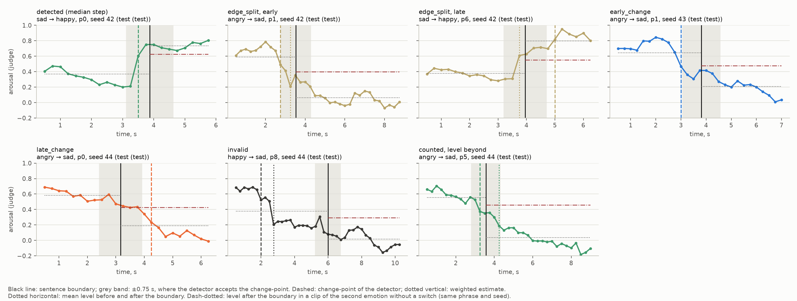
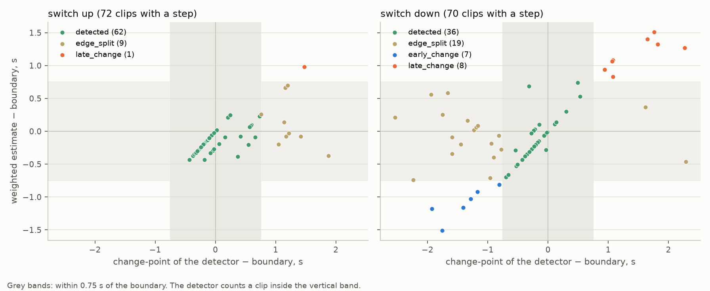
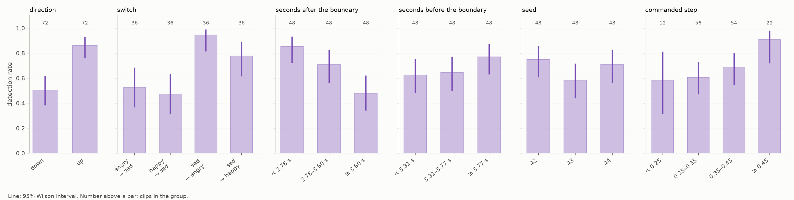
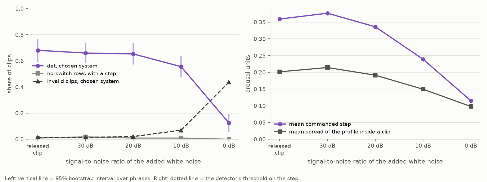
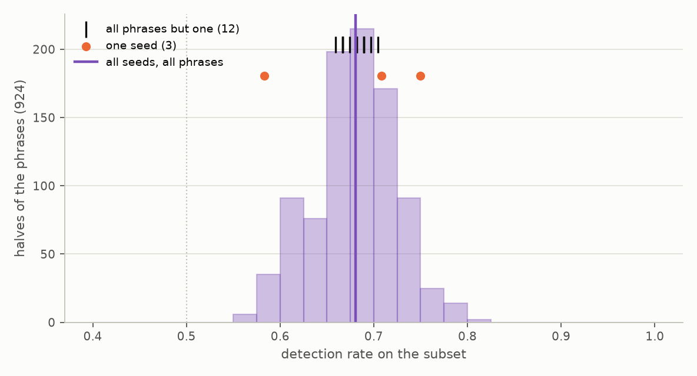
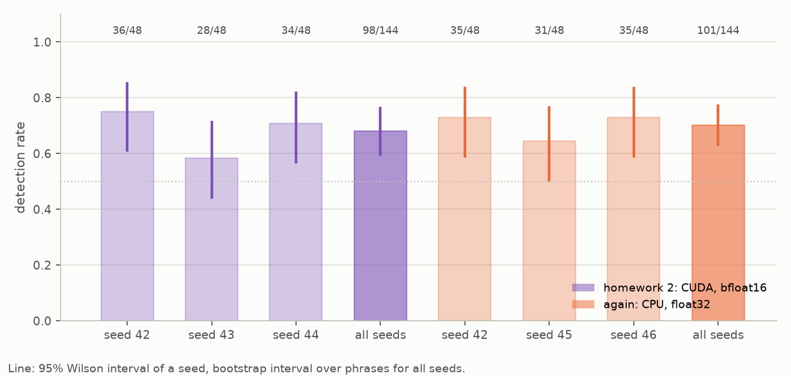

# ДЗ3. Где ошибается однопроходная смена эмоции: разбор пропусков, срезы, устойчивость, ограничения

ДЗ3 курса «Исследования и разработка в ML», тема №33. Продолжение [ДЗ2](HW2.md): та же модель R, тот
же детектор, те же фразы. Новых систем нет; ни один параметр модели или детектора не менялся.

Выбранное решение — полная однопроходная система `swap_anchor_steer` из ДЗ2. На оценочном наборе ДЗ2
(12 фраз, 4 перехода, 3 сида) детектор засчитал смену в 98 из 144 (0.681) клипов. Здесь разобраны
остальные 46 и то, чему в этих 98 можно верить.

| что проверено | что получилось |
|---|---|
| есть ли шаг уровня там, где смена не засчитана | да: шаг заказанного знака не меньше 0.15 есть во всех 144 клипах. 44 пропуска из 46 — положение точки смены, 2 — сбой речи |
| типы пропусков | 28 — точка смены у границы по другой оценке; 7 — уровень меняется раньше границы; 9 — позже; 2 — модель повторила конец первого предложения |
| что из этого ошибки системы | поздняя смена (9 клипов, у склейки 0) и сбой речи (2). Ранняя смена и 28 «краевых» пропусков от поведения детектора на склейке с известным местом смены не отличимы |
| ошибка, которую метрика не видит | в 76 из 142 годных клипов уровень после смены уходит дальше, чем у той же эмоции без смены, не меньше чем на 0.15. Так только у систем со сдвигом скрытого состояния; у склейки 7 из 144 |
| срезы | переход вверх 62 из 72 (0.861), вниз 36 из 72 (0.500). Асимметрия не специфична для выбранной системы: у склейки 62 и 24 из 72 |
| шум во входном аудио | при 30 и 20 дБ det 95 из 144 (0.660) и 94 из 144 (0.653), внутри интервала чистого условия; при 10 дБ 80 из 144 (0.556), при 0 дБ 18 из 144 (0.125). Белый стационарный шум ложных шагов в клипах без смены не добавляет (не больше 2 из 108 при 1 на чистых). Решение для отдельного клипа менее устойчиво, чем доля: при 30 дБ оно меняется у 9 клипов из 144 |
| другой состав оценочного набора | det от 0.659 до 0.705 без одной фразы и от 0.556 до 0.806 на половине фраз; полная система выше обеих неполных на всех подвыборках |
| повторная генерация: другое железо, новые сиды | на трёх новых прогонах det 101 из 144 (0.701) при 98 из 144 в ДЗ2; по прогонам 0.729, 0.646, 0.729. Сид между CUDA и CPU не переносится: прогон сида 42 совпадает с клипами ДЗ2 по решению в 33 случаях из 48, как два разных сида (30–36), поэтому вклад железа отдельно от сида не виден. Асимметрия направлений (62 и 39 из 72) и уровень дальше целевого (80 из 144) повторились; негодных клипов нет |

Планы проверок, правила разбиения пропусков на типы и ожидания закоммичены до измерений
([docs/plan_hw3.md](docs/plan_hw3.md), [docs/plan_hw3_render.md](docs/plan_hw3_render.md)). Что
добавлено после планов, перечислено в разделе 7.

Содержание: [1. Что анализируется](#1-что-анализируется) · [2. Анализ ошибок](#2-анализ-ошибок) ·
[3. Срезы](#3-срезы) · [4. Проверки устойчивости](#4-проверки-устойчивости) ·
[5. Ограничения](#5-ограничения) · [6. Выводы](#6-выводы) ·
[7. Что добавлено после планов](#7-что-добавлено-после-планов) ·
[8. Запуск и артефакты](#8-запуск-и-артефакты)

Термины ДЗ1–ДЗ2, которые используются без изменений (определения — в
[README, «Термины»](README.md#термины)):

- **Судья** — модель, которая оценивает возбуждение (arousal) речи в окне 1 с с шагом 0.25 с и даёт
  профиль по времени. **Граница** — начало первого слова второго предложения по принудительному
  выравниванию.
- **Шаг** — средний уровень судьи после границы минус средний уровень до неё. **Точка смены** — лучшее
  разбиение профиля на два уровня.
- **det** — доля клипов, где шаг имеет заказанный знак, не меньше 0.15 и точка смены лежит не дальше
  0.75 с от границы; негодный клип (WER > 0.20, произнесённая инструкция или длительность больше 15 с)
  считается как «смены нет». Основная метрика, без изменений с ДЗ1.
- **Подмена** (в таблицах `anchor`) и **сдвиг** (`steer`) — два компонента системы из ДЗ2.
- **Нулевые строки** (`swap_null`) — клипы той же двухфазной процедуры без подмены и без сдвига, в
  которых обе инструкции называют одну эмоцию: смены не заказано.
- **Склейка** (`stitch`) — референс ДЗ1: два предложения отрендерены по отдельности и соединены, так
  что место смены известно по построению.
- В таблицах наборы названы именем и ролью: `test (test)` — оценочный набор, `p2a (dev)` — dev.

## 1. Что анализируется

**Решение.** `swap_anchor_steer`: инструкция меняется на границе предложений внутри одного прохода
декодера, начало контекста подменяется кадрами рендера во второй эмоции (доля 0.6), скрытое состояние
слоя 20 сдвигается в сторону второй эмоции (α = 0.15). Конфигурация —
[configs/inpass.yaml](configs/inpass.yaml). Эксперимент ДЗ2 — строки `swap_anchor_steer` в
[results/inpass/experiments.csv](results/inpass/experiments.csv), запуск
`swap_anchor_steer/test/all seeds` в [mlflow_runs.csv](results/inpass/mlflow_runs.csv). Выбор обоснован
в ДЗ2: система выше каждой из двух систем с одним компонентом (знаковые тесты по фразам, поправка
Холма, [HW2.md, раздел 5](HW2.md#5-результаты)).

**Набор и требование «анализ на валидационных данных».** Разбирается набор, на котором в ДЗ2
получена метрика решения: 144 клипа, в репозитории он называется `test`. Других данных с метрикой
выбранной системы нет: на val (`heldout`) она не рендерилась (ДЗ2, раздел 7), а dev — это 3 фразы и
36 клипов, и на dev в исходном проекте выбирались параметры компонентов. Набор здесь только
читается: ничего на нём не подбирается, модель и детектор не меняются. Цена записана в плане заранее:
для любой системы или метрики, придуманной по итогам этого разбора, набор уже не отложенный, им нужны
новые фразы. 36 клипов dev используются как сверка: повторяется ли находка на клипах, по которым она
не искалась.

**Что не менялось.** Модель, параметры компонентов, судья, выравнивание, ASR, константы детектора.
Конфигурация ДЗ3 — [configs/diagnostics.yaml](configs/diagnostics.yaml); тест проверяет, что она
измеряет и считает так же, как конфигурация ДЗ2.

<!-- table: diagnostics.md#Chosen system -->
| set | system | detected | det | 95% Wilson interval | valid, step of the commanded sign and size | misses by type |
|---|---|---|---|---|---|---|
| test (test) | swap_anchor_steer | 98/144 | 0.681 | [0.60, 0.75] | 142/144 | edge_split 28, early_change 7, late_change 9, invalid 2 |
| p2a (dev) | swap_anchor_steer | 25/36 | 0.694 | [0.53, 0.82] | 34/36 | edge_split 6, early_change 1, late_change 2, invalid 2 |
<!-- /table -->

Интервал — Уилсона по клипам. «valid, step of the commanded sign and size» — годные клипы с шагом
заказанного знака не меньше 0.15: их детектор засчитал бы без условия на точку смены. На оценочном
наборе такой шаг есть во всех 144 клипах, 2 из них негодные.

## 2. Анализ ошибок

### 2.1. Как пропуски разбиты на типы

Детектор объясняет пропуск одним словом: `misplaced` (шаг есть, точка смены далеко от границы),
`flat` (шаг меньше 0.15), `wrong_sign` или `invalid`. Для 44 строк `misplaced` этого мало: неясно,
меняется ли уровень в другом месте или детектор неверно определил место. Поэтому каждая такая строка
разделена по правилу из плана. Кроме точки смены детектора считается взвешенная оценка по тому же
профилю (ДЗ1, `detect.best_split(..., weighted=True)`).

| тип | правило |
|---|---|
| `edge_split` | точка смены детектора дальше 0.75 с от границы, взвешенная оценка — не дальше |
| `early_change` | обе оценки раньше границы больше чем на 0.75 с |
| `late_change` | обе оценки позже границы больше чем на 0.75 с |
| `other` | оценки по разные стороны границы, обе дальше 0.75 с |
| `invalid` | клип не проходит проверку речи |

Решение детектора при этом не меняется: det остаётся 98 из 144. Число клипов каждого типа у выбранной
системы, у склейки и у остальных систем ДЗ2 по тем же правилам:

<!-- table: diagnostics.md#Misses by type -->
|  | swap_anchor_steer, test (test) | — switch up | — switch down | swap_anchor_steer, p2a (dev) | stitch, test (test) | — stitch, switch up | — stitch, switch down | swap, test (test) | swap_anchor, test (test) | swap_steer, test (test) |
|---|---|---|---|---|---|---|---|---|---|---|
| clips | 144 | 72 | 72 | 36 | 144 | 72 | 72 | 144 | 144 | 144 |
| detected | 98 | 62 | 36 | 25 | 86 | 62 | 24 | 5 | 49 | 70 |
| edge_split | 28 | 9 | 19 | 6 | 16 | — | 16 | 2 | 4 | 34 |
| early_change | 7 | — | 7 | 1 | 13 | — | 13 | — | 4 | 2 |
| late_change | 9 | 1 | 8 | 2 | — | — | — | — | 2 | 33 |
| other | — | — | — | — | — | — | — | — | — | 3 |
| flat | — | — | — | — | 29 | 10 | 19 | 137 | 83 | 2 |
| invalid | 2 | — | 2 | 2 | — | — | — | — | 2 | — |
<!-- /table -->

**Взвешенная оценка — не эталон.** Она умножает разность средних на √(n₁n₂/n) и поэтому штрафует
разбиения с короткой стороной, то есть тянет точку смены к середине клипа, где находится и граница.
Чтобы понять, чему из трёх признаков положения можно верить, они проверены там, где ответ известен
(добавлено после плана):

<!-- table: diagnostics.md#The three readings where the answer is known -->
| clips | n | change-point of the detector within 0.75 s | weighted estimate within 0.75 s | midpoint crossing within 0.75 s |
|---|---|---|---|---|
| stitch, switch up: join by construction | 63 | 62/63 | 63/63 | 63/63 |
| stitch, switch down: join by construction | 60 | 32/60 | 46/60 | 57/60 |
| swap_null: no switch, boundary by alignment | 108 | 26/108 | 34/108 | n/a |
<!-- /table -->

Третий признак, «midpoint crossing» — первое окно, начиная с которого профиль не меньше трёх окон
подряд находится по другую сторону от середины между уровнями до и после границы. Разбиения профиля
он не использует, но опирается на ту же границу и те же два уровня.

Что видно из таблицы:

- На склейке место смены — стык, известный по построению. При переходе вверх все три признака находят
  его почти всегда. При переходе вниз оценка детектора попадает в допуск в 32 клипах из 60, взвешенная
  — в 46, пересечение середины — в 57. Детектор теряет почти половину заведомо правильных переходов
  вниз.
- На клипах без смены взвешенная оценка оказывается в допуске у границы в 34 клипах из 108, оценка
  детектора — в 26. Поэтому «взвешенная оценка у границы» само по себе слабое свидетельство; тип
  `edge_split` опирается ещё и на шаг заказанного знака и размера, который есть у каждого такого клипа.

Примеры ниже выбраны правилом, а не на слух: в каждом типе взят пропуск с самым большим шагом, то
есть самый явный шаг, который всё же не засчитан (у негодных клипов — с самым большим WER). Все клипы
лежат в репозитории, ссылка ведёт на аудио. Клипы я не прослушивал: всё сказанное о них ниже —
чтение профиля судьи и расшифровки ASR.

<!-- table: diagnostics.md#Examples -->
| example of | clip | set | switch | seed | commanded step | change-point − boundary, s | the same by the weighted estimator, s | level after the boundary | the same in a clip of the second emotion without a switch | WER | duration, s |
|---|---|---|---|---|---|---|---|---|---|---|---|
| edge_split, early | [inpass_test_s42/inpass-swap_anchor_steer-angry2sad-p1](data/audio/inpass_test_s42/inpass-swap_anchor_steer-angry2sad-p1.flac) | test (test) | angry → sad | 42 | 0.529 | -0.78 | -0.28 | 0.062 | 0.395 | 0.00 | 9.4 |
| edge_split, late | [inpass_test_s42/inpass-swap_anchor_steer-sad2happy-p6](data/audio/inpass_test_s42/inpass-swap_anchor_steer-sad2happy-p6.flac) | test (test) | sad → happy | 42 | 0.417 | +1.05 | -0.20 | 0.795 | 0.550 | 0.00 | 7.0 |
| early_change | [inpass_test_s43/inpass-swap_anchor_steer-angry2sad-p1](data/audio/inpass_test_s43/inpass-swap_anchor_steer-angry2sad-p1.flac) | test (test) | angry → sad | 43 | 0.435 | -0.81 | -0.81 | 0.209 | 0.475 | 0.00 | 7.7 |
| late_change | [inpass_test_s44/inpass-swap_anchor_steer-angry2sad-p0](data/audio/inpass_test_s44/inpass-swap_anchor_steer-angry2sad-p0.flac) | test (test) | angry → sad | 44 | 0.394 | +1.08 | +1.08 | 0.189 | 0.426 | 0.00 | 6.8 |
| invalid | [inpass_test_s44/inpass-swap_anchor_steer-happy2sad-p8](data/audio/inpass_test_s44/inpass-swap_anchor_steer-happy2sad-p8.flac) | test (test) | happy → sad | 44 | 0.361 | -3.99 | -3.24 | 0.017 | 0.292 | 0.35 | 10.9 |
| counted, level beyond | [inpass_test_s44/inpass-swap_anchor_steer-angry2sad-p5](data/audio/inpass_test_s44/inpass-swap_anchor_steer-angry2sad-p5.flac) | test (test) | angry → sad | 44 | 0.521 | -0.32 | +0.68 | 0.035 | 0.457 | 0.00 | 9.5 |
<!-- /table -->



### 2.2. Тип 1, `edge_split`: шаг есть, детектор выбирает разбиение в стороне от границы (28 из 46)

**Пример.** `angry → sad`, фраза p1, сид 42: уровень падает с 0.59 до 0.06, шаг 0.529. Взвешенная оценка
ставит смену на 0.28 с раньше границы, детектор — на 0.78 с раньше, на 0.03 с за допуском. Второй
пример, `sad → happy`, p6: уровень поднимается у границы и ещё раз через секунду; детектор выбрал
второй подъём (+1.05 с), взвешенная оценка — первый (−0.20 с).

**Что подтверждено данными.**

- У всех 28 клипов есть шаг заказанного знака и размера, и пересечение середины лежит в допуске.

<!-- table: diagnostics.md#Where the level changes, three readings -->
| direction | valid clips with a step of the commanded sign and size | change-point of the detector within 0.75 s | weighted estimate within 0.75 s | midpoint crossing within 0.75 s | median crossing − boundary, s |
|---|---|---|---|---|---|
| up | 72 | 62/72 | 71/72 | 72/72 | -0.13 |
| down | 70 | 36/70 | 55/70 | 61/70 | -0.02 |
| all | 142 | 98/142 | 126/142 | 133/142 | -0.11 |
<!-- /table -->

- Тот же промах детектор делает на склейке, где смена стоит у стыка по построению: 28 клипов из 60
  при переходе вниз (таблица в 2.1) и 16 клипов типа `edge_split` по правилу (таблица типов). Значит,
  этот тип — свойство оценки точки смены, однопроходная система для него не нужна.
- Где лежит разбиение детектора:

<!-- table: diagnostics.md#Edge splits -->
| direction | edge_split clips | detector's split before the boundary | after the boundary | shorter side of the split: 3 windows (the minimum) | 4–5 windows | 6 windows or more |
|---|---|---|---|---|---|---|
| up | 9 | 0 | 9 | 4 | 3 | 2 |
| down | 19 | 17 | 2 | 5 | 6 | 8 |
| all | 28 | 17 | 11 | 9 | 9 | 10 |
<!-- /table -->

  При переходе вниз оно почти всегда раньше границы (17 из 19), при переходе вверх всегда позже (9 из
  9). Название «краевое» точно для трети клипов: у 9 из 28 короткая сторона разбиения минимальна
  (3 окна), у 10 она не короче 6 окон.

- Уровень внутри клипа не постоянен и без смены. В 108 нулевых клипах первые три окна выше середины
  клипа в 96, уровень снижается в среднем на 0.011 в секунду при любой эмоции; шаг на границе при этом
  в среднем около нуля.

<!-- table: diagnostics.md#Level inside a clip without a switch -->
| emotion (no switch) | clips | first 3 windows | middle | last 3 windows | first above middle | last below middle | slope per second | mean step at the boundary | step below zero |
|---|---|---|---|---|---|---|---|---|---|
| angry | 36 | 0.644 | 0.592 | 0.555 | 33/36 | 31/36 | -0.0112 | -0.002 | 18/36 |
| happy | 36 | 0.599 | 0.554 | 0.517 | 29/36 | 24/36 | -0.0121 | -0.006 | 19/36 |
| sad | 36 | 0.406 | 0.333 | 0.309 | 34/36 | 24/36 | -0.0108 | -0.005 | 14/36 |
<!-- /table -->

**Что остаётся предположением.** Механизм: при переходе вниз высокий старт клипа и затухающий конец
работают в ту же сторону, что и заказанная смена, и невзвешенная оценка (ДЗ1, п. 7 README) выбирает
разбиение, отделяющее эти окна. Направления промахов (вниз — раньше, вверх — позже) с этим согласуются,
но прямой проверки нет. Почему при переходе вверх уровень во втором предложении продолжает расти
(пример p6), тоже не проверялось.



### 2.3. Тип 2, `early_change`: обе оценки ставят смену раньше границы (7 из 46)

**Пример.** `angry → sad`, p1, сид 43: уровень падает между 2.8 и 3.2 с, первое слово второго
предложения начинается на 3.8 с. Обе оценки ставят смену на 0.81 с раньше границы.

**Что подтверждено данными.** Все 7 клипов — переходы вниз. У склейки по тому же правилу 13 таких
клипов, тоже все вниз, хотя смена там стоит на стыке. Поэтому приписать этот тип выбранной системе
нельзя: он не отличим от того, что детектор и взвешенная оценка дают на заведомо правильных клипах.

Насколько счёт зависит от того, где читается граница, показывает таблица: та же пауза между
предложениями (медиана 0.64–0.78 с), граница в трёх её местах, всё остальное без изменений.

<!-- table: diagnostics.md#Boundary read elsewhere in the pause -->
| system | direction | clips | boundary = start of sentence 2 | boundary = middle of the pause | boundary = end of sentence 1 | median pause, s |
|---|---|---|---|---|---|---|
| swap_anchor_steer | up | 72 | 62/72 | 55/72 | 41/72 | 0.72 |
| swap_anchor_steer | down | 72 | 36/72 | 42/72 | 47/72 | 0.64 |
| stitch | up | 72 | 62/72 | 62/72 | 58/72 | 0.78 |
| stitch | down | 72 | 24/72 | 33/72 | 46/72 | 0.72 |
<!-- /table -->

При границе по концу первого предложения переходов вниз засчитано 47 вместо 36, у склейки 46 вместо
24; переходов вверх, наоборот, меньше. Правило «граница = начало второго предложения» строже к
переходам вниз.

**Что остаётся предположением.** Что падение уровня начинается уже с концом первого предложения и
паузой. Против простого прочтения говорит третий признак: медиана пересечения середины относительно
границы −0.02 с вниз и −0.13 с вверх. На склейке сдвиг границы на конец первого предложения увеличивает
счёт вниз, хотя уводит границу от стыка, то есть компенсирует смещение оценки, а не находит место
смены. Таблица — диагностика чувствительности, заменой метрики она не является: место границы выбрано
после просмотра этих же клипов.

### 2.4. Тип 3, `late_change`: уровень доходит до нового значения с опозданием (9 из 46)

**Пример.** `angry → sad`, p0, сид 44: после границы уровень ещё около 0.75 с держится у 0.43 и только
потом падает до 0.1. Обе оценки ставят смену на 1.08 с позже границы.

**Что подтверждено данными.** Это единственный тип положения, которого нет у склейки (0 клипов). У
системы с одним сдвигом (`swap_steer`) таких клипов 33, у системы с одной подменой — 2, у полной — 9.
Поздняя смена связана со сдвигом скрытого состояния, и подмена контекста убирает большую её часть.
В ДЗ2 это было видно иначе: у `swap_steer` 60 точек смены лежали позже допуска (HW2.md, раздел 6).
8 из 9 клипов — переходы вниз; по пересечению середины 6 из 9 остаются вне допуска
([clips.csv](results/diagnostics/clips.csv)).

**Что остаётся предположением.** Почему сдвиг запаздывает и почему чаще вниз. Проверки с изменением α
или доли подмены не было.

### 2.5. Тип 4, `invalid`: модель повторяет конец первого предложения (2 из 46)

**Примеры.** Оба негодных клипа набора — `happy → sad`, сид 44:

- p4, расшифровка ASR: «She left her umbrella in the waiting room. Umbrella in the waiting room.
  Luckily, the rain stopped before the evening.» WER 0.33.
- p8: «My sister keeps old letters in a wooden box. Old letters in a wooden box. Sometimes she reads
  them aloud to her children.» WER 0.35.

На профиле p8 (рисунок выше) уровень падает за 3.2 с до начала второго предложения, то есть раньше
повтора. Произнесён ли повтор уже во второй эмоции, по профилю можно только предполагать.

**Что подтверждено данными.** Негодные клипы есть только у систем с подменой контекста, на обоих
наборах (в ДЗ2 это отмечено для оценочного набора):

<!-- table: diagnostics.md#Invalid clips and the anchor -->
| set | invalid clips, systems with the anchor | invalid clips, systems without it |
|---|---|---|
| p2a (dev) | 3/72 | 0/72 |
| test (test) | 4/288 | 0/288 |
| all sets | 7/360 | 0/360 |

Fisher's exact test over the sets, two-sided: p = 0.015.
<!-- /table -->

Семь клипов — не семь независимых случаев: это 5 сочетаний набора, фразы, перехода и сида на 3 фразах,
4 из 5 на сиде 44; p здесь ориентир, а не вывод. Сбои разные
([predictions.csv](results/inpass/predictions.csv)): на оценочном наборе повтор конца первого
предложения (4 клипа, WER 0.33–0.35); на dev два клипа зациклились до лимита длины (31.9 с, WER 0.46),
и ещё один негоден только по длительности (16.0 с при WER 0). Все 7 — переходы к `sad`.

**Что остаётся предположением.** Причина: после подмены начала контекста модель видит кадры другого
рендера и теряет позицию в тексте. Прямой проверки (например, меньшей доли подмены) не было.

### 2.6. Тип 5, не пропуск: уровень уходит дальше, чем у той же эмоции без смены

Детектор этот тип не видит и считает такие клипы успехом. В ДЗ2 (раздел 10) было отмечено, что
средний шаг у систем со сдвигом больше, чем у склейки. Здесь уровень после смены сравнён с уровнем
самой модели: для каждого клипа взят нулевой клип второй эмоции (та же фраза, тот же сид, без подмены
и сдвига) и его уровень после той же границы.

**Пример.** `angry → sad`, p5, сид 44, клип засчитан: после границы уровень 0.03, а в клипе той же
фразы и того же сида, где `sad` заказано на всё высказывание, после той же границы 0.46.

**Что подтверждено данными.**

<!-- table: diagnostics.md#Level after the switch against a clip of the second emotion -->
| system | second emotion | valid clips | level before the boundary | level after | level after the boundary in a clip of the second emotion without a switch | after − without a switch, in the commanded direction | beyond by ≥ 0.15 | short by ≥ 0.15 |
|---|---|---|---|---|---|---|---|---|
| swap_anchor_steer | sad | 70 | 0.540 | 0.168 | 0.336 | +0.168 | 41/70 | 0/70 |
| swap_anchor_steer | angry | 36 | 0.375 | 0.724 | 0.593 | +0.131 | 13/36 | 0/36 |
| swap_anchor_steer | happy | 36 | 0.370 | 0.718 | 0.552 | +0.165 | 22/36 | 0/36 |
| stitch | sad | 72 | 0.537 | 0.329 | 0.336 | +0.007 | 2/72 | 0/72 |
| stitch | angry | 36 | 0.351 | 0.615 | 0.593 | +0.022 | 2/36 | 1/36 |
| stitch | happy | 36 | 0.345 | 0.568 | 0.552 | +0.015 | 3/36 | 1/36 |
| swap | sad | 72 | 0.566 | 0.507 | 0.336 | -0.171 | 0/72 | 46/72 |
| swap | angry | 36 | 0.348 | 0.393 | 0.593 | -0.200 | 0/36 | 25/36 |
| swap | happy | 36 | 0.348 | 0.400 | 0.552 | -0.152 | 0/36 | 19/36 |
| swap_anchor | sad | 70 | 0.551 | 0.407 | 0.336 | -0.070 | 0/70 | 10/70 |
| swap_anchor | angry | 36 | 0.365 | 0.508 | 0.593 | -0.085 | 0/36 | 7/36 |
| swap_anchor | happy | 36 | 0.365 | 0.505 | 0.552 | -0.047 | 0/36 | 1/36 |
| swap_steer | sad | 72 | 0.551 | 0.235 | 0.336 | +0.101 | 18/72 | 0/72 |
| swap_steer | angry | 36 | 0.362 | 0.699 | 0.593 | +0.106 | 13/36 | 1/36 |
| swap_steer | happy | 36 | 0.361 | 0.654 | 0.552 | +0.101 | 13/36 | 0/36 |
| swap_anchor_steer, p2a (dev) | sad | 16 | 0.556 | 0.190 | 0.326 | +0.135 | 6/16 | 0/16 |
| swap_anchor_steer, p2a (dev) | angry | 9 | 0.388 | 0.723 | 0.598 | +0.125 | 3/9 | 0/9 |
| swap_anchor_steer, p2a (dev) | happy | 9 | 0.378 | 0.718 | 0.561 | +0.157 | 4/9 | 0/9 |
<!-- /table -->

«beyond by ≥ 0.15» — уровень дальше уровня нулевого клипа в заказанную сторону не меньше чем на порог
детектора; «short by ≥ 0.15» — не доходит до него на столько же.

- У выбранной системы уровень в среднем на 0.13–0.17 дальше при любой второй эмоции; в 76 из 142
  годных клипов — не меньше чем на 0.15.
- Превышение есть только у систем со сдвигом: 44 клипа из 144 у `swap_steer`, 0 у `swap` и
  `swap_anchor`. Без сдвига уровень, наоборот, не доходит до целевого. У склейки разность около нуля
  (7 клипов из 144 дальше, 2 ближе).
- На dev, по клипам которого этот тип не искался, то же самое: 13 клипов из 34.

**Что остаётся предположением.** Что превышение растёт с α и что его можно убрать, уменьшив α: α не
варьировался. Чем превышение слышно (более выраженная эмоция или искажение), без прослушивания
сказать нельзя.

**Почему это ошибка, а не запас.** Задача — сменить эмоцию на заказанную, а не на более сильную. Шаг,
который считает детектор, частично состоит из этого превышения: метрика поощряет выход за уровень
целевой эмоции.

### 2.7. Вывод по разделу

- Пропуски выбранной системы — это не «смены нет». Шаг заказанного знака и размера есть во всех 144
  клипах. По пересечению середины уровень меняется в пределах 0.75 с от границы в 133 годных клипах
  из 142.
- 28 пропусков из 46 и 7 ранних смен не отличимы от того, что детектор делает на склейке, где место
  смены известно. Ошибки системы — 9 поздних смен (у склейки их нет) и 2 сбоя речи.
- det = 0.681 занижает долю клипов, где уровень сменился у границы, и при этом ничего не говорит о
  том, что уровень после смены правильный: в половине клипов он дальше целевого. Как оценке «уровень
  сменился» det можно доверять с поправкой на строгость к переходам вниз; как оценке «получилась
  заказанная эмоция» — нельзя.

## 3. Срезы

Срезы и границы групп объявлены в плане до расчёта; знак отклонения точки смены, разбивку по фразам и
по длительности я видел при составлении плана, поэтому раздел описательный. Интервалы — Уилсона по
клипам; клипы одной фразы зависимы, так что интервалы скорее узки.

<!-- table: diagnostics.md#Slices -->
| slice | group | clips | detected | det | 95% Wilson interval | valid, step of the commanded sign and size | misses by type |
|---|---|---|---|---|---|---|---|
| direction | down | 72 | 36/72 | 0.500 | [0.39, 0.61] | 70/72 | edge_split 19, early_change 7, late_change 8, invalid 2 |
| direction | up | 72 | 62/72 | 0.861 | [0.76, 0.92] | 72/72 | edge_split 9, late_change 1 |
| switch | angry → sad | 36 | 19/36 | 0.528 | [0.37, 0.68] | 36/36 | edge_split 10, early_change 4, late_change 3 |
| switch | happy → sad | 36 | 17/36 | 0.472 | [0.32, 0.63] | 34/36 | edge_split 9, early_change 3, late_change 5, invalid 2 |
| switch | sad → angry | 36 | 34/36 | 0.944 | [0.82, 0.98] | 36/36 | edge_split 2 |
| switch | sad → happy | 36 | 28/36 | 0.778 | [0.62, 0.88] | 36/36 | edge_split 7, late_change 1 |
| seconds after the boundary | < 2.78 s | 48 | 41/48 | 0.854 | [0.73, 0.93] | 48/48 | edge_split 6, late_change 1 |
| seconds after the boundary | 2.78–3.60 s | 48 | 34/48 | 0.708 | [0.57, 0.82] | 48/48 | edge_split 9, early_change 3, late_change 2 |
| seconds after the boundary | ≥ 3.60 s | 48 | 23/48 | 0.479 | [0.34, 0.62] | 46/48 | edge_split 13, early_change 4, late_change 6, invalid 2 |
| seconds before the boundary | < 3.31 s | 48 | 30/48 | 0.625 | [0.48, 0.75] | 48/48 | edge_split 12, late_change 6 |
| seconds before the boundary | 3.31–3.77 s | 48 | 31/48 | 0.646 | [0.50, 0.77] | 48/48 | edge_split 9, early_change 5, late_change 3 |
| seconds before the boundary | ≥ 3.77 s | 48 | 37/48 | 0.771 | [0.63, 0.87] | 46/48 | edge_split 7, early_change 2, invalid 2 |
| seed | 42 | 48 | 36/48 | 0.750 | [0.61, 0.85] | 48/48 | edge_split 9, early_change 2, late_change 1 |
| seed | 43 | 48 | 28/48 | 0.583 | [0.44, 0.71] | 48/48 | edge_split 13, early_change 3, late_change 4 |
| seed | 44 | 48 | 34/48 | 0.708 | [0.57, 0.82] | 46/48 | edge_split 6, early_change 2, late_change 4, invalid 2 |
| commanded step | < 0.25 | 12 | 7/12 | 0.583 | [0.32, 0.81] | 12/12 | edge_split 3, early_change 1, late_change 1 |
| commanded step | 0.25–0.35 | 56 | 34/56 | 0.607 | [0.48, 0.72] | 55/56 | edge_split 13, early_change 4, late_change 4, invalid 1 |
| commanded step | 0.35–0.45 | 54 | 37/54 | 0.685 | [0.55, 0.79] | 53/54 | edge_split 10, early_change 2, late_change 4, invalid 1 |
| commanded step | ≥ 0.45 | 22 | 20/22 | 0.909 | [0.72, 0.97] | 22/22 | edge_split 2 |
<!-- /table -->



**Направление и переход.** Вверх 0.861, вниз 0.500; интервалы не пересекаются (асимметрия известна из
ДЗ2, раздел 8). Шаг при этом есть во всех клипах: разница целиком в положении точки смены и в двух
сбоях речи. Асимметрия не специфична для выбранной системы: у склейки 62 и 24 из 72, и на склейке с
известным стыком оценка детектора ошибается в 28 клипах из 60 вниз и в 1 из 63 вверх (раздел 2.1).
Склейку рендерит та же модель, поэтому вклад самой речи (спад уровня к концу предложения) не
исключён. Вывод «система хуже переключает вниз» из этого среза сделать нельзя. Между `sad → angry`
(0.944) и `sad → happy` (0.778) разница 6 клипов из 36, интервалы пересекаются.

**Время после границы и время до границы.** Обе длительности связаны с направлением: грустная речь
медленнее, поэтому длинная вторая часть и короткая первая — это переход вниз. Таблицы разводят
длительность и направление:

<!-- table: diagnostics.md#Direction by time after the boundary -->
| direction | < 2.78 s | 2.78–3.60 s | ≥ 3.60 s |
|---|---|---|---|
| down | 3/3 (1.00) | 13/24 (0.54) | 20/45 (0.44) |
| up | 38/45 (0.84) | 21/24 (0.88) | 3/3 (1.00) |
<!-- /table -->

<!-- table: diagnostics.md#Direction by time before the boundary -->
| direction | < 3.31 s | 3.31–3.77 s | ≥ 3.77 s |
|---|---|---|---|
| down | 23/41 (0.56) | 12/24 (0.50) | 1/7 (0.14) |
| up | 7/7 (1.00) | 19/24 (0.79) | 36/41 (0.88) |
<!-- /table -->

Без учёта направления det падает с длиной второй части (0.854, 0.708, 0.479) и растёт с длиной
первой (0.625, 0.646, 0.771). Внутри направления первого эффекта нет (вниз 0.54 и 0.44, вверх 0.84
и 0.88), а второй меняет знак: вниз 0.56, 0.50, 0.14. В крайних ячейках 3 и 7 клипов, по ним вывода
нет. Оба среза по длительности без разведения с направлением вводят в заблуждение.

**Сид.** 0.750, 0.583, 0.708 (те же числа в ДЗ2). Разброс 0.17 при 48 клипах на сид; интервалы
пересекаются. Оба негодных клипа — сид 44.

**Размер шага.** При шаге не меньше 0.45 засчитано 20 из 22, при меньшем — 0.58–0.69; интервалы
крайних групп соприкасаются. Большой шаг делает положение точки смены однозначным.

**Фраза.**

<!-- table: diagnostics.md#By phrase -->
| slice | group | clips | detected | det | 95% Wilson interval | valid, step of the commanded sign and size | misses by type |
|---|---|---|---|---|---|---|---|
| phrase | p0 | 12 | 9/12 | 0.750 | [0.47, 0.91] | 12/12 | late_change 3 |
| phrase | p1 | 12 | 8/12 | 0.667 | [0.39, 0.86] | 12/12 | edge_split 2, early_change 2 |
| phrase | p2 | 12 | 6/12 | 0.500 | [0.25, 0.75] | 12/12 | edge_split 6 |
| phrase | p3 | 12 | 10/12 | 0.833 | [0.55, 0.95] | 12/12 | edge_split 1, late_change 1 |
| phrase | p4 | 12 | 7/12 | 0.583 | [0.32, 0.81] | 11/12 | edge_split 4, invalid 1 |
| phrase | p5 | 12 | 7/12 | 0.583 | [0.32, 0.81] | 12/12 | edge_split 3, early_change 2 |
| phrase | p6 | 12 | 5/12 | 0.417 | [0.19, 0.68] | 12/12 | edge_split 3, early_change 2, late_change 2 |
| phrase | p7 | 12 | 7/12 | 0.583 | [0.32, 0.81] | 12/12 | edge_split 3, late_change 2 |
| phrase | p8 | 12 | 8/12 | 0.667 | [0.39, 0.86] | 11/12 | edge_split 2, late_change 1, invalid 1 |
| phrase | p9 | 12 | 11/12 | 0.917 | [0.65, 0.99] | 12/12 | edge_split 1 |
| phrase | p10 | 12 | 10/12 | 0.833 | [0.55, 0.95] | 12/12 | edge_split 2 |
| phrase | p11 | 12 | 10/12 | 0.833 | [0.55, 0.95] | 12/12 | edge_split 1, early_change 1 |
<!-- /table -->

От 5 до 11 клипов из 12. При 12 клипах на фразу ширина интервала около 0.4, и по одной фразе выводов
нет. Устойчивее другое наблюдение: 6 сочетаний фразы и перехода из 48 не засчитаны ни на одном сиде,
все вниз (таблица «Cells by seeds» в разделе 4.2).

**Сверка на dev.**

<!-- table: diagnostics.md#Direction and switch on the other set -->
| slice | group | clips | detected | det | 95% Wilson interval | valid, step of the commanded sign and size | misses by type |
|---|---|---|---|---|---|---|---|
| direction | down | 18 | 11/18 | 0.611 | [0.39, 0.80] | 16/18 | edge_split 3, late_change 2, invalid 2 |
| direction | up | 18 | 14/18 | 0.778 | [0.55, 0.91] | 18/18 | edge_split 3, early_change 1 |
| switch | angry → sad | 9 | 6/9 | 0.667 | [0.35, 0.88] | 9/9 | edge_split 1, late_change 2 |
| switch | happy → sad | 9 | 5/9 | 0.556 | [0.27, 0.81] | 7/9 | edge_split 2, invalid 2 |
| switch | sad → angry | 9 | 7/9 | 0.778 | [0.45, 0.94] | 9/9 | edge_split 1, early_change 1 |
| switch | sad → happy | 9 | 7/9 | 0.778 | [0.45, 0.94] | 9/9 | edge_split 2 |
<!-- /table -->

Направление то же (вверх 14 из 18, вниз 11 из 18), но на 18 клипах интервалы пересекаются.

**Вывод по разделу.** Единственное различие между группами, которое остаётся после учёта направления,
— само направление, и оно в значительной части создаётся детектором: тем же способом он теряет
переходы вниз на склейке. Сравнивать системы по det можно при одинаковом составе переходов;
сравнивать направления между собой и наборы с разной долей переходов вниз — нельзя.

## 4. Проверки устойчивости

Проверок три, и они отвечают на разные вопросы. Первые две не запускают генератор: шум проверяет
измерительную цепочку, от которой зависит каждое число этой работы, пересчёт по подвыборкам —
зависимость результата от состава набора. Третья генерирует клипы выбранной системы заново.

### 4.1. Шум во входном аудио

**Исходное условие.** Выложенные клипы: 144 клипа выбранной системы и 108 нулевых.
**Изменение.** К клипу добавлен белый гауссов шум с отношением сигнал/шум 30, 20, 10 и 0 дБ; мощность
сигнала считается по всему клипу, включая паузы; сид шума 0, свой поток у каждого клипа и уровня
([src/emoswitch/perturb.py](src/emoswitch/perturb.py)). Шум добавляется на частоте клипа 24 кГц; судья
читает 16 кГц, так что у него отношение выше номинала: по оценке, не измерению, примерно на 1.8 дБ (10·lg(12/8) при
допущении, что выше 8 кГц энергии речи нет). Больше не менялось ничего:
генератор не запускался, судья, выравнивание, ASR и детектор те же. **Что проверяется.** Зависит ли
измеренный результат от чистоты записи. Это устойчивость связки «клип → судья → детектор».
**Метрики.** det, число негодных клипов, средний шаг, доля ложных шагов в нулевых строках, число
клипов, у которых решение детектора отличается от решения на чистом клипе.

<!-- table: diagnostics.md#Noise added to the clip -->
| signal-to-noise ratio | detected | det | 95% interval over phrases | decisions lost | decisions gained | valid, step of the commanded sign and size | mean commanded step | invalid clips | mean WER | mean spread of the profile inside a clip | no-switch rows with a step | no-switch rows, decision changed | median shift of the boundary, s | misses by type |
|---|---|---|---|---|---|---|---|---|---|---|---|---|---|---|
| released clip | 98/144 | 0.681 | [0.60, 0.76] | 0 | 0 | 142/144 | 0.359 | 2 | 0.0052 | 0.202 | 1/108 | 0 | 0.000 | edge_split 28, early_change 7, late_change 9, invalid 2 |
| 30 dB | 95/144 | 0.660 | [0.59, 0.73] | 6 | 3 | 142/144 | 0.377 | 2 | 0.0062 | 0.214 | 2/108 | 1 | 0.000 | edge_split 29, early_change 11, late_change 7, invalid 2 |
| 20 dB | 94/144 | 0.653 | [0.58, 0.73] | 8 | 4 | 140/144 | 0.336 | 3 | 0.0090 | 0.191 | 1/108 | 2 | 0.000 | edge_split 27, early_change 12, late_change 5, other 2, flat 1, invalid 3 |
| 10 dB | 80/144 | 0.556 | [0.48, 0.63] | 26 | 8 | 122/144 | 0.239 | 10 | 0.0548 | 0.150 | 1/108 | 2 | 0.000 | edge_split 26, early_change 12, late_change 4, flat 12, invalid 10 |
| 0 dB | 18/144 | 0.125 | [0.06, 0.19] | 83 | 3 | 33/144 | 0.115 | 63 | 0.3046 | 0.098 | 0/108 | 1 | 0.000 | edge_split 9, early_change 3, late_change 3, flat 48, invalid 63 |
<!-- /table -->

«decisions lost / gained» — клипы, у которых решение детектора изменилось относительно чистого клипа;
«no-switch rows, decision changed» — то же для нулевых строк (решение там — есть ли шаг);
«median shift of the boundary» — насколько сдвинулась граница по выравниванию.



**Ожидания плана выполнены.** При 30 и 20 дБ det равен 95 из 144 (0.660) и 94 из 144 (0.653): оба
значения внутри интервала чистого условия [0.60, 0.76]. Ложных шагов в нулевых строках 2 и 1 из 108,
негодных клипов 2 и 3 из 144; оба ограничения плана (не больше 0.10) выполнены с запасом. По критерию,
записанному до измерения, результат ДЗ2 устойчив к белому шуму до 20 дБ.

**Доля устойчивее, чем решение для отдельного клипа.** Уже при 30 дБ решение детектора меняется у
9 клипов из 144 (6 потеряно, 3 получено), при 20 дБ — у 12 (8 и 4). Граница по выравниванию при этом
стоит на месте (медиана сдвига 0.000 с на всех уровнях), шаг заказанного знака и размера остаётся у
142 и 140 клипов. При 30 дБ все пропуски годных клипов — по положению точки смены (29, 11 и 7), то
есть шум такого уровня двигает оценку точки смены через порог 0.75 с, а не убирает шаг. Это
согласуется с разделом 2.2: оценка точки смены чувствительна к малым изменениям профиля.

**При 10 дБ и ниже результат разрушается** (между 20 и 10 дБ не измерялось). При 10 дБ det 80 из 144
(0.556), ниже интервала чистого условия: потеряно 26 решений, получено 8; средний шаг падает с 0.359
до 0.239, 12 клипов становятся `flat`, негодных клипов 10. При 0 дБ det 18 из 144 (0.125): негодных
клипов 63 (средний WER 0.30), `flat` 48, средний шаг 0.115 — ниже порога детектора. На этих двух
уровнях судья сжимает профиль: средний разброс профиля внутри клипа 0.150 и 0.098 при 0.202 на чистых
клипах. При 30 дБ он, наоборот, чуть выше (0.214), как и средний шаг (0.377).

**Ложных шагов шум не добавляет, но решения добавляет.** В нулевых строках шаг есть у 2, 1, 1 и 0
из 108 при 1 из 108 на чистых клипах; решение в них меняется у 1, 2, 2 и 1 строки. В клипах со сменой
шум не только отнимает решения: получено 3, 4, 8 и 3. Потерь заметно больше, чем приобретений, только
при 10 и 0 дБ (26 против 8 и 83 против 3); при 30 и 20 дБ это 6 против 3 и 8 против 4, и по таким
числам направление не различить. Вывод поэтому узкий: белый стационарный шум не создаёт шаг там, где
смену не заказывали, а при 10 и 0 дБ занижает det.

**Ограничения этой проверки.** Шум только белый и стационарный, одна реализация (сид 0);
реверберация, сжатие с потерями и другой микрофон не проверялись. Контрольного уровня без шума через
тот же путь нет: исходное условие — сохранённое измерение ДЗ2. Генератор не запускался: это свойство
измерения, а не системы.

### 4.2. Другой состав оценочного набора

**Исходное условие.** det по трём сидам и 12 фразам: 98 из 144. **Изменение.** Тот же расчёт на части
рендеров ДЗ2: 12 подвыборок без одной фразы; все 924 половины по 6 фраз; каждый сид отдельно. Меняется
только состав клипов. **Что проверяется.** Держится ли вывод ДЗ2 (det ≥ 0.50 и превосходство над
каждой системой с одним компонентом) на другом составе фраз.

<!-- table: diagnostics.md#Seeds and subsets of phrases -->
| subset | subsets | lowest det | 5% | median det | 95% | highest det | det ≥ 0.50 | above each single-component system |
|---|---|---|---|---|---|---|---|---|
| all seeds, all phrases | 1 | 0.681 | 0.681 | 0.681 | 0.681 | 0.681 | 1/1 | 1/1 |
| one seed | 3 | 0.583 | 0.596 | 0.708 | 0.746 | 0.750 | 3/3 | 3/3 |
| all phrases but one | 12 | 0.659 | 0.663 | 0.682 | 0.700 | 0.705 | 12/12 | 12/12 |
| half of the phrases (6) | 924 | 0.556 | 0.611 | 0.681 | 0.750 | 0.806 | 924/924 | 924/924 |
<!-- /table -->

<!-- table: diagnostics.md#Single seeds and phrases left out -->
| subset | detected | det | above each single-component system |
|---|---|---|---|
| seed 42 | 36/48 | 0.750 | yes |
| seed 43 | 28/48 | 0.583 | yes |
| seed 44 | 34/48 | 0.708 | yes |
| without p0 | 89/132 | 0.674 | yes |
| without p1 | 90/132 | 0.682 | yes |
| without p2 | 92/132 | 0.697 | yes |
| without p3 | 88/132 | 0.667 | yes |
| without p4 | 91/132 | 0.689 | yes |
| without p5 | 91/132 | 0.689 | yes |
| without p6 | 93/132 | 0.705 | yes |
| without p7 | 91/132 | 0.689 | yes |
| without p8 | 90/132 | 0.682 | yes |
| without p9 | 87/132 | 0.659 | yes |
| without p10 | 88/132 | 0.667 | yes |
| without p11 | 88/132 | 0.667 | yes |
<!-- /table -->



Что здесь нового, а что нет. Числа по сидам (0.750, 0.583, 0.708) перенесены из ДЗ2. Ожидание плана
«det ≥ 0.50 на каждой подвыборке» выполнено, но оно следовало из пофразной таблицы, которую я видел
до плана: худшая половина — это шесть худших фраз, 40 клипов из 72. Распределение по половинам
повторяет бутстреп-интервал ДЗ2: 90% половин лежат между 0.611 и 0.750. Новое одно: на каждой из 924
половин и на каждой подвыборке без одной фразы полная система выше обеих систем с одним компонентом,
то есть порядок систем из ДЗ2 не зависит от того, какие фразы попали в набор.

Согласие сидов на уровне клипа (общий итог, 25 из 48, есть в ДЗ2):

<!-- table: diagnostics.md#Cells by seeds -->
| seeds on which the cell is counted | cells (phrase × switch) |
|---|---|
| 0 of 3 | 6/48 |
| 1 of 3 | 5/48 |
| 2 of 3 | 18/48 |
| 3 of 3 | 19/48 |

Never counted: p1 angry → sad (edge_split, early_change, edge_split); p2 angry → sad (edge_split, edge_split, edge_split); p6 angry → sad (early_change, late_change, early_change); p7 angry → sad (edge_split, edge_split, late_change); p5 happy → sad (edge_split, early_change, edge_split); p6 happy → sad (late_change, edge_split, edge_split).
<!-- /table -->

**Ограничение этой проверки.** Это пересчёт по имеющимся рендерам: все 12 фраз одного типа и одной
длины (6–9 слов в предложении), генератор не запускался.

### 4.3. Повторная генерация: другое железо и новые сиды

План этой проверки закоммичен до рендера: [docs/plan_hw3_render.md](docs/plan_hw3_render.md).

**Исходное условие.** Клипы ДЗ2: рендер на CUDA в bfloat16, сиды 42, 43, 44. **Изменения по плану.**
(1) Сид 42, тот же код и чекпоинт, рендер на CPU в float32. (2) Сиды 45 и 46 на том же CPU.
Рендерятся выбранная система и нулевые строки на тех же 12 фразах, 84 клипа на прогон
([src/emoswitch/rerender.py](src/emoswitch/rerender.py)); измеритель и детектор те же.
**Что проверяется.** Воспроизводится ли результат ДЗ2, когда система генерирует клипы заново.
**Метрики.** det по прогонам и вместе, негодные клипы, ложные шаги в нулевых строках, типы пропусков,
доля клипов с уровнем дальше уровня второй эмоции, согласие решений между прогонами.

<!-- table: diagnostics.md#Rendered again -->
| render | seed | detected | det | 95% Wilson interval | 95% interval over phrases | detected, switch up | detected, switch down | same decision as the homework 2 clip | invalid clips | mean commanded step | no-switch rows with a step | level beyond the second emotion by ≥ 0.15 | misses by type |
|---|---|---|---|---|---|---|---|---|---|---|---|---|---|
| homework 2: CUDA, bfloat16 | 42 | 36/48 | 0.750 | [0.61, 0.85] | [0.60, 0.88] | 20/24 | 16/24 | — | 0 | 0.376 | 0/36 | 33/48 | edge_split 9, early_change 2, late_change 1 |
| homework 2: CUDA, bfloat16 | 43 | 28/48 | 0.583 | [0.44, 0.71] | [0.50, 0.67] | 18/24 | 10/24 | — | 0 | 0.338 | 0/36 | 22/48 | edge_split 13, early_change 3, late_change 4 |
| homework 2: CUDA, bfloat16 | 44 | 34/48 | 0.708 | [0.57, 0.82] | [0.62, 0.81] | 24/24 | 10/24 | — | 2 | 0.364 | 1/36 | 21/46 | edge_split 6, early_change 2, late_change 4, invalid 2 |
| homework 2: CUDA, bfloat16 | 42, 43, 44 | 98/144 | 0.681 | [0.60, 0.75] | [0.60, 0.76] | 62/72 | 36/72 | — | 2 | 0.359 | 1/108 | 76/142 | edge_split 28, early_change 7, late_change 9, invalid 2 |
| again: CPU, float32 | 42 | 35/48 | 0.729 | [0.59, 0.83] | [0.62, 0.83] | 21/24 | 14/24 | 33/48 | 0 | 0.394 | 0/36 | 27/48 | edge_split 8, late_change 5 |
| again: CPU, float32 | 45 | 31/48 | 0.646 | [0.50, 0.77] | [0.56, 0.73] | 18/24 | 13/24 | — | 0 | 0.378 | 0/36 | 28/48 | edge_split 12, early_change 1, late_change 4 |
| again: CPU, float32 | 46 | 35/48 | 0.729 | [0.59, 0.83] | [0.58, 0.85] | 23/24 | 12/24 | — | 0 | 0.383 | 0/36 | 25/48 | edge_split 7, early_change 2, late_change 2, other 2 |
| again: CPU, float32 | 42, 45, 46 | 101/144 | 0.701 | [0.62, 0.77] | [0.63, 0.77] | 62/72 | 39/72 | — | 0 | 0.385 | 0/108 | 80/144 | edge_split 27, early_change 3, late_change 11, other 2 |
<!-- /table -->



«same decision as the homework 2 clip» — у скольких клипов сида 42 решение детектора то же, что у клипа
ДЗ2 с тем же сидом, фразой и переходом.

**Ожидания плана выполнены все.** На трёх новых прогонах вместе det 101 из 144 (0.701), внутри
интервала [0.60, 0.76]; по прогонам 35 из 48 (0.729), 31 из 48 (0.646) и 35 из 48 (0.729), все выше
0.50. Ложных шагов в нулевых строках нет (0 из 36 на каждом прогоне), негодных клипов нет. Уровень
после смены дальше уровня второй эмоции не меньше чем на 0.15 в 27, 28 и 25 клипах из 48, то есть
больше трети на каждом прогоне; вместе 80 из 144 при 76 из 142 в ДЗ2. По критерию, записанному до
рендера, результат ДЗ2 воспроизводится при повторной генерации на другом железе и с другими сидами.

**Фактор «железо» отдельно не выделился.** План рассчитывал, что прогон сида 42 на CPU отличается
от прогона ДЗ2 только железом и точностью. Это не так: сид не переносится между CUDA и CPU. Генераторы
случайных чисел torch на этих устройствах разные, и логиты считаются с другой точностью, так что
вместе с железом меняется и сэмплирование (причина названа по устройству torch; запуском я её не
проверял и две её части не разделял). По решениям
детектора это видно прямо:

<!-- table: diagnostics.md#Decisions of two runs -->
| pair of runs | run | run | clips with the same decision |
|---|---|---|---|
| same seed, other hardware | homework 2, seed 42 | again, seed 42 | 33/48 |
| other seed, same hardware | homework 2, seed 42 | homework 2, seed 43 | 30/48 |
| other seed, same hardware | homework 2, seed 42 | homework 2, seed 44 | 34/48 |
| other seed, same hardware | homework 2, seed 43 | homework 2, seed 44 | 34/48 |
| other seed, same hardware | again, seed 42 | again, seed 45 | 34/48 |
| other seed, same hardware | again, seed 42 | again, seed 46 | 36/48 |
| other seed, same hardware | again, seed 45 | again, seed 46 | 30/48 |
| other seed, other hardware | homework 2, seed 42 | again, seed 45 | 29/48 |
| other seed, other hardware | homework 2, seed 42 | again, seed 46 | 33/48 |
| other seed, other hardware | homework 2, seed 43 | again, seed 42 | 33/48 |
| other seed, other hardware | homework 2, seed 43 | again, seed 45 | 27/48 |
| other seed, other hardware | homework 2, seed 43 | again, seed 46 | 31/48 |
| other seed, other hardware | homework 2, seed 44 | again, seed 42 | 37/48 |
| other seed, other hardware | homework 2, seed 44 | again, seed 45 | 29/48 |
| other seed, other hardware | homework 2, seed 44 | again, seed 46 | 37/48 |
<!-- /table -->

Прогон сида 42 на CPU даёт то же решение, что клип ДЗ2 с тем же сидом, у 33 клипов из 48. Два разных
сида на одном железе согласуются в 30–36 клипах из 48, разные сиды на разном железе — в 27–37. «Тот
же сид на другом железе» ведёт себя как ещё один новый сид. Поэтому требование «один фактор за раз»
для первого изменения выполнено только номинально: три прогона на CPU — это три новых случайных
прогона на другом железе и с другой точностью, и вклад железа от вклада сида в них не отделяется.

**Что остаётся от сравнения.** Три новых прогона дают 35, 31 и 35 из 48 (det от 0.646 до 0.729), три
прогона ДЗ2 — 36, 28 и 34 из 48 (от 0.583 до 0.750). Оба разброса меньше ширины интервала
Уилсона одного прогона (около 0.25, таблица выше), так что о влиянии железа это сравнение ничего не
говорит. Оно говорит, что новые случайные прогоны на другой конфигурации дают долю в том же
диапазоне.

**Что ещё повторилось.** Асимметрия направлений из раздела 3: вверх 62 из 72, вниз 39 из 72 (в ДЗ2
62 и 36). Состав пропусков близкий: `edge_split` 27 (в ДЗ2 28), поздняя смена 11 (9), ранняя 3 (7),
`other` 2 (0). **Что не повторилось.** Негодных клипов нет (в ДЗ2 2 из 144): сбой речи из раздела 2.5
на новых рендерах не наблюдался. При частоте 2 из 144 это ему не противоречит и его не подтверждает.

**Ограничения этой проверки.** Фразы те же 12, так что 101 и 98 — не независимые оценки по фразам;
проверка говорит о повторной генерации, а не о новых текстах. Железо, точность и поток случайных
чисел меняются вместе, раздельно эти факторы здесь не видны. Новые клипы не прослушаны.

## 5. Ограничения

**Границы применимости.**

- Измерено на одной модели, одном дикторе, английском языке, двух предложениях по 6–9 слов с одной
  сменой на их стыке. О смене внутри предложения, о нескольких сменах и о длинных текстах данных нет.
- Четыре перехода между `sad` и `angry`/`happy`. Эти пары различаются возбуждением. Переходы
  `angry ↔ happy` не оценивались и этим детектором не могут быть оценены: уровень возбуждения у них
  близкий (0.59 и 0.55 в нулевых клипах).
- Переходы к `sad`: все 7 негодных клипов на обоих наборах. Системой нельзя пользоваться без проверки
  расшифровки каждого клипа.
- Уровень после смены в половине клипов дальше, чем у целевой эмоции (раздел 2.6). Там, где важна
  естественность, а не контраст, система не проверена.

**Источники ошибок.**

- Измерение. Оценка точки смены теряет почти половину переходов вниз даже на склейке (28 из 60).
  Граница читается по началу второго предложения, что строже к переходам вниз. Судья обучен на
  естественной речи и применён к синтетической; его окно 1 с не различает события ближе полсекунды.
- Модель. С системами, в которых есть сдвиг, связаны поздняя смена (9 клипов) и уровень дальше
  целевого (76 клипов); с системами, в которых есть подмена, — сбои речи (2 клипа из 144, 7 из 360).
  Причины этих связей не проверялись (разделы 2.4–2.6).
- Данные. 12 фраз и 3 сида: интервал для det около ±0.08, для одной фразы его ширина около 0.4.
  Разметки людьми нет; «правильная эмоция» нигде не проверена.
- Постановка. Метрика одномерна (возбуждение) и считает шаг, а не соответствие целевому уровню.

**Риски практического применения.**

- Оптимизация по det может вести в неверную сторону: всё, что увеличивает шаг, увеличивает det, в том
  числе выход за уровень целевой эмоции. Перед любым подбором параметров в метрику нужно добавить
  сравнение с уровнем эмоции без смены.
- det нельзя сравнивать между направлениями перехода и между наборами с разной долей переходов вниз.
- Малые группы: вывод по одной фразе или одному сиду ненадёжен (раздел 3).
- 2 клипа из 144 оценочного набора содержат повтор текста; на dev 2 из 36 зациклены. Для
  использования нужна проверка WER на выходе и повторная генерация при сбое.
- det, измеренный на записи с отношением сигнал/шум ниже 20 дБ, нельзя сравнивать с числами этой
  работы: при 10 дБ он ниже на 0.125 при тех же клипах (раздел 4.1).
- Решение детектора для отдельного клипа неустойчиво: шум 30 дБ меняет его у 9 клипов из 144.
  Отбирать или отбраковывать отдельные клипы по решению детектора нельзя; опираться можно на долю по
  набору.
- Сид не переносится между CUDA и CPU: при том же сиде 42 решение детектора совпадает у 33 клипов
  из 48, как у двух разных сидов (30–36 из 48; раздел 4.3). Воспроизвести конкретный клип на другом
  железе нельзя, и сравнивать системы поклипно между машинами нельзя.

**Утечки данных и их контроль.**

- Оценочные тексты и обучение модели: проверено в ДЗ1 по обучающему манифесту (README, раздел о
  данных). Предложения, на которых оценены направления сдвига, не входят ни в один оценочный набор
  (тест в репозитории); отдельные слова общие (HW2.md, раздел 7).
- Параметры компонентов выбраны в исходном проекте на dev и val, поэтому dev не чист; выводы ДЗ2
  сделаны по набору, фразы которого написаны позже.
- Новый источник, возникший в ДЗ3: оценочный набор прочитан на уровне клипов. Взвешенная оценка,
  пересечение середины и другое место границы выбраны после просмотра этих клипов. Контроль: ни один
  из этих признаков не используется как метрика, det не пересчитан; любое изменение детектора или
  системы по итогам разбора должно проверяться на новых фразах.
- В проверках устойчивости настраивать нечего: уровни и сид шума, сиды и состав повторного рендера
  записаны в планах до измерений.

## 6. Выводы

1. **Ошибки.** Из 46 пропусков 35 (28 `edge_split` и 7 ранних) не отличимы от промахов детектора на
   склейке с известным местом смены, 9 — поздняя смена, свойственная системам со сдвигом, 2 — сбой
   речи. Самая частая ошибка системы пропуском не считается: в 76 клипах из 142 уровень уходит за
   целевой. Доверие к det как к «уровень сменился» это повышает (шаг есть во всех 144 клипах), доверие
   к нему как к «получилась заказанная эмоция» — снимает.
2. **Срезы.** det зависит от направления перехода (0.861 и 0.500), и та же зависимость есть у склейки.
   После учёта направления срезы по длительности различий не дают. Применимость: сравнивать системы
   по det можно при одинаковом составе переходов.
3. **Устойчивость.** Измерение устойчиво к белому шуму до 20 дБ (det 0.660 и 0.653 при 0.681 на
   чистых клипах) и занижает det при 10 и 0 дБ (0.556 и 0.125); ложных шагов в клипах без смены шум не
   добавляет, а решение для отдельного клипа меняется уже при 30 дБ (9 из 144). Порядок систем из ДЗ2
   не зависит от состава фраз. При повторной генерации на другом железе и с новыми сидами det 101
   из 144 (0.701) при 0.681 в ДЗ2, все ожидания плана выполнены; асимметрия направлений (62 и 39
   из 72) и уровень дальше целевого (80 из 144) повторились. Вклад железа отдельно от сида выделить
   не удалось: сид между CUDA и CPU не переносится. Всё это на тех же 12 фразах.
4. **Ограничения.** Система не проверена на естественность и на соответствие целевой эмоции, даёт
   сбой речи в переходах к `sad` и измерена на одном типе фраз. Следующий шаг — не новая система, а
   исправление измерения: оценка точки смены без потери переходов вниз, граница по паузе и сравнение
   уровня после смены с уровнем эмоции без смены, всё на новых фразах.

## 7. Что добавлено после планов

Первый план ([docs/plan_hw3.md](docs/plan_hw3.md)) закоммичен до измерения клипов с шумом и до
пересчёта по подвыборкам. После него добавлено, всё по тем же 144 клипам и без изменения метрики:

- третий признак положения смены (пересечение середины) и проверка трёх признаков на склейке и на
  нулевых клипах (раздел 2.1);
- таблица о том, где лежит разбиение детектора у клипов типа `edge_split` (раздел 2.2);
- чтение границы в другом месте паузы (раздел 2.3);
- сравнение уровня после смены с уровнем нулевого клипа второй эмоции, тип 5 (раздел 2.6);
- таблица негодных клипов по наличию подмены и точный тест Фишера (раздел 2.5);
- таблицы направление × время до границы и сверка на dev (раздел 3);
- третья проверка устойчивости, повторный рендер; у неё свой план, закоммиченный до рендера
  ([docs/plan_hw3_render.md](docs/plan_hw3_render.md)). Разбивка её результата по направлению
  перехода и попарное согласие решений между прогонами добавлены после рендера, в плане их нет;
- число нулевых строк, у которых шум изменил решение, и разброс профиля в таблице шума (раздел 4.1).

Правило типов применено как записано, с одним уточнением: на dev основное правило не учитывает
годность клипа, и два зацикленных клипа детектор называет `flat`; здесь незасчитанный негодный клип
всегда `invalid`.

Отчёт и код до сдачи прошли независимое ревью; по его замечаниям добавлены проверка признаков на
склейке, разведение длительности с направлением и повторный рендер.

## 8. Запуск и артефакты

```bash
git clone --branch hw3 https://github.com/2Bye/emotion-switch-tts.git && cd emotion-switch-tts
uv sync
```

**Быстрая проверка без моделей.** Пересчитывает типы пропусков, срезы, проверки устойчивости, таблицы
и графики из построчных измерений и проверяет, что таблицы этого отчёта им соответствуют:

```bash
scripts/run_diagnostics.sh --quick
```

**Полная проверка шумом, CPU.** Добавляет шум к выложенным клипам и измеряет их; уровни, для которых
есть файл в `results/diagnostics/noise/`, пропускаются. Чтобы измерить заново, удалите этот каталог
(1008 измерений, по 73–90 минут на уровень при двух уровнях одновременно на Apple M4):

```bash
scripts/run_diagnostics.sh
```

**Повторный рендер, CPU.** Нужен чекпоинт R; сиды, уже отрендеренные по манифесту, пропускаются
(около 2 часов на рендер 252 клипов и 42 минуты на их измерение на Apple M4):

```bash
uv run hf download byebye9/qwen3-tts-emotion-instruct --revision 47f851a9c8f32fb8a720c479e5a3509aa18cbd4b --local-dir checkpoints/R
uv run --extra gen python -m emoswitch.rerender --config configs/diagnostics.yaml --checkpoint checkpoints/R
```

**Тесты.** `uv run pytest -q`.

| что | где |
|---|---|
| конфигурация: выбранная система, срезы, уровни и сид шума, сиды повторного рендера | [configs/diagnostics.yaml](configs/diagnostics.yaml) |
| планы, закоммиченные до проверок | [docs/plan_hw3.md](docs/plan_hw3.md), [docs/plan_hw3_render.md](docs/plan_hw3_render.md) |
| строка на клип выбранной системы: тип пропуска, отклонения точки смены, уровни, длительности | [results/diagnostics/clips.csv](results/diagnostics/clips.csv), 180 строк |
| срезы | [results/diagnostics/slices.csv](results/diagnostics/slices.csv) |
| проверка шумом: сводка и построчные измерения | [results/diagnostics/noise.csv](results/diagnostics/noise.csv), [results/diagnostics/noise/](results/diagnostics/noise/) |
| состав набора: сиды и подвыборки фраз | [results/diagnostics/resample.csv](results/diagnostics/resample.csv) |
| повторный рендер: аудио, манифест, построчные измерения | `data/audio/rerender_test_s{42,45,46}/`, [data/manifest_rerender.jsonl](data/manifest_rerender.jsonl), [results/diagnostics/rerender/](results/diagnostics/rerender/) |
| всё то же машинно | [results/diagnostics/diagnostics.json](results/diagnostics/diagnostics.json) |
| таблицы этого отчёта | [results/diagnostics/diagnostics.md](results/diagnostics/diagnostics.md) |
| графики | `results/diagnostics/fig_*.png` |
| код | [src/emoswitch/diagnose.py](src/emoswitch/diagnose.py), [src/emoswitch/perturb.py](src/emoswitch/perturb.py), [src/emoswitch/rerender.py](src/emoswitch/rerender.py), тесты в [tests/test_diagnostics.py](tests/test_diagnostics.py) |

Сиды: генерация 42, 43, 44 (рендеры ДЗ2) и 42, 45, 46 (повторный рендер), шум 0, бутстреп — сид из
`stats` конфигурации.

Мета-файлы проверок шумом и повторного рендера записывают отпечаток конфигурации измерения,
устройство и платформу. Версии библиотек в них не записаны; окружение задаёт `uv.lock`.
