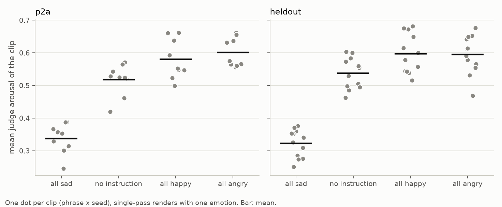
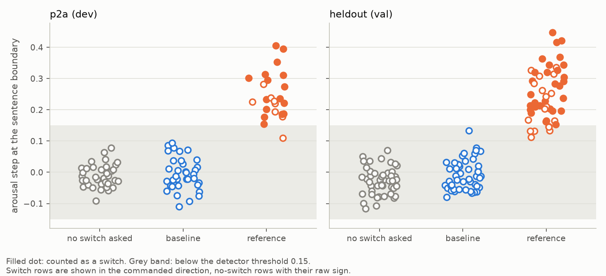
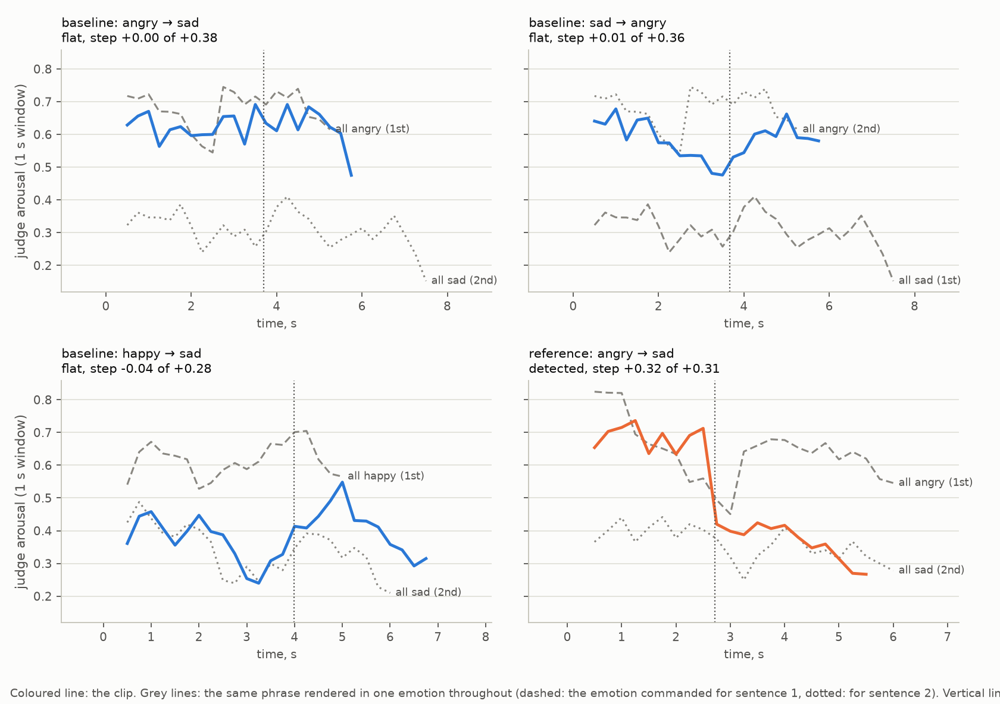

# Смена эмоции внутри высказывания в синтезе речи: постановка, baseline, протокол оценки

ДЗ1 курса «Исследования и разработка в ML», тема №33 из таблицы курса.

Вопрос работы: умеет ли дообученная авторегрессионная TTS-модель сменить эмоцию на границе
предложений внутри одного высказывания, если попросить её об этом самым простым способом, одной
инструкцией. Ответ измерен, и он отрицательный: на валидационном наборе смена детектирована
в 0 из 48 высказываний (три сида). Тот же измеритель на том же наборе засчитывает смену
в 30 из 48 высказываний, когда два предложения отрендерены по отдельности и склеены.

**Место ДЗ1 в теме №33.** Тема целиком: управление эмоцией на уровне слов по непрерывной шкале,
сравнение авторегрессионной и неавторегрессионной архитектур, слушательское исследование. ДЗ1 берёт
первый шаг: самый грубый случай управления внутри фразы (одна граница на стыке предложений, три
категории эмоций) и самую простую систему. Здесь фиксируются задача, измеритель и точка отсчёта.
Уровень слова, непрерывная шкала, вторая архитектура и слушатели отложены на следующие работы.

Содержание: [Термины](#термины) · [1. Постановка](#1-постановка-задачи) ·
[2. Формализация](#2-формализация) · [3. Данные](#3-данные-eda) · [4. Baseline](#4-baseline) ·
[5. Протокол оценки](#5-протокол-оценки) · [6. Результаты](#6-результаты-baseline) ·
[7. Выводы](#7-выводы) · [Обязательные вопросы](#ответы-на-обязательные-вопросы) ·
[Исследовательские вопросы](#собственные-исследовательские-вопросы) · [Запуск](#запуск) ·
[Структура](#структура-репозитория) · [Воспроизводимость](#воспроизводимость) ·
[Заимствования](#источники-и-заимствования) · [Лицензия](#лицензия)

## Термины

| термин | значение |
|---|---|
| модель R | авторегрессионная TTS-модель Qwen3-TTS 0.6B, дообученная так, чтобы инструкция задавала эмоцию (п. 4) |
| рендер, клип | одно синтезированное высказывание |
| сид | начальное значение генератора случайных чисел при синтезе |
| судья | публичная модель, оценивающая возбуждение (arousal) по звуку, шкала примерно от 0 до 1 |
| профиль | оценки судьи в скользящем окне вдоль клипа |
| шаг (step), Δ | средний профиль после границы минус средний профиль до неё |
| детектор, det | правило «смена засчитана» (п. 5.2) и доля высказываний, где оно выполнено |
| нулевые строки (no-switch rows) | клипы, где смены не просили: вся фраза в одной эмоции (`control`) или без инструкции (`plain`) |
| референс (reference) | склейка двух отдельно отрендеренных предложений (`stitch`) |
| гейт | условие допуска системы к сравнению: её речь должна оставаться разборчивой |
| ASR, WER | распознавание речи и доля ошибочных слов в распознанном тексте |
| LUFS | единица громкости программы |
| узел | GPU-сервер, на котором рендерилось аудио |
| dev, val | набор для настройки измерителя (`p2a`) и набор для отчёта (`heldout`) |

Заголовки автоматически собранных таблиц английские, потому что таблицы пишет код:

| столбец | значение |
|---|---|
| detected, det | число и доля высказываний со сменой |
| 95% CI (Wilson, rows) / (bootstrap over phrases) | интервал Уилсона по строкам / бутстреп с пересэмплированием фраз |
| mean abs step, max abs step, p95 abs step | средний, наибольший модуль шага и его 95-й перцентиль |
| commanded step | шаг в командном направлении: положителен, если профиль сдвинулся туда, куда велели |
| ideal step | шаг, который дали бы одноэмоциональные рендеры той же фразы (п. 5.7) |
| realised share | сумма commanded step, делённая на сумму ideal step |
| sign ok | доля высказываний, где знак шага совпал с командой |
| change-point at boundary | доля высказываний, где точка смены профиля не дальше 0.75 с от границы |
| would pass the detector (either sign) | сколько нулевых строк прошли бы детектор при любом знаке шага |
| profile SD | разброс профиля внутри клипа |
| leak rate, looped | доля клипов с произнесённой инструкцией; число клипов длиннее 15 с |
| outcome: flat / wrong_sign / misplaced / no_step | шаг меньше порога / не тот знак / точка смены далеко от границы / шаг не измерен |

## 1. Постановка задачи

**Что предсказывается.** Модель синтеза получает текст из двух предложений и команду «первое
предложение произнеси с эмоцией e1, второе с эмоцией e2» и выдаёт одну звуковую волну. Задача
решена на высказывании, если в этой волне эмоция меняется там, где велено, и в ту сторону,
в которую велено, а речь остаётся разборчивой.

**Объект предсказания.** Одно высказывание: пара предложений, пара эмоций, сид генерации.

**Что доступно на момент предсказания.** Текст, идентификатор диктора и текст инструкции.
Эталонной записи этого текста с нужной сменой эмоции нет ни при обучении, ни при оценке.

**Практический смысл.** Аудиокнига, реплика персонажа или ответ голосового ассистента редко
держат одну эмоцию от начала до конца: «Мы всё подготовили. Но заказчик отменил встречу».
Штатный канал инструкции у TTS-моделей задаёт одну эмоцию на всё высказывание. Методы смены
эмоции внутри высказывания появляются в исследованиях (например, TED-TTS), но готовой ручки
в открытых моделях этого семейства нет. Обходной путь, резать текст и склеивать волну, даёт шов
и стоит N запусков модели вместо одного.

**Ограничения постановки.**

- Один диктор (ESD 0016), английский язык.
- Три эмоции и четыре перехода: happy → sad, sad → happy, sad → angry, angry → sad. Переходы
  выбраны так, чтобы эмоции различались возбуждением: измеритель использует только его. Happy и angry
  по возбуждению почти совпадают (п. 3.4), поэтому переход между ними в задачу не входит.
- «Смена эмоции» здесь означает смену уровня возбуждения. Категорию эмоции метрика не проверяет.
- Граница одна и стоит на стыке предложений.
- Оценка автоматическая. Людей в этом ДЗ нет.
- Чекпоинт модели не распространяется (см. [Воспроизводимость](#воспроизводимость)).

**Основная гипотеза (H1).**

> Если командовать смену эмоции одной инструкцией на всё высказывание («Say the first sentence
> cheerfully and the second sentence sadly»), то доля высказываний с детектированной сменой на
> валидационном наборе превысит долю ложных срабатываний детектора на высказываниях без смены
> не более чем на 0.10. Предполагаемая причина: канал инструкции обучен на парах «одна инструкция,
> одна эмоция на весь клип» и работает как стиль всего высказывания.
>
> Контрольная часть: если те же два предложения отрендерить по отдельности, каждое со своей
> эмоцией, и склеить волну, детектор засчитает смену не менее чем в половине высказываний того
> же набора. Тогда нулевой результат baseline говорит о модели, а не о слепоте измерителя.

Гипотеза опровергается, если разность «det baseline минус доля ложных срабатываний» на val
больше 0.10, либо если склейка даёт меньше 0.50. Причину в H1 этот эксперимент не проверяет:
он проверяет только предсказание о доле.

**Что из этого было предсказанием, а что нет.** Здесь важно не приукрасить.

| когда (UTC) | что произошло | откуда известно |
|---|---|---|
| 04.09.2026, 13:28 | первый прогон baseline на dev, сид 42. По нему вручную выбраны константы детектора (п. 5.2) | выложенные dev-клипы сида 42 побайтно совпадают с клипами этого прогона: [calibration_run_sha256.tsv](data/reference/calibration_run_sha256.tsv), тест |
| 05.09.2026, 01:01 | написаны тексты val; отрендерен референс на val, сид 42 | [provenance.json](data/reference/provenance.json) |
| 05.09.2026, 07:30 | отрендерен baseline на val, сид 42 | там же |
| 10–11.11.2026 | H1 записана в этом репозитории с порогами 0.10 и 0.50 | история коммитов начинается позже, по репозиторию не проверить |
| 11.11.2026 | отрендерены baseline на сидах 43 и 44 (оба набора) и референс на val на сидах 43 и 44 | baseline: [provenance.json](data/reference/provenance.json); референс: дата записана в [generator_check.json](data/reference/generator_check.json) с моих слов |

Следствия. На dev нулевой результат baseline был наблюдением: на этих же клипах настраивался
детектор. Пороги H1 записаны, когда результаты сида 42 на val (0 из 16 у baseline, 10 из 16
у референса) уже были известны. Предсказанием H1 является только для прогонов от 11 ноября: 32 высказываний baseline
и 32 высказываний референса на val. Их результаты получены после записи порогов; порядок этих двух
событий внутри 10–11 ноября подтверждается только моим словом, по репозиторию его не проверить.

## 2. Формализация

| что | значение |
|---|---|
| **X** | `(text, speaker, e1, e2)`: текст из двух предложений `s1 s2`, диктор, эмоция первого и второго предложения |
| **Выход модели** | звуковая волна, 24 кГц, моно |
| **y** | Размеченной цели нет: это генерация. Цель задана требованием к выходу: шаг возбуждения на границе между `s1` и `s2` со знаком `sign(A(e2) − A(e1))`, где `A(e)` — номинальное возбуждение эмоции (angry 0.64, happy 0.57, sad 0.29; используется только порядок) |
| **Тип задачи** | Условная генерация (управляемый TTS). В список «binary / multiclass / regression / ranking / forecasting» не укладывается. Оценка сводится к бинарному исходу на высказывание: смена детектирована или нет |
| **Единица наблюдения** | Высказывание: фраза × переход × сид. Высказывания одной фразы зависимы: у них общий текст и общая фразовая мелодика |
| **Одно предсказание** | Одна волна на один вход, один проход модели |
| **Признаки на inference** | Текст, имя диктора, текст инструкции. Ни опорного аудио, ни разметки. Сид задаёт случайность декодирования и в X не входит |
| **Типы признаков** | Текст (строка), инструкция (строка), диктор и эмоции (категории) |

Детектор получает wav, текст и команду. Для склейки он дополнительно получает момент стыка
(п. 5.1): это единственное отличие в обращении с двумя системами.

## 3. Данные (EDA)

Данных два вида. Обучающие данные модели R в этом ДЗ не используются напрямую (чекпоинт
зафиксирован), но от них зависит, есть ли утечка. Оценочные данные лежат в репозитории целиком.

### 3.1. Оценочные тексты

Два набора двухпредложных фраз с нейтральным содержанием, написаны мной. Смена эмоции командуется
на первом слове второго предложения.

| набор | роль | фраз | файл |
|---|---|---|---|
| `p2a` | dev: на рендерах этих фраз настраивался детектор | 3 | [configs/phrases/p2a.json](configs/phrases/p2a.json) |
| `heldout` | val: число для отчёта | 4 | [configs/phrases/heldout.json](configs/phrases/heldout.json) |

<!-- table: eda.md#Texts -->
| set | phrases | words in sentence 1 (min / median / max) | words in sentence 2 | words in the phrase | first word of sentence 2 |
|---|---|---|---|---|---|
| p2a | 3 | 7 / 8 / 8 | 6 / 6 / 7 | 13 / 14 / 15 | later, tomorrow, afterwards |
| heldout | 4 | 8 / 8 / 9 | 6 / 8.5 / 9 | 15 / 16.5 / 17 | nobody, suddenly, otherwise, everyone |
<!-- /table -->

Тексты нейтральны намеренно: эмоцию должна нести подача, а не слова. Тесты проверяют, что
в текстах нет слов-эмоций из инструкции (основ из ключа `leak_stems` конфига: `sad`, `happy`,
`cheerful`, `angry` и их вариантов; на них настроен детектор утечки), нет цифр и что первое слово второго предложения встречается во фразе
один раз. Слова «first» и «second» из инструкции детектор утечки не ищет: «second» есть
в dev-фразе «…on the second shelf».

### 3.2. Выложенное аудио

Каждая строка [data/manifest.jsonl](data/manifest.jsonl) описывает один клип: прогон, набор, сид,
условие, текст, инструкцию, ожидаемый знак шага, путь к файлу. Условий четыре:

| условие | что это | роль |
|---|---|---|
| `nl_instruct` | один проход, инструкция называет обе эмоции | **baseline** |
| `stitch` | два независимых рендера (по предложению), склейка волны с кроссфейдом 20 мс | референс |
| `control` | один проход, одна эмоция на всю фразу | нулевые строки |
| `plain` | один проход, без инструкции | нулевые строки |

<!-- table: eda.md#Released clips -->
| run | set | seed | plain | control | nl_instruct | stitch | clips | audio, s |
|---|---|---|---|---|---|---|---|---|
| inline_p2a_s42 | p2a | 42 | 3 | 9 | 12 | 0 | 24 | 133.7 |
| inline_heldout_s42 | heldout | 42 | 4 | 12 | 16 | 0 | 32 | 212.1 |
| inline_p2a_s43 | p2a | 43 | 3 | 9 | 12 | 0 | 24 | 129.3 |
| inline_heldout_s43 | heldout | 43 | 4 | 12 | 16 | 0 | 32 | 206.4 |
| inline_p2a_s44 | p2a | 44 | 3 | 9 | 12 | 0 | 24 | 137.4 |
| inline_heldout_s44 | heldout | 44 | 4 | 12 | 16 | 0 | 32 | 209.2 |
| stitch_p2a_s42 | p2a | 42 | 3 | 9 | 0 | 12 | 24 | 140.9 |
| stitch_p2a_s43 | p2a | 43 | 3 | 9 | 0 | 12 | 24 | 130.5 |
| stitch_heldout_s42 | heldout | 42 | 4 | 12 | 0 | 16 | 32 | 211.5 |
| stitch_heldout_s43 | heldout | 43 | 4 | 12 | 0 | 16 | 32 | 206.7 |
| stitch_heldout_s44 | heldout | 44 | 4 | 12 | 0 | 16 | 32 | 210.6 |
| **all** |  |  | 39 | 117 | 84 | 72 | 312 | 1928.2 |

Sample rate: 24000 Hz (312 clips). 240 of the 312 clips are distinct audio. Byte-identical repeats: 12 no-switch clips of stitch_p2a_s42 repeat inline_p2a_s42; 12 no-switch clips of stitch_p2a_s43 repeat inline_p2a_s43; 16 no-switch clips of stitch_heldout_s42 repeat inline_heldout_s42; 16 no-switch clips of stitch_heldout_s43 repeat inline_heldout_s43; 16 no-switch clips of stitch_heldout_s44 repeat inline_heldout_s44.
<!-- /table -->

Нулевые строки прогонов склейки повторяют нулевые строки baseline-прогонов с тем же набором
и сидом побайтно. Они лежат в манифесте, потому что каждый прогон несёт свои контроли, но
независимыми наблюдениями не считаются: остальные таблицы EDA и график считают каждый
аудиофайл один раз.

**Что не выложено.** В исходных прогонах были ещё два условия, которые при импорте отброшены:

- `inline_tag`: эмоции заданы тегами в тексте («[happy] … [sad] …»). По отчётам узла модель
  читает теги вслух в 94–100 % клипов, то есть не проходит гейт утечки; det при этом 0.
- `cont`: второе предложение генерируется как продолжение первого под новой инструкцией. По
  отчётам узла det 0.17, 0.08 и 0.06 на трёх прогонах.

Оба в этом ДЗ не оцениваются. Они названы, чтобы было видно: baseline не выбран как лучший из
нескольких по оцениваемой метрике.

<!-- table: eda.md#Durations and boundary position -->
| condition | distinct clips | duration, s (min / median / max) | boundary position, share of the clip | judge windows per clip | clips without a located boundary |
|---|---|---|---|---|---|
| plain | 21 | 4.72 / 6.08 / 6.96 | 0.47 / 0.53 / 0.59 | 15 / 21 / 24 | 0 |
| control | 63 | 4.08 / 5.84 / 9.60 | 0.44 / 0.53 / 0.63 | 13 / 20 / 35 | 0 |
| nl_instruct | 84 | 4.16 / 6.28 / 8.88 | 0.43 / 0.53 / 0.60 | 13 / 21.5 / 32 | 0 |
| stitch | 72 | 5.02 / 6.38 / 8.54 | 0.35 / 0.48 / 0.62 | 17 / 22 / 31 | 0 |
<!-- /table -->

Пропусков нет: у каждого клипа есть текст, аудио и найденная граница; у `plain` инструкции нет
по построению. Баланс задан конструкцией: на каждую фразу и сид приходится по одному
высказыванию на каждый из четырёх переходов, два вверх по возбуждению и два вниз.

### 3.3. Обучающие данные модели R

Модель R дообучена на 18 013 клипах из трёх открытых корпусов. Числа ниже сняты с обучающего
манифеста на узле: [docs/train_manifest_stats.txt](docs/train_manifest_stats.txt). Самих корпусов
и скрипта, снимавшего статистику, в репозитории нет, так что проверить эти числа по репозиторию нельзя.

| источник | клипов | дикторов | различных строк текста | эмоции |
|---|---|---|---|---|
| ESD (английская часть) | 15 000 | 10 | 451 | neutral, happy, sad, angry, surprise: по 3 000 |
| CREMA-D | 1 869 | 87 | 12 | neutral 574, angry 390, fear 368, happy 315, sad 222 |
| RAVDESS | 1 144 | 22 | 2 | по 176 на angry, calm, fear, happy, sad, surprise; neutral 88 |

Строки текста посчитаны как есть; после приведения регистра и пунктуации по всем источникам
остаётся 441 различный текст.

- **Диктор оценки есть в обучении.** ESD 0016: 1 500 клипов, по 300 на каждую из пяти эмоций.
  Оценка идёт на виденном голосе и невиденных текстах.
- **Тексты короткие и однопредложные.** Медиана 6 слов, максимум 12; два и более предложения
  содержат 50 строк из 18 013. Оценочные фразы (13–17 слов) длиннее любого обучающего текста.
- **Каждый клип размечен одной эмоцией.** Среди 507 различных инструкций нет ни одной со словами
  «first sentence» или «second sentence». Других форм инструкции с двумя эмоциями я не искал.
- **Классы почти сбалансированы** для пяти основных эмоций (3 176–3 662 клипа); fear (544) и calm
  (176) редки. В оценке участвуют только happy, sad и angry.

### 3.4. Уровни возбуждения, между которыми нужно переключаться

<!-- table: eda.md#Arousal levels of the single-emotion renders -->
| set | rendered as | clips | mean arousal | SD across clips | SD within a clip (window noise) | loudness as rendered, LUFS |
|---|---|---|---|---|---|---|
| p2a | sad | 9 | 0.338 | 0.046 | 0.057 | -30.3 |
| p2a | plain | 9 | 0.518 | 0.048 | 0.056 | -30.1 |
| p2a | happy | 9 | 0.580 | 0.061 | 0.049 | -28.2 |
| p2a | angry | 9 | 0.601 | 0.044 | 0.061 | -26.5 |
| heldout | sad | 12 | 0.323 | 0.043 | 0.068 | -29.9 |
| heldout | plain | 12 | 0.537 | 0.048 | 0.069 | -29.0 |
| heldout | happy | 12 | 0.598 | 0.060 | 0.061 | -26.7 |
| heldout | angry | 12 | 0.595 | 0.059 | 0.071 | -25.8 |

Across the 84 single-emotion and plain renders of the inline runs, loudness as rendered spans -33.1 to -22.2 LUFS and correlates with judged arousal at r = 0.63. Both follow the rendered emotion: the model speaks an aroused emotion louder. It is not the judge reading level, because the judge rescales every window before scoring.
<!-- /table -->



Sad лежит на 0.32–0.34, happy и angry на 0.58–0.60, разброс между клипами одной эмоции 0.04–0.06.
Зазор между sad и любой из двух других эмоций равен 0.24–0.28: примерно вчетверо больше оконного
шума внутри клипа (0.05–0.07). Средние happy и angry различаются на 0.02 на dev и на 0.003 на val,
поэтому переход между ними судьёй по возбуждению не измерить. Рендер без инструкции (`plain`,
0.52–0.54) ближе к happy и angry, чем к sad: по одному уровню возбуждения angry от «никакой эмоции»
отличается слабо.

Модель произносит возбуждённую эмоцию громче: angry примерно на 4 дБ громче sad. Громкость клипа
коррелирует с оценкой возбуждения (r = 0.63), но это связь двух проявлений одной эмоции, а не
чувствительность судьи к уровню: судья сам нормирует каждое окно (п. 5.1).

### 3.5. Источники шума

Размеченной цели нет, поэтому «шум разметки» здесь означает шум измерителя.

- **Оконный шум судьи.** Внутри клипа с одной эмоцией оценка по окнам в 1 с колеблется с SD 0.05–0.07.
- **Фразовая мелодика.** Возбуждение меняется вдоль фразы и без команды. Поэтому у каждой фразы
  есть нулевые строки с тем же текстом.
- **Судья обучен на естественной речи** (MSP-Podcast), а оценивает синтез. Его согласие
  с человеком на синтетической речи в этом ДЗ не проверяется.
- **Оценка точки смены смещена к краям клипа** (п. 5.2): на бесструктурном профиле она чаще
  всего попадает на крайнее допустимое разбиение.
- **ASR пишет числительные цифрами и меняет орфографию** («nine» → «9», «neighbour» → «neighbor»):
  WER при этом ненулевой без дефекта речи (п. 6.4).

### 3.6. Потенциальные утечки

| риск | что сделано |
|---|---|
| Оценочные тексты есть в обучении модели | На узле проверены обучающий и валидационный манифесты R: ни одно из 14 оценочных предложений не встречается ни целиком, ни подстрокой ([docs/train_manifest_stats.txt](docs/train_manifest_stats.txt)) |
| Константы детектора подобраны на данных отчёта | Настройка шла на первом dev-прогоне. Число для отчёта берётся с `heldout`, тексты которого написаны позже (хронология в п. 1) |
| Чекпоинт R выбран по оцениваемой метрике | По записям исходного проекта шаг 1050 выбран по точности распознавания категории эмоции на отдельных текстах; переключение при выборе не измерялось. По репозиторию не проверить |
| Строки одной фразы попали в разные наборы | Разбиение идёт по фразе: все её переходы, контроли и сиды лежат в одном наборе |
| Модель произнесла инструкцию, и судья оценил слова | Гейт утечки по транскрипту (п. 5.4) |
| Baseline подогнан под оценочный набор | Формулировка инструкции одна; режим генерации записан в конфиге. Альтернативные условия из тех же прогонов названы в п. 3.2 |
| Val уже видел другие системы | Да. В исходном проекте на этих же двух наборах измерялись и другие системы. Для них val не является нетронутым набором; подробности в п. 7 |

## 4. Baseline

**Что выбрано.** Однопроходная инструкция: модель R получает весь текст и одну инструкцию
`Say the first sentence {e1-ly} and the second sentence {e2-ly}` и генерирует высказывание
за один проход. Это самый простой способ попросить то, что нужно: тем каналом, которым модель
и так управляется, без дообучения, без второго рендера, без вмешательства в декодирование.

**Модель R.** Qwen3-TTS-12Hz-0.6B-Base (авторегрессионная языковая модель над токенами
нейрокодека), дообученная LoRA на данных из п. 3.3 так, чтобы инструкция задавала категорию
эмоции. Рецепт и команда обучения приведены в [docs/model_R.md](docs/model_R.md); кода обучения
в этом репозитории нет. По отчётам исходного проекта на уровне высказывания канал работает
(точность категориального судьи 0.74 при шансе 0.20, инструкция не произносится); здесь эти
числа не воспроизводятся.

**Почему модель не публичная.** У открытых чекпоинтов этого семейства на 0.6B канала эмоции
через инструкцию нет: библиотека производителя отключает параметр `instruct` для 0.6B, а базовая
модель без дообучения инструкцию игнорирует или читает вслух (наблюдение исходного проекта).
Поэтому точкой отсчёта служит собственный дообученный чекпоинт.

**Почему это честный baseline, а не «почти SOTA».**

- Настраиваемых параметров у него нет, формулировка инструкции одна
  ([configs/baseline.yaml](configs/baseline.yaml)). Другие формулировки не пробовались (вопрос 7).
- В данных дообучения нет ни одного клипа, размеченного двумя эмоциями (п. 3.3). О предобучении
  базовой модели этого сказать нельзя.
- Это то, что сделает пользователь модели в первую очередь.
- Он интерпретируем: по профилю видно, что сделала модель (п. 6.5).

**Почему baseline не склейка.** Склейка проще некуда и даёт ненулевой det, но нарушает условие
задачи «одно высказывание за один проход»: это два рендера и стык в волне. Если это условие снять,
точкой отсчёта становится она. Цена стыка в этом ДЗ не измерена (п. 7), поэтому склейка служит
референсом для измерителя, а не конкурентом.

**Preprocessing.** Текст подаётся как есть. Вся обработка относится к оценке и одинакова для всех
систем (п. 5.1).

**Зафиксированные параметры генерации.** Диктор `esd0016`. Первый кодбук декодируется жадно
(`do_sample: false`, `repetition_penalty: 1.05`, `max_new_tokens: 400`). Остальные кодбуки
предсказывает подмодель, которая сэмплирует (`subtalker_dosample: true`, температура 0.9,
top-k 50): эти значения записаны в самом чекпоинте и продублированы в конфиге. Поэтому сид
меняет рендер: между тремя сидами не совпал побайтно ни один из 56 клипов прогона. При
фиксированном сиде рендер воспроизводится побайтно (п. «Воспроизводимость»).

**Обучения в этом ДЗ нет.** Скрипта `train.py` нет: модель R обучена раньше и вне этого
репозитория, а baseline — это способ её спросить. Место обучающего скрипта занимает
[src/emoswitch/generate.py](src/emoswitch/generate.py), который рендерит оба условия готовым чекпоинтом.

## 5. Протокол оценки

### 5.1. Измеритель

Каждый клип проходит один путь ([src/emoswitch/evaluate.py](src/emoswitch/evaluate.py)):

1. **Подготовка.** Моно, 16 кГц, приведение к −23 LUFS ([judge.py](src/emoswitch/judge.py)). Шаг
   унаследован от исходного измерителя и на результат не влияет: судья нормирует каждое окно
   сам. Проверено тестом: профиль клипа при −23 LUFS, без нормализации и при усилении в 0.1 раза
   расходится меньше чем на 0.005 ([tests/test_models.py](tests/test_models.py)).
2. **Профиль.** Окно 1.0 с скользит с шагом 0.25 с; в каждом окне модель
   `audeering/wav2vec2-large-robust-12-ft-emotion-msp-dim` выдаёт возбуждение. Ревизия модели
   записана в конфиге.
3. **Граница.** У однопроходного клипа известный текст выравнивается на аудио (torchaudio MMS_FA),
   граница равна началу первого слова второго предложения ([align.py](src/emoswitch/align.py)).
   У склейки граница известна по построению: конец первого сегмента. Определения разные: они расходятся на
   паузу перед вторым предложением. Величина расхождения в этом ДЗ не измерена.
4. **Шаг.** `Δ = mean(профиль в окнах с центром после границы) − mean(профиль до границы)`.
5. **Точка смены.** Независимо от команды ищется разбиение профиля, максимизирующее
   `|mean(после) − mean(до)|`, не менее трёх окон с каждой стороны ([detect.py](src/emoswitch/detect.py)).
6. **Проверка речи.** Транскрипт faster-whisper large-v3 в детерминированном режиме: WER к тексту
   и поиск произнесённой инструкции ([gates.py](src/emoswitch/gates.py)); клип длиннее 15 с
   считается зацикленным ([evaluate.py](src/emoswitch/evaluate.py)).

### 5.2. Основная метрика

**det**: доля высказываний, в которых смена детектирована. Нужны три условия сразу:

| условие | константа | что отсекает |
|---|---|---|
| модуль шага Δ не меньше 0.15 | `min_abs_delta` | шаг в пределах шума окна и фразовой мелодики |
| знак Δ совпадает с командой | нет | смена не в ту сторону |
| точка смены не дальше 0.75 с от границы | `max_changepoint_err_s` | дрейф через всю фразу, смена не на том слове |

**Почему именно она.** Требование задачи бинарное: смена либо произошла там и туда, куда велено,
либо нет. Средний шаг эту разницу скрывает.

**Откуда константы.** Они выбраны вручную по первому dev-прогону, без оптимизации (записи
исходного проекта). Оконный шум на одноэмоциональных клипах был 0.055. Ожидаемый шаг
оценивался тогда по номинальным уровням эмоций как 0.28–0.35; измеренный зазор между контролями
на том же прогоне меньше, 0.23–0.27. Порог 0.15 выше шума и составляет около 0.6 измеренного зазора. Допуск 0.75 с равен трём шагам профиля. Требование «три окна с каждой стороны» добавлено,
когда оказалось, что разбиение с одним окном на краю выигрывает на шуме.

**Слабые места детектора.** Оценка точки смены смещена к краям клипа, потому что среднее по трём
окнам шумнее среднего по десяти. Третье условие поэтому отбрасывает часть настоящих смен: это
ложноотрицательные срабатывания метрики (п. 6.3). Менять детектор после того, как val уже
измерен, значило бы подгонять его под val. Он оставлен замороженным, а зависимость результата
от его констант показана отдельной таблицей (п. 6.2). Метрика видит только возбуждение.

### 5.3. Нулевой контроль

На строках `control` и `plain` смены не просили. Доля таких строк, которые прошли бы детектор
при любом знаке шага, оценивает сверху долю ложных срабатываний. С ней сравнивается baseline в H1.
У склейки собственного нулевого контроля нет: клипов, склеенных из двух сегментов одной эмоции,
в наборе нет, и реакция детектора на сам стык не измерена.

### 5.4. Гейт

Система допускается к сравнению по det на наборе, только если её речь на этом наборе остаётся
речью: средний WER не выше 0.10, нет зацикленных клипов, нет произнесённой инструкции. Гейт
агрегатный: отдельные строки не выбрасываются. Код выводит результат гейта в отчёт; правило
«det системы, не прошедшей гейт, не сравнивается» применяет читающий отчёт.
Утечка ловится по транскрипту: основа слова-эмоции из инструкции, скобка, цифра, которой нет
в тексте словом. Проверка намеренно чувствительна в сторону ложных тревог.

### 5.5. Разбиение

| роль | что это | что на нём подбиралось |
|---|---|---|
| train | 18 013 клипов трёх корпусов (п. 3.3) | веса R |
| dev | `p2a`, 3 фразы | константы детектора |
| val | `heldout`, 4 фразы | ничего в этом ДЗ |

Разбиение по фразе (group split): высказывания одной фразы зависимы. Случайное разбиение по
строкам положило бы один текст в dev и val. Временного порядка в данных нет, стратификация не
нужна: состав переходов в каждой фразе одинаков. K-fold неприменим: обучения нет, а константы
детектора заморожены.

**Почему это корректно для baseline.** У baseline нет параметров, подбираемых на dev или val.
По оценочным данным подбирались только константы детектора, и только на dev.

**Чего не хватает.** Отдельного тестового набора нет, а val уже использовался для других систем
(п. 7). Для сравнения систем в следующих ДЗ нужны новые фразы, написанные до измерений.

### 5.6. Неопределённость

- **Интервал Уилсона** для det по строкам. Он предполагает независимость строк, которой нет.
- **Бутстреп по фразам** ([stats.py](src/emoswitch/stats.py)). При трёх-четырёх фразах он ненадёжен:
  при нуле детекций вырождается в точку и может оказаться уже интервала Уилсона. Приводится для
  полноты; опираться на него нельзя.
- **Уровень фраз.** Честная единица обобщения на новые тексты — фраза, а их на val четыре.
  Что измеренное верно и для других текстов, этот набор не доказывает (п. 7).
- **Сиды:** det на каждом сиде и SD по сидам.
- **Парное сравнение** на общих строках: точный тест Макнемара по строкам и знаковый тест по фразам.

### 5.7. Дополнительные метрики

| метрика | зачем |
|---|---|
| commanded step | величина шага в командном направлении |
| ideal step | уровень второго предложения в контроле e2 минус уровень первого предложения в контроле e1 той же фразы: шаг при идеальной смене |
| realised share | какая доля идеального шага реализована |
| outcome | причина каждого промаха. Проверки идут по порядку: строка с шагом ниже порога считается `flat` независимо от знака |
| nearest level | к какому рендеру той же фразы ближе средний уровень клипа: всё e1, всё e2 или без инструкции |

### 5.8. Как выбирается лучшая модель

В этом ДЗ выбирать не из чего. Правило на будущее: система проходит гейт на val; сравнение идёт
по det на val; разница считается эффектом, если она больше разброса между сидами и подтверждается
парным тестом. По dev модели не выбираются.

## 6. Результаты baseline

Таблицы этого раздела скопированы из [results/baseline/](results/baseline/) скриптом
[scripts/sync_readme.py](scripts/sync_readme.py); тест проверяет, что копии совпадают с источником.
Заголовки столбцов расшифрованы в разделе [Термины](#термины).

### 6.1. Основной результат

<!-- table: summary.md#Main result -->
| system | set | phrases | seeds | detected | det | 95% CI (Wilson, rows) | 95% CI (bootstrap over phrases) |
|---|---|---|---|---|---|---|---|
| baseline: one pass, instruction | p2a (dev) | 3 | 3 | 0/36 | **0.000** | [0.00, 0.10] | [0.00, 0.00] |
| baseline: one pass, instruction | heldout (val) | 4 | 3 | 0/48 | **0.000** | [0.00, 0.07] | [0.00, 0.00] |
| reference: stitched segments | p2a (dev) | 3 | 2 | 16/24 | **0.667** | [0.47, 0.82] | [0.62, 0.75] |
| reference: stitched segments | heldout (val) | 4 | 3 | 30/48 | **0.625** | [0.48, 0.75] | [0.54, 0.71] |
<!-- /table -->

<!-- table: summary.md#Seeds -->
| system | set | detected per seed | mean of seed rates | SD over seeds |
|---|---|---|---|---|
| baseline: one pass, instruction | p2a | s42: 0/12, s43: 0/12, s44: 0/12 | 0.000 | 0.000 |
| baseline: one pass, instruction | heldout | s42: 0/16, s43: 0/16, s44: 0/16 | 0.000 | 0.000 |
| reference: stitched segments | p2a | s42: 10/12, s43: 6/12 | 0.667 | 0.236 |
| reference: stitched segments | heldout | s42: 10/16, s43: 10/16, s44: 10/16 | 0.625 | 0.000 |
<!-- /table -->

<!-- table: summary.md#Step size -->
| system | set | mean abs step | max abs step | commanded step | ideal step | realised share | sign ok | change-point at boundary |
|---|---|---|---|---|---|---|---|---|
| baseline: one pass, instruction | p2a (dev) | 0.042 | 0.110 | -0.006 | 0.256 | -0.02 | 0.42 | 0.06 |
| baseline: one pass, instruction | heldout (val) | 0.040 | 0.134 | -0.007 | 0.274 | -0.03 | 0.42 | 0.02 |
| reference: stitched segments | p2a (dev) | 0.247 | 0.405 | 0.247 | 0.252 | 0.98 | 1.00 | 0.71 |
| reference: stitched segments | heldout (val) | 0.251 | 0.448 | 0.251 | 0.274 | 0.91 | 1.00 | 0.65 |
<!-- /table -->



Каждая точка соответствует одному высказыванию. Серая полоса: область ниже порога детектора.
Закрашенные точки засчитаны как смена.

Baseline не дал ни одной детекции: 0 из 36 на dev и 0 из 48 на val, на каждом из трёх сидов.
Средний шаг в командном направлении на val равен −0.007 при идеальном шаге 0.274. Наибольший
модуль шага у baseline на val равен 0.134 при пороге 0.15, знак совпадает с командой в 42 %
высказываний. Референс на val проходит детектор
в 30 из 48 высказываний (0.625, интервал Уилсона [0.48, 0.75]), по 10 из 16 на каждом из трёх
сидов, и реализует 91 % идеального шага. На dev он даёт 16 из 24: 10 из 12 на сиде 42 и 6 из 12
на сиде 43.

### 6.2. Нулевые строки, устойчивость к константам и проверка H1

<!-- table: summary.md#No-switch rows: what the detector reads when nothing was asked -->
| no-switch rows of | set | n | mean abs step | p95 abs step | max abs step | would pass the detector (either sign) | 95% CI (Wilson) | profile SD |
|---|---|---|---|---|---|---|---|---|
| inline runs | p2a (dev) | 36 | 0.030 | 0.067 | 0.091 | 0/36 = 0.000 | [0.00, 0.10] | 0.056 |
| inline runs | heldout (val) | 48 | 0.041 | 0.093 | 0.116 | 0/48 = 0.000 | [0.00, 0.07] | 0.067 |
| stitch runs | p2a (dev) | 24 | 0.027 | 0.057 | 0.078 | 0/24 = 0.000 | [0.00, 0.14] | 0.052 |
| stitch runs | heldout (val) | 48 | 0.041 | 0.093 | 0.116 | 0/48 = 0.000 | [0.00, 0.07] | 0.067 |
<!-- /table -->

Ни одна из 84 нулевых строк baseline-прогонов не прошла бы детектор; верхняя граница Уилсона
по 84 строкам 0.04, на одном val (48 строк) 0.07. Наибольший модуль шага без команды равен 0.116.
Строки прогонов склейки в этой таблице повторяют те же клипы (п. 3.2) и новых свидетельств не дают.

<!-- table: summary.md#Sensitivity to the detector constants -->
| detector variant | baseline, p2a | baseline, heldout | reference, p2a | reference, heldout | no-switch rows, p2a | no-switch rows, heldout |
|---|---|---|---|---|---|---|
| frozen detector | 0/36 | 0/48 | 16/24 | 30/48 | 0/36 | 0/48 |
| threshold 0.1 | 0/36 | 0/48 | 17/24 | 31/48 | 0/36 | 0/48 |
| threshold 0.2 | 0/36 | 0/48 | 12/24 | 24/48 | 0/36 | 0/48 |
| change-point tolerance 0.5 s | 0/36 | 0/48 | 16/24 | 29/48 | 0/36 | 0/48 |
| change-point tolerance 1.0 s | 0/36 | 0/48 | 17/24 | 35/48 | 0/36 | 0/48 |
| no change-point condition | 0/36 | 0/48 | 23/24 | 42/48 | 0/36 | 0/48 |
| weighted change-point estimator | 0/36 | 0/48 | 19/24 | 38/48 | 0/36 | 0/48 |
<!-- /table -->

Вывод о baseline не меняется при проверенных вариантах детектора: при пороге от 0.10 до 0.20, допуске от 0.5
до 1.0 с, без условия на точку смены и с взвешенной оценкой точки смены у baseline остаётся
0 из 48 на val и 0 из 36 на dev, у нулевых строк тоже ноль. У референса результат от констант
зависит: на val от 24 до 42 из 48. Без условия на точку смены он проходит в 42 из 48 (0.88),
со взвешенной оценкой точки смены в 38 из 48. Число 0.625 поэтому следует читать как нижнюю
оценку того, как часто в склейке есть шаг нужной величины и знака.

<!-- table: summary.md#Paired comparison -->
| rows of | paired rows | detected by reference only | by baseline only | McNemar p (rows) | phrases | phrases where reference is ahead | where baseline is ahead | sign test p (phrases) |
|---|---|---|---|---|---|---|---|---|
| heldout (val) | 48 | 30 | 0 | 1.9e-09 | 4 | 4 | 0 | 0.12 |
| p2a (dev) | 24 | 16 | 0 | 3.1e-05 | 3 | 3 | 0 | 0.25 |
| all sets | 72 | 46 | 0 | 2.8e-14 | 7 | 7 | 0 | 0.016 |
<!-- /table -->

**Вердикт по H1.** Разность «det baseline минус доля ложных срабатываний» на val равна
0.00 − 0.00 = 0.00 при пороге опровержения 0.10: основная часть не опровергнута, в том числе
на 32 высказываниях сидов 43 и 44, отрендеренных после записи порогов. Контрольная часть: референс
на 32 высказываниях сидов 43 и 44, отрендеренных после записи порогов, даёт 20 из 32 (0.625) при
требуемых 0.50, то есть выполнена по точечной оценке. Нижняя граница интервала Уилсона для 20 из 32
равна 0.45, для всех 48 строк val 0.48: чуть ниже порога, так что на уровне интервала
контрольная часть подтверждена слабее основной.

Парное сравнение на val: из 48 общих строк 30 засчитаны только у референса и ни одной только
у baseline (тест Макнемара по строкам p = 2·10⁻⁹). На уровне фраз референс впереди во всех четырёх
фразах val, но четырёх фраз мало: знаковый тест даёт p = 0.125. По семи фразам обоих наборов
p = 0.016. Различие систем очевидно на измеренных фразах; его перенос на другие тексты этим
набором статистически не доказан.

### 6.3. Исходы и срезы по переходам

<!-- table: summary.md#Outcome of every switch row -->
| system | set | n | detected | flat | wrong_sign | misplaced | no_step |
|---|---|---|---|---|---|---|---|
| baseline: one pass, instruction | p2a | 36 | 0 | 36 | 0 | 0 | 0 |
| baseline: one pass, instruction | heldout | 48 | 0 | 48 | 0 | 0 | 0 |
| reference: stitched segments | p2a | 24 | 16 | 1 | 0 | 7 | 0 |
| reference: stitched segments | heldout | 48 | 30 | 6 | 0 | 12 | 0 |
<!-- /table -->

<!-- table: summary.md#By commanded switch (all sets and seeds) -->
| system | commanded switch | detected | commanded step | ideal step | whole-clip arousal is nearest to the render of |
|---|---|---|---|---|---|
| baseline: one pass, instruction | angry → sad | 0/21 | 0.031 | 0.297 | angry: 15, plain: 6 |
| baseline: one pass, instruction | happy → sad | 0/21 | 0.003 | 0.287 | happy: 1, plain: 7, sad: 13 |
| baseline: one pass, instruction | sad → angry | 0/21 | -0.037 | 0.243 | angry: 16, plain: 5 |
| baseline: one pass, instruction | sad → happy | 0/21 | -0.022 | 0.239 | happy: 1, plain: 4, sad: 16 |
| reference: stitched segments | angry → sad | 8/18 | 0.259 | 0.299 | angry: 2, plain: 9, sad: 7 |
| reference: stitched segments | happy → sad | 5/18 | 0.236 | 0.290 | happy: 1, plain: 8, sad: 9 |
| reference: stitched segments | sad → angry | 17/18 | 0.251 | 0.241 | angry: 1, plain: 10, sad: 7 |
| reference: stitched segments | sad → happy | 16/18 | 0.251 | 0.237 | happy: 1, plain: 12, sad: 5 |
<!-- /table -->

Все 84 высказывания baseline имеют исход `flat`: ни одно не дошло до порога по величине шага,
поэтому вопрос о знаке и положении для них не возникает. Уровень возбуждения на границе не
меняется. В парах sad ↔ angry высказывание целиком ближе всего к рендеру «всё angry» в 15 и
в 16 случаях из 21, в остальных к рендеру без инструкции; при этом angry и рендер без инструкции
по возбуждению близки (п. 3.4). В парах happy ↔ sad оно ближе к «всё sad» в 13 и в 16 из 21.
Зеркальные пары дают похожую картину при обоих порядках эмоций в инструкции, но она зависит от
фразы, и по одному возбуждению нельзя сказать, какую именно эмоцию модель произнесла.

У референса из 26 промахов 19 имеют исход `misplaced` и 7 `flat`. `misplaced` означает, что шаг
нужной величины и знака есть, а оценка точки смены ушла дальше 0.75 с от стыка. В склейке момент
смены известен точно, поэтому я считаю эти промахи скорее ложноотрицательными срабатываниями
детектора, чем ошибками склейки (п. 5.2). Это предположение: взвешенная оценка точки смены
возвращает 11 из 19, а прослушиванием оно не проверено. Промахи сосредоточены в переходах вниз
по возбуждению:
вверх (sad → angry, sad → happy) засчитано 33 из 36, вниз (angry → sad, happy → sad) 13 из 36.

### 6.4. Гейт речи

<!-- table: summary.md#Speech gates -->
| system | set | n | WER mean | WER median | leak rate | looped | gate |
|---|---|---|---|---|---|---|---|
| baseline: one pass, instruction | p2a (dev) | 36 | 0.021 | 0.000 | 0.00 | 0 | pass |
| baseline: one pass, instruction | heldout (val) | 48 | 0.025 | 0.000 | 0.00 | 0 | pass |
| reference: stitched segments | p2a (dev) | 24 | 0.018 | 0.000 | 0.00 | 0 | pass |
| reference: stitched segments | heldout (val) | 48 | 0.026 | 0.000 | 0.00 | 0 | pass |
<!-- /table -->

<!-- table: eda.md#Clips with a non-zero WER -->
| target words | ASR wrote | set | distinct clips |
|---|---|---|---|
| `neighbour` | `neighbor` | heldout | 35 |
| `eight` | `8` | heldout | 24 |
| `nine` | `9` | p2a | 21 |
| `afterwards` | `after words` | p2a | 2 |
| `ripen` | `repen` | heldout | 2 |
| `neighbour repaired the fence before the storm everyone in the street thanked him the next morning` | `neighbor repaired the fence before the storm everyone in the street thanked him the next morning you` | heldout | 1 |

85 of the 240 distinct clips have a non-zero WER; the table lists all of them.
<!-- /table -->

Гейт пройден обеими системами на обоих наборах. Ненулевой WER почти целиком происходит от
орфографии ASR: «neighbour» записано как «neighbor», числительные записаны цифрами. Дефектами
речи можно считать только клипы склейки: «afterwards» распалось на «after words», «ripen»
записано как «repen», в одном клипе в конце добавилось лишнее «you». У фраз с числительным или британским написанием есть ненулевой пол WER
(одно слово из 13–17), и гейт на среднем имеет к нему запас. Нормализовать числительные
и орфографию перед подсчётом WER было бы правильнее; здесь измеритель оставлен как есть.

### 6.5. Типичные ошибки

<!-- table: summary.md#Examples -->
| clip | system | commanded | outcome | commanded step | ideal step | change-point error, s | whole-clip arousal nearest to | WER |
|---|---|---|---|---|---|---|---|---|
| [inline_heldout_s42/inline-nl-angry2sad-p1](data/audio/inline_heldout_s42/inline-nl-angry2sad-p1.flac) | baseline | angry → sad | flat | 0.003 | 0.377 | 1.56 | angry | 0.00 |
| [inline_heldout_s42/inline-nl-sad2angry-p1](data/audio/inline_heldout_s42/inline-nl-sad2angry-p1.flac) | baseline | sad → angry | flat | 0.009 | 0.363 | 2.42 | plain | 0.00 |
| [inline_heldout_s42/inline-nl-happy2sad-p2](data/audio/inline_heldout_s42/inline-nl-happy2sad-p2.flac) | baseline | happy → sad | flat | -0.042 | 0.282 | 2.26 | sad | 0.00 |
| [stitch_heldout_s42/segcont-naive-angry2sad-p0](data/audio/stitch_heldout_s42/segcont-naive-angry2sad-p0.flac) | reference | angry → sad | detected | 0.321 | 0.313 | 0.03 | plain | 0.00 |
<!-- /table -->



Три примера baseline показывают одну ошибку: профиль идёт на одном уровне через всю фразу,
ступеньки у границы нет. При команде angry → sad и при зеркальной sad → angry (одна фраза,
один сид) средние уровни близки, 0.62 и 0.58: первое ближе к рендеру «всё angry» (0.68), второе
к рендеру без инструкции (0.56). Четвёртая панель показывает
смену, когда она есть: у референса профиль за одно-два окна переходит с одного уровня на другой
у границы. Клипы можно послушать по ссылкам в таблице.

### 6.6. Воспроизводимость измерений на другой машине

Клипы, отрендеренные скриптами исходного проекта, были измерены на узле (Linux, CUDA) кодом
исходного проекта. Здесь они измерены заново на CPU (macOS, arm64) кодом этого репозитория.
Измерения узла лежат в [data/reference/](data/reference/) и в оценке не участвуют.

<!-- table: agreement.md#Per run -->
| run | clips | same window grid | max abs arousal diff | mean abs arousal diff | max boundary time diff, s | max abs step diff | same detector decision | same WER | max abs WER diff | same leak flag |
|---|---|---|---|---|---|---|---|---|---|---|
| inline_p2a_s42 | 24 | 24/24 | 0.0001 | 0.00001 | 0.000 | 0.0001 | 24/24 | 24/24 | 0.000 | 24/24 |
| stitch_p2a_s42 | 24 | 24/24 | 0.0001 | 0.00001 | 0.000 | 0.0001 | 24/24 | 24/24 | 0.000 | 24/24 |
| inline_p2a_s43 | 24 | 24/24 | 0.0001 | 0.00001 | 0.000 | 0.0001 | 24/24 | 24/24 | 0.000 | 24/24 |
| stitch_p2a_s43 | 24 | 24/24 | 0.0001 | 0.00002 | 0.000 | 0.0001 | 24/24 | 24/24 | 0.000 | 24/24 |
| inline_p2a_s44 | 24 | 24/24 | 0.0002 | 0.00001 | 0.000 | 0.0001 | 24/24 | 24/24 | 0.000 | 24/24 |
| inline_heldout_s42 | 32 | 32/32 | 0.0002 | 0.00001 | 0.000 | 0.0001 | 32/32 | 31/32 | 0.062 | 32/32 |
| stitch_heldout_s42 | 32 | 32/32 | 0.0001 | 0.00001 | 0.000 | 0.0001 | 32/32 | 31/32 | 0.062 | 32/32 |
| inline_heldout_s43 | 32 | 32/32 | 0.0001 | 0.00001 | 0.000 | 0.0000 | 32/32 | 31/32 | 0.062 | 32/32 |
| inline_heldout_s44 | 32 | 32/32 | 0.0001 | 0.00001 | 0.000 | 0.0001 | 32/32 | 32/32 | 0.000 | 32/32 |

All detector decisions agree.

Not measured on the node (rendered by this repository's generator): stitch_heldout_s43 (32 clips), stitch_heldout_s44 (32 clips).
<!-- /table -->

Сравниваются измеренные величины и решение, которое правило этого репозитория даёт на шаге
каждой стороны. Это проверка переноса кода и независимости от железа, а не проверка самого
измерителя: модели и метод одни и те же. Расхождения WER касаются записи числительного
(«eight» или «8»): транскрипт между машинами может отличаться.

## 7. Выводы

**Что получилось.**

- Задача поставлена так, что успех на одном высказывании проверяется автоматически и одним
  правилом для любой системы; у склейки граница берётся по построению. У измерителя есть нулевой контроль (0 из 84) и референс со сменой по построению.
- Baseline измерен на трёх сидах: 0 из 48 на val, 0 из 36 на dev, при любых проверенных константах
  детектора. Основная часть H1 не опровергнута.
- Референс показывает, что измеритель видит смену: 0.625 на val на каждом из трёх сидов, 0.88
без условия на точку смены. Контрольная часть H1 выполнена по точечной оценке.

**Где baseline слаб.** Он не решает задачу вовсе: уровень возбуждения на границе не меняется.
Объяснение «канал инструкции задаёт один стиль на высказывание» согласуется с данными, но этим
экспериментом не проверено: оценочные фразы ещё и длиннее обучающих, и формулировка инструкции одна.

**Что уже известно из исходного проекта.** На этих же двух наборах в исходном проекте измерялись
и другие системы: условия `inline_tag` и `cont` (п. 3.2), подмена контекста при декодировании,
несколько вариантов дообучения, неавторегрессионная модель. Для них val не является нетронутым.

**Следующая гипотеза (H2).** Baseline показывает, что уровень не меняется, когда второе
предложение продолжает первое. Референс показывает, что та же модель меняет уровень, когда второе
предложение рендерится с чистого листа. Предположение: стиль второго предложения держит уже
сгенерированное аудио первого, которое авторегрессионная модель продолжает.

> Если генерировать второе предложение как продолжение первого в одном проходе декодера, но
> заменить часть контекста первого предложения кодами того же текста, отрендеренного во второй
> эмоции, то det на val вырастет с 0 до не менее чем 0.50 без склейки волны. Если сменить на
> границе только инструкцию и оставить контекст как есть, det останется ниже 0.20.

Эта гипотеза не новая: в исходном проекте она уже проверялась, и её исход мне известен (подмена
контекста дала 43 из 56 на объединённом наборе, продолжение без подмены 0.06–0.17). В следующем
ДЗ она будет воспроизведена в этом репозитории с абляциями на новых фразах, а не предсказана заново.

**Ограничения.**

- **Мало текстов.** На val четыре фразы одного автора и одного шаблона. Интервал по строкам
  предполагает независимость, которой нет; на уровне фраз знаковый тест на val не достигает
  значимости (п. 6.2). Обобщение на другие тексты не доказано.
- **Узкая постановка.** Один диктор, один язык, три эмоции, одна граница.
- **Метрика видит только возбуждение** и пропускает часть настоящих смен из-за условия на точку
  смены (п. 6.3). Категориального судьи нет.
- **Судья не сверен с людьми** на синтетической речи.
- **У референса нет своего нулевого контроля,** а цена стыка не измерена.
- **Формулировка инструкции одна;** длина оценочных фраз больше обучающих.
- **Чекпоинт не опубликован:** рендер проверяющий повторить не может.
- **Val не нетронут** (см. выше); тестового набора нет.

## Ответы на обязательные вопросы

**1. Что именно нужно предсказывать и почему это такая постановка задачи?**
Одну звуковую волну для текста из двух предложений, в которой уровень возбуждения меняется на
границе предложений в командную сторону. Смена эмоции внутри высказывания нужна на практике,
а штатный канал управления задаёт одну эмоцию на высказывание. Граница на стыке предложений
взята как самый грубый случай управления внутри фразы. Подробно: [п. 1](#1-постановка-задачи).

**2. Что является объектом наблюдения, что входит в `X`, что является `y`, и какие данные доступны на inference?**
Объект: высказывание (фраза × переход × сид). `X`: текст, диктор, пара эмоций. Размеченного `y` нет,
цель задана требованием к выходу: шаг возбуждения нужного знака на границе. На inference доступны
текст, имя диктора и текст инструкции. Подробно: [п. 2](#2-формализация).

**3. Какая метрика и какой validation protocol выбраны, и почему они корректны для этой задачи?**
Метрика: det, доля высказываний, где шаг на границе не меньше 0.15, имеет командный знак и точка
смены профиля лежит не дальше 0.75 с от границы. Нулевой контроль показывает, что без команды
детектор молчит (0 из 84), а таблица чувствительности показывает, что вывод о baseline не меняется
при проверенных вариантах констант. Разбиение по фразам: dev для настройки детектора, val для отчёта; у baseline нет
параметров, подбираемых на любом из них. Неопределённость: интервал Уилсона, сиды, парные тесты
по строкам и по фразам. Слабые места названы в [п. 5.2](#52-основная-метрика) и [п. 7](#7-выводы).

**4. Какой baseline выбран, какие preprocessing steps и признаки он использует, и почему это разумная точка отсчёта?**
Однопроходная инструкция с двумя эмоциями на дообученной модели R. Признаки: текст и инструкция.
У генерации preprocessing нет. Это первое, что сделает пользователь модели; настраиваемых
параметров нет; один проход. Почему не склейка и почему не публичная модель, объяснено
в [п. 4](#4-baseline).

**5. Какие основные ошибки делает baseline, есть ли риск лика, и какая следующая гипотеза выглядит наиболее разумной?**
Ошибка одна во всех 84 высказываниях: шага на границе нет ([п. 6.3](#63-исходы-и-срезы-по-переходам),
[п. 6.5](#65-типичные-ошибки)). Риски лика разобраны в [п. 3.6](#36-потенциальные-утечки):
оценочных текстов в обучении нет, константы настраивались только на dev; остаточные риски — val
уже видел другие системы, а пороги H1 записаны после сида 42. Следующая гипотеза H2: стиль держит
уже сгенерированный контекст ([п. 7](#7-выводы)).

## Собственные исследовательские вопросы

**1. Переносится ли настройка детектора с трёх dev-фраз на новые тексты и сиды?**
Критерий: доля нулевых строк val, которые прошли бы детектор, не выше 0.05.
Ответ: 0 из 48, верхняя граница Уилсона 0.07; по всем 84 нулевым строкам 0.04. Точечно да. Граница
интервала на одном val выше 0.05, и фраз на val всего четыре.

**2. Больше ли разброс det между сидами, чем ошибка выборки строк?**
Критерий: SD det по сидам против биномиальной ошибки `sqrt(p(1−p)/n)`.
Ответ: у baseline разброса нет. У референса на val разброса тоже нет:
10 из 16 на каждом из трёх сидов. На dev два сида дали 10/12 и 6/12 (SD 0.24 при биномиальной
ошибке 0.14), но точный тест Фишера для этой пары даёт p = 0.19, а все шесть промахов сида 43
имеют исход `misplaced`. На этих данных влияние сида от шума выборки и от смещения
оценки точки смены не отличить.

**3. Зависит ли уровень высказывания от порядка эмоций в инструкции?**
Критерий: зеркальные пары (e1 → e2 и e2 → e1).
Ответ: в целом нет: зеркальные пары дают близкие распределения ближайшего уровня (п. 6.3). Но
выбор «ближайшего из трёх рендеров» грубый, и на отдельных фразах уровень следует за эмоцией,
названной первой. Для уверенного ответа нужен категориальный судья.

**4. Какое наименьшее улучшение над baseline различимо на val?**
Критерий: точный тест Макнемара против baseline с нулём детекций.
Ответ: на одном сиде (16 строк) p < 0.05 достигается начиная с 6 детекций (2·0.5⁶ = 0.031;
при пяти 0.0625), то есть с det 0.375. На уровне фраз четырёх фраз недостаточно ни для какого
эффекта: даже 4 из 4 дают p = 0.125. Для сравнения систем нужно не меньше шести фраз.

**5. Что стоит за промахами референса: величина шага или условие на точку смены?**
Критерий: исходы и таблица чувствительности.
Ответ: условие на точку смены. Из 26 промахов 19 `misplaced`; без этого условия референс
проходит в 42 из 48 на val и в 23 из 24 на dev. Величины шага у этих 19 строк хватает: в среднем 0.24 при пороге 0.15.
Следствие для протокола: условие на точку смены в нынешнем виде, вероятно, занижает det систем,
которые меняют уровень, особенно при переходе вниз. До сравнения систем его нужно заменить
оценкой без смещения к краям и заново настроить допуск на dev.

**6. Устойчив ли вывод к длине окна судьи?** Не измерено.
План: повторить оценку с окном 0.5 с и шагом 0.125 с, заново настроив порог на нулевых строках dev.
Критерий: det baseline на val остаётся не выше 0.10. Если он вырастет, часть нулевого результата
объясняется сглаживанием секундным окном.

**7. Чувствителен ли baseline к формулировке инструкции?** Не измерено.
План: три перефразировки на dev, три сида. Критерий: если хотя бы одна даёт det на dev выше 0.10,
вывод относится к формулировке, а не к каналу, и baseline нужно брать лучший по dev.

## Запуск

Нужны [uv](https://docs.astral.sh/uv/) и Python 3.11 (uv поставит его сам).

```bash
git clone https://github.com/2Bye/emotion-switch-tts.git && cd emotion-switch-tts
uv sync
```

**Быстрая проверка без моделей, несколько секунд.** Пересчитывает метрики, все таблицы и графики
из построчных измерений [results/baseline/rows.jsonl](results/baseline/rows.jsonl) и выложенного
аудио (громкость для EDA) и проверяет,
что таблицы README им соответствуют:

```bash
scripts/run_baseline.sh --quick
```

**Полная оценка из аудио, CPU.** Заново измеряет каждый клип. При первом запуске скачивает веса
судьи (0.7 ГБ), выравнивателя (1.3 ГБ) и ASR (3.1 ГБ):

```bash
scripts/run_baseline.sh
```

Полная оценка 312 клипов заняла 49 минут на ноутбуке с Apple M4 (время записано
в [measure_meta.json](results/baseline/measure_meta.json), модель процессора там не указана), быстрая проверка занимает несколько
секунд. Обе команды перезаписывают файлы в `results/baseline/`.

**Тесты.**

```bash
uv run pytest -q             # без моделей
uv run pytest -q -m models   # с моделями: повторное измерение двух клипов, независимость судьи от громкости
```

**Рендер, GPU и чекпоинт R** (чекпоинт в репозиторий не входит):

```bash
scripts/render_baseline.sh <каталог чекпоинта R>
```

Отдельные шаги. Относительные пути считаются от корня репозитория.

```bash
uv run python -m emoswitch.evaluate --config configs/baseline.yaml              # аудио -> строки -> метрики
uv run python -m emoswitch.evaluate --config configs/baseline.yaml --from-rows  # строки -> метрики
uv run python -m emoswitch.report   --config configs/baseline.yaml              # таблицы и графики
uv run python -m emoswitch.eda      --config configs/baseline.yaml              # таблицы раздела 3
uv run python scripts/compare_with_reference.py                                # сверка с узлом
uv run python scripts/sync_readme.py                                           # таблицы -> README
uv run python -m emoswitch.generate --set heldout --kind inline --seed 42 --dry-run   # строки рендера, без модели
```

## Структура репозитория

```text
├── README.md, LICENSE
├── pyproject.toml, uv.lock, .python-version   зависимости; точные версии в uv.lock
├── configs/
│   ├── baseline.yaml                константы эксперимента и список прогонов
│   └── phrases/{p2a,heldout}.json   оценочные фразы с ролью набора
├── src/emoswitch/
│   ├── config.py                    чтение конфига
│   ├── stimuli.py                   какие высказывания просить: строки прогона из конфига
│   ├── generate.py                  рендер baseline и референса (GPU, чекпоинт R)
│   ├── judge.py                     подготовка аудио, судья, оконный профиль
│   ├── align.py                     выравнивание известного текста на аудио
│   ├── asr.py                       детерминированный ASR
│   ├── detect.py                    шаг, точка смены, решение детектора
│   ├── gates.py                     WER и утечка инструкции
│   ├── stats.py                     интервал Уилсона, бутстреп по фразам, парные тесты
│   ├── evaluate.py                  измерение клипов и подсчёт метрик
│   ├── report.py                    таблицы, графики, примеры ошибок
│   └── eda.py                       таблицы по данным
├── scripts/
│   ├── run_baseline.sh              оценка, отчёт и проверки одной командой
│   ├── render_baseline.sh           рендер всех прогонов из конфига
│   ├── import_node_export.py        как выложенные данные получены из прогонов узла
│   ├── compare_with_reference.py    сверка с измерениями узла
│   └── sync_readme.py               копирование таблиц в README
├── data/
│   ├── manifest.jsonl               что оценивать
│   ├── audio/<run>/*.flac           выложенное аудио
│   └── reference/                   измерения узла, происхождение прогонов, проверка генератора
├── results/baseline/                rows.jsonl, metrics.json, measure_meta.json, таблицы, графики
├── docs/                            статистика обучающего манифеста, рецепт модели R
└── tests/
```

## Воспроизводимость

| уровень | что воспроизводится | что нужно |
|---|---|---|
| 1 | метрики, таблицы, графики из построчных измерений | только этот репозиторий |
| 2 | построчные измерения из аудио | CPU и открытые веса судьи, выравнивателя и ASR |
| 3 | аудио из модели | GPU, пакет `qwen-tts`, чекпоинт R |

Уровень 3 для проверяющего закрыт: чекпоинт R не опубликован. Он обучен на корпусах
с исследовательской лицензией, и решение о публикации не принято. Это главный недостаток сдачи:
проверяющий может воспроизвести оценку, но не генерацию.

Что сделано, чтобы результат можно было проверить без весов:

- **Аудио каждого высказывания выложено** вместе с командой, по которой оно получено.
- **Генератор этого репозитория проверен на узле.** Клипы девяти прогонов отрендерены скриптами
  исходного проекта. `generate.py` — их перенос. Он запущен на узле с тем же чекпоинтом на двух
  выложенных прогонах: все 48 клипов совпали побайтно, включая склейку, отрендеренную другим
  скриптом в сентябре ([generator_check.json](data/reference/generator_check.json)). Два прогона
  референса на val (сиды 43 и 44) отрендерены уже самим `generate.py`.
- **Происхождение прогонов записано** в [provenance.json](data/reference/provenance.json). Для
  девяти прогонов исходного проекта там аргументы запуска и идентификаторы, для шести
  baseline-прогонов ещё и sha256 весов; у трёх сентябрьских прогонов склейки узел его не записывал,
  путь к чекпоинту у них тот же. Рабочее дерево исходного репозитория при этих девяти прогонах было
  с незакоммиченными изменениями. Для двух прогонов, отрендеренных `generate.py`, записано только,
  чем они отрендерены; дата и чекпоинт указаны в `generator_check.json`.
- **Зафиксированы** версии пакетов (`uv.lock`), ревизии судьи и ASR, сиды, сид бутстрепа, режим ASR.

Что проверено:

- Повторное измерение двух клипов воспроизводит закоммиченные профиль, границу и шаг в пределах
  допуска (тест с моделями; транскрипт в нём не сравнивается).
- Измерения совпадают с измерениями узла (п. 6.6).
- Финальный полный прогон повторил измерения предыдущего прогона во всех полях для всех 248
  клипов, которые измерялись оба раза (предыдущий прогон в репозитории не сохранён).
- Тесты проверяют, что манифест совпадает с тем, что строит конфиг, что `metrics.json` получается
  из `rows.jsonl` и что таблицы README равны сгенерированным.

Что не проверено: запуск на Linux с этим `uv.lock`. На другой платформе возможны расхождения
в четвёртом знаке оценок и в записи числительных в транскрипте; тест сверки допускает разницу
до 0.01 по возбуждению и требует совпадения решений.

## Источники и заимствования

**Что взято из моего собственного проекта.** Измеритель (оконный профиль, шаг, точка смены,
условия детектора, детектор утечки, режим ASR) и способ рендера перенесены из кода моей
магистерской работы об управлении эмоцией в TTS (приватный репозиторий, автор тот же). Там же
обучена модель R и сделаны девять из одиннадцати прогонов. Для этого ДЗ сделано заново: отдельный
пакет с конфигом и тестами; сверка строк узла с конфигом при импорте; пересчёт всех измерений на
CPU и построчная сверка с узлом; сиды 43 и 44; интервалы, парные тесты, идеальный шаг и доля
реализации, классификация исходов, анализ чувствительности к константам; EDA оценочных данных
и проверка утечки текстов; формулировка гипотезы с порогами и исследовательских вопросов.

**Чужой код.**

- Классы `EmotionModel` и `RegressionHead` в [judge.py](src/emoswitch/judge.py) следуют примеру
  из карточки модели `audeering/wav2vec2-large-robust-12-ft-emotion-msp-dim`.
- Вызов выравнивателя в [align.py](src/emoswitch/align.py) следует руководству torchaudio по
  forced alignment с `MMS_FA`.

**Модели и данные.**

| что | лицензия | роль |
|---|---|---|
| Qwen3-TTS-12Hz-0.6B-Base | Apache-2.0 | база модели R |
| audeering/wav2vec2-large-robust-12-ft-emotion-msp-dim | CC BY-NC-SA 4.0 | судья |
| Systran/faster-whisper-large-v3 | MIT | ASR |
| torchaudio MMS_FA | CC BY-NC 4.0 | выравнивание |
| ESD, CREMA-D, RAVDESS | исследовательские лицензии корпусов | обучение R; в репозитории их нет |

**Литература.**

- Hu H. et al. Qwen3-TTS Technical Report. 2026. arXiv:2601.15621.
- Wagner J. et al. Dawn of the Transformer Era in Speech Emotion Recognition: Closing the Valence Gap. 2022. arXiv:2203.07378.
- Zhou K. et al. Emotional Voice Conversion: Theory, Databases and ESD. 2021. arXiv:2105.14762.
- Radford A. et al. Robust Speech Recognition via Large-Scale Weak Supervision. 2022. arXiv:2212.04356.
- Pratap V. et al. Scaling Speech Technology to 1,000+ Languages. 2023. arXiv:2305.13516.
- Liang Q. et al. TED-TTS: Training-Free Intra-Utterance Emotion and Duration Control for Text-to-Speech Synthesis. 2026. arXiv:2601.03170.

## Лицензия

Код: BSD 3-Clause ([LICENSE](LICENSE)). Аудио в `data/audio/` синтезировано моделью, обученной на
корпусах с исследовательской лицензией, и выложено только для проверки результатов этой работы.
