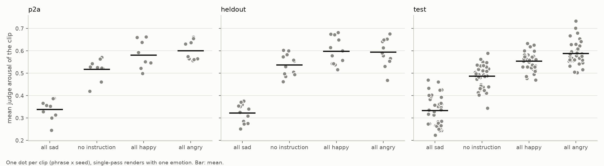
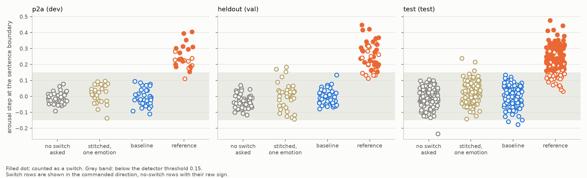
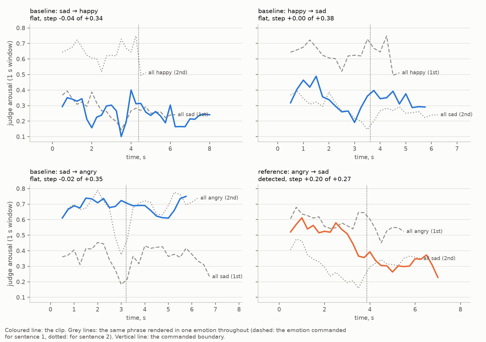

# Смена эмоции внутри высказывания в синтезе речи: постановка, baseline, протокол оценки

ДЗ1 курса «Исследования и разработка в ML», тема №33 из таблицы курса.
Продолжение, ДЗ2 (два улучшения baseline и абляции): [HW2.md](HW2.md).

Вопрос работы: умеет ли дообученная авторегрессионная TTS-модель сменить эмоцию на границе
предложений внутри одного высказывания, если попросить её об этом самым простым способом, одной
инструкцией. Для одной модели, одного диктора и одной формулировки инструкции ответ измерен, и он
отрицательный: на тестовом наборе (12 фраз, три сида) смена детектирована в 0 из 144 высказываний.
Тот же измеритель на тех же фразах засчитывает смену в 86 из 144 высказываний, когда два
предложения отрендерены по отдельности и склеены. Тексты, правила измерения и пороги гипотезы
закоммичены до рендера тестовых клипов ([docs/prereg_test.md](docs/prereg_test.md)). На dev и val,
измеренных раньше, картина та же: 0 из 36 и 0 из 48 против 16 из 24 и 30 из 48.

**Место ДЗ1 в теме №33.** Тема целиком: управление эмоцией на уровне слов по непрерывной шкале,
сравнение авторегрессионной и неавторегрессионной архитектур, слушательское исследование. ДЗ1 берёт
первый шаг: самый грубый случай управления внутри фразы (одна граница на стыке предложений, три
категории эмоций) и самую простую систему. Здесь фиксируются задача, измеритель и точка отсчёта.
Уровень слова, непрерывная шкала, вторая архитектура и слушатели отложены на следующие работы.

Как это связано с остальной темой. Измеритель ДЗ1 не привязан к границе предложений: шаг профиля
считается относительно начала любого слова, найденного выравниванием, так что переход к уровню слов
меняет стимулы, а не протокол. Ограничивает его окно судьи в 1 с: смену на одном коротком слове оно
сгладит (вопрос 6). Судья выдаёт непрерывную оценку, и величина шага уже измеряется (п. 5.7);
бинарный det взят потому, что на этом шаге проверяется только, есть ли смена вообще. Вторая
архитектура оценивается тем же кодом: измерителю нужны wav, текст и команда. Слушатели нужны, чтобы
проверить самого судью на синтетической речи; пока этого нет, все выводы относятся к оценке судьи,
а не к восприятию.

Содержание: [Термины](#термины) · [1. Постановка](#1-постановка-задачи) ·
[2. Формализация](#2-формализация) · [3. Данные](#3-данные-eda) · [4. Baseline](#4-baseline) ·
[5. Протокол оценки](#5-протокол-оценки) · [6. Результаты](#6-результаты-baseline) ·
[7. Выводы](#7-выводы) · [Обязательные вопросы](#ответы-на-обязательные-вопросы) ·
[Исследовательские вопросы](#собственные-исследовательские-вопросы) · [Запуск](#запуск) ·
[Структура](#структура-репозитория) · [Воспроизводимость](#воспроизводимость) ·
[Заимствования](#источники-и-заимствования) · [Лицензия](#лицензия)

## Термины

| термин | значение |
|---|---|
| модель R | авторегрессионная TTS-модель Qwen3-TTS 0.6B, дообученная так, чтобы инструкция задавала эмоцию (п. 4) |
| рендер, клип | одно синтезированное высказывание |
| сид | начальное значение генератора случайных чисел при синтезе |
| судья | публичная модель, оценивающая возбуждение (arousal) по звуку, шкала примерно от 0 до 1 |
| профиль | оценки судьи в скользящем окне вдоль клипа |
| шаг (step), Δ | средний профиль после границы минус средний профиль до неё |
| детектор, det | правило «смена засчитана» (п. 5.2) и доля высказываний, где оно выполнено |
| нулевые строки (no-switch rows) | клипы, где смены не просили: вся фраза в одной эмоции (`control`), без инструкции (`plain`) или склейка двух сегментов одной эмоции (`stitch_null`) |
| референс (reference) | склейка двух отдельно отрендеренных предложений (`stitch`) |
| гейт | условие допуска системы к сравнению: её речь должна оставаться разборчивой |
| годный клип (valid) | клип, речь которого совпадает с текстом: WER не больше 0.20, инструкция не произнесена, длительность не больше 15 с |
| граница по построению / по выравниванию | два способа найти границу в склейке: конец первого сегмента или начало первого слова второго предложения (п. 5.1) |
| ASR, WER | распознавание речи и доля ошибочных слов в распознанном тексте |
| LUFS | единица громкости программы |
| узел | GPU-сервер, на котором рендерилось аудио |
| dev, val, test | набор для настройки измерителя (`p2a`), первый набор для отчёта (`heldout`) и набор, на котором проверяется заранее записанная гипотеза (`test`) |

Заголовки автоматически собранных таблиц английские, потому что таблицы пишет код:

| столбец | значение |
|---|---|
| detected, det | число и доля высказываний со сменой |
| 95% CI (Wilson, rows) / (bootstrap over phrases) | интервал Уилсона по строкам / бутстреп с пересэмплированием фраз |
| mean abs step, max abs step, p95 abs step | средний, наибольший модуль шага и его 95-й перцентиль |
| commanded step | шаг в командном направлении: положителен, если профиль сдвинулся туда, куда велели |
| ideal step | шаг, который дали бы одноэмоциональные рендеры той же фразы (п. 5.7) |
| realised share | сумма commanded step, делённая на сумму ideal step |
| sign ok | доля высказываний, где знак шага совпал с командой |
| change-point at boundary | доля высказываний, где точка смены профиля не дальше 0.75 с от границы |
| would pass the detector (either sign) | сколько нулевых строк прошли бы детектор при любом знаке шага |
| profile SD | разброс профиля внутри клипа |
| leak rate, looped | доля клипов с произнесённой инструкцией; число клипов длиннее 15 с |
| outcome: invalid / flat / wrong_sign / no_changepoint / misplaced / no_step | клип негоден / шаг меньше порога / не тот знак / точка смены не определена / точка смены далеко от границы / шаг не измерен |
| primary rule | правило набора, по которому считается det: чем задана граница склейки и применяется ли годность клипа (п. 5.2) |
| stitched boundary by construction / by forced alignment | det при границе склейки по построению / по выравниванию |
| sign test p (phrases) | двусторонний знаковый тест по фразам |

## 1. Постановка задачи

**Что предсказывается.** Модель синтеза получает текст из двух предложений и команду «первое
предложение произнеси с эмоцией e1, второе с эмоцией e2» и выдаёт одну звуковую волну. Задача
решена на высказывании, если в этой волне эмоция меняется там, где велено, и в ту сторону,
в которую велено, а речь остаётся разборчивой.

Измеряется более узкое условие (п. 5.2): на границе предложений оценка возбуждения сдвигается не
меньше чем на 0.15 в командную сторону, и сдвиг приходится на границу. Категория эмоции и качество
речи за пределами разборчивости в него не входят, поэтому «смена детектирована» слабее, чем
«задача решена».

**Объект предсказания.** Одно высказывание: пара предложений, пара эмоций, сид генерации.

**Что доступно на момент предсказания.** Текст, идентификатор диктора и текст инструкции.
Эталонной записи этого текста с нужной сменой эмоции нет ни при обучении, ни при оценке.

**Практический смысл.** Аудиокнига, реплика персонажа или ответ голосового ассистента редко
держат одну эмоцию от начала до конца: «Мы всё подготовили. Но заказчик отменил встречу».
Штатный канал инструкции у TTS-моделей задаёт одну эмоцию на всё высказывание. Методы смены
эмоции внутри высказывания появляются в исследованиях (например, TED-TTS), но готовой ручки
в открытых моделях этого семейства нет. Обходной путь, резать текст и склеивать волну, даёт шов
и стоит N запусков модели вместо одного.

**Ограничения постановки.**

- Один диктор (ESD 0016), английский язык.
- Три эмоции и четыре перехода: happy → sad, sad → happy, sad → angry, angry → sad. Переходы
  выбраны так, чтобы эмоции различались возбуждением: измеритель использует только его. Happy и angry
  по возбуждению почти совпадают (п. 3.4), поэтому переход между ними в задачу не входит.
- «Смена эмоции» здесь означает смену уровня возбуждения. Категорию эмоции метрика не проверяет.
- Граница одна и стоит на стыке предложений.
- Оценка автоматическая. Людей в этом ДЗ нет.
- Чекпоинт модели лежит не в репозитории, а на Hugging Face (см. [Воспроизводимость](#воспроизводимость)).

**Основная гипотеза (H1).** В том виде, в каком она была записана 10–11 ноября:

> Если командовать смену эмоции одной инструкцией на всё высказывание («Say the first sentence
> cheerfully and the second sentence sadly»), то доля высказываний с детектированной сменой на
> валидационном наборе превысит долю ложных срабатываний детектора на высказываниях без смены
> не более чем на 0.10. Предполагаемая причина: канал инструкции обучен на парах «одна инструкция,
> одна эмоция на весь клип» и работает как стиль всего высказывания.
>
> Контрольная часть: если те же два предложения отрендерить по отдельности, каждое со своей
> эмоцией, и склеить волну, детектор засчитает смену не менее чем в половине высказываний того
> же набора. Тогда нулевой результат baseline говорит о модели, а не о слепоте измерителя.

Причину эксперимент не проверяет: он проверяет только утверждение о долях.

**На dev и val это не предсказание.** Пороги 0.10 и 0.50 записаны, когда результаты сида 42 на val
уже были известны (0 из 16 у baseline, 10 из 16 у референса). Числа на этих двух наборах поэтому
приводятся как наблюдение, под которое гипотеза сформулирована.

**Проверка на тестовом наборе.** Чтобы у H1 была проверка, которую можно провалить, написан третий
набор из 12 новых фраз. Тексты, список прогонов, правила измерения, критерий и пороги записаны
в [docs/prereg_test.md](docs/prereg_test.md) и закоммичены до рендера первого тестового клипа.
На тестовом наборе H1 принимается, если выполнены все три условия:

- det baseline не больше 0.10;
- det референса не меньше 0.50;
- двусторонний знаковый тест по фразам для разности «референс − baseline» даёт p < 0.05.

От исходной формулировки это отличается в двух местах: det baseline сравнивается с порогом напрямую,
а доля ложных шагов проверяется отдельным ожиданием (не больше 0.10 для каждого вида нулевых строк);
добавлен критерий на уровне фраз. Результат приведён в п. 6.2.

В файле предрегистрации список прогонов назван ключом `planned_runs`. После рендера те же 15
прогонов перенесены в ключ `runs` конфига; сам файл не менялся. После коммита `ed9e543` в коде
оценки менялись только отчётные части: строка о разнице двух границ, разбивка таблицы переходов
по наборам и оформление графиков. Перерендеров не было: журнал рендера содержит один проход из 15
прогонов, все 747 клипов выложены, включая негодный. В файле предрегистрации число текстов
в манифестах модели указано как 446 и 47, в сохранённой статистике манифестов (п. 3.3) 441 и 46;
причину расхождения я не установил.

**Хронология.**

| когда | что произошло | откуда известно |
|---|---|---|
| 04.09.2026, 13:28 | первый прогон baseline на dev, сид 42. По нему вручную выбраны константы детектора (п. 5.2) | выложенные dev-клипы сида 42 взяты из повторного прогона 05.09 и побайтно совпадают с клипами первого: [calibration_run_sha256.tsv](data/reference/calibration_run_sha256.tsv), тест |
| 04.09.2026, 23:32 и 23:40 | отрендерен референс на dev, сиды 42 и 43 | [provenance.json](data/reference/provenance.json) |
| 05.09.2026, 01:01 | отрендерен референс на val, сид 42. Тексты val написаны перед этим прогоном | прогон: provenance.json; тексты: с моих слов |
| 05.09.2026, 07:30 | отрендерен baseline на val, сид 42 | provenance.json |
| 10–11.11.2026 | H1 записана с порогами 0.10 и 0.50 | с моих слов: история коммитов начинается позже |
| 11.11.2026 | отрендерены baseline на сидах 43 и 44 (оба набора) и референс на val на сидах 43 и 44 | baseline: provenance.json; референс: дата записана в [generator_check.json](data/reference/generator_check.json) с моих слов |
| 17.11.2026, 12:42 UTC | закоммичены тестовый набор и предрегистрация (коммит `c4df5a2`) | история git |
| 17.11.2026, 12:42–14:42 UTC | рендер тестового набора на узле | [render_test_log.txt](data/reference/render_test_log.txt) |
| 17.11.2026, 14:09 UTC | закоммичен код измерения тестового набора (коммит `ed9e543`); аудио к этому моменту не скачано и не измерено | история git; что аудио не измерялось раньше, известно с моих слов |
| 17.11.2026, до 16:35 UTC | тестовые клипы скачаны с узла и измерены двумя проходами | время с моих слов; длительность проходов записана в [measure_meta.json](results/baseline/measure_meta.json) |

Время сентябрьских и ноябрьских прогонов взято из идентификаторов прогонов узла; часовой пояс в них
не записан. Рабочее дерево исходного проекта при девяти прогонах, сделанных его скриптами, было
с незакоммиченными изменениями (provenance.json). Время коммитов ставит автор, а журнал рендера
пишет узел, к которому у проверяющего нет доступа: порядок событий 17 ноября подтверждается двумя
согласованными записями, но обе мои.

## 2. Формализация

| что | значение |
|---|---|
| **X** | `(text, speaker, e1, e2)`: текст из двух предложений `s1 s2`, диктор, эмоция первого и второго предложения |
| **Выход модели** | звуковая волна, 24 кГц, моно |
| **y** | Размеченной цели нет: это генерация. Цель задана требованием к выходу: шаг возбуждения на границе между `s1` и `s2` со знаком `sign(A(e2) − A(e1))`, где `A(e)` — номинальное возбуждение эмоции (angry 0.64, happy 0.57, sad 0.29: уровни из записей исходного проекта, в расчётах участвует только их порядок; измеренные уровни приведены в п. 3.4) |
| **Тип задачи** | Условная генерация (управляемый TTS). В список «binary / multiclass / multilabel / regression / ranking / forecasting» не укладывается. Оценка сводится к бинарному исходу на высказывание: смена детектирована или нет |
| **Единица наблюдения** | Высказывание: фраза × переход × сид. Высказывания одной фразы зависимы: у них общий текст и общая фразовая мелодика |
| **Одно предсказание** | Одна волна на один вход, один проход модели |
| **Признаки на inference** | Текст, имя диктора, текст инструкции. Ни опорного аудио, ни разметки. Сид задаёт случайность декодирования и в X не входит |
| **Типы признаков** | Текст (строка), инструкция (строка), диктор и эмоции (категории) |

Детектор получает wav, текст и команду. Для склейки известен ещё и момент стыка; граница в ней
считается двумя способами, и на тестовом наборе обе системы измеряются одним (п. 5.1, 5.2).

## 3. Данные (EDA)

Данных два вида. Обучающие данные модели R в этом ДЗ не используются напрямую (чекпоинт
зафиксирован), но от них зависит, есть ли утечка. Оценочные данные лежат в репозитории целиком.

### 3.1. Оценочные тексты

Три набора двухпредложных фраз с нейтральным содержанием, написаны мной. Смена эмоции командуется
на первом слове второго предложения.

| набор | роль | фраз | файл |
|---|---|---|---|
| `p2a` | dev: на рендерах этих фраз настраивался детектор | 3 | [configs/phrases/p2a.json](configs/phrases/p2a.json) |
| `heldout` | val: первое число для отчёта; гипотеза записана с его знанием | 4 | [configs/phrases/heldout.json](configs/phrases/heldout.json) |
| `test` | test: проверка H1; тексты и правила закоммичены до рендера | 12 | [configs/phrases/test.json](configs/phrases/test.json) |

<!-- table: eda.md#Texts -->
| set | phrases | words in sentence 1 (min / median / max) | words in sentence 2 | words in the phrase | first word of sentence 2 |
|---|---|---|---|---|---|
| p2a | 3 | 7 / 8 / 8 | 6 / 6 / 7 | 13 / 14 / 15 | later, tomorrow, afterwards |
| heldout | 4 | 8 / 8 / 9 | 6 / 8.5 / 9 | 15 / 16.5 / 17 | nobody, suddenly, otherwise, everyone |
| test | 12 | 7 / 8 / 9 | 6 / 7 / 8 | 14 / 15 / 17 | passengers, somebody, meanwhile, visitors, luckily, customers, eventually, drivers, sometimes, tonight, villagers, volunteers |
<!-- /table -->

Тексты нейтральны намеренно: эмоцию должна нести подача, а не слова. Тесты проверяют, что
в текстах нет слов-эмоций из инструкции (основ из ключа `leak_stems` конфига: `sad`, `happy`,
`cheerful`, `angry` и их вариантов; на них настроен детектор утечки), нет цифр и что первое слово
второго предложения встречается во фразе один раз. Слова «first» и «second» из инструкции детектор
утечки не ищет: «second» есть в dev-фразе «…on the second shelf». В тестовых фразах, кроме того, нет
числительных и слов с разным британским и американским написанием: на dev и val они давали
ненулевой WER без дефекта речи (п. 3.5).

### 3.2. Выложенное аудио

Каждая строка [data/manifest.jsonl](data/manifest.jsonl) описывает один клип: прогон, набор, сид,
условие, текст, инструкцию, ожидаемый знак шага, путь к файлу. Условий пять:

| условие | что это | роль |
|---|---|---|
| `nl_instruct` | один проход, инструкция называет обе эмоции | **baseline** |
| `stitch` | два независимых рендера (по предложению), склейка волны с кроссфейдом 20 мс | референс |
| `control` | один проход, одна эмоция на всю фразу | нулевые строки |
| `plain` | один проход, без инструкции | нулевые строки |
| `stitch_null` | склейка двух сегментов одной эмоции | нулевые строки референса |

<!-- table: eda.md#Released clips -->
| run | set | seed | plain | control | stitch_null | nl_instruct | stitch | clips | audio, s |
|---|---|---|---|---|---|---|---|---|---|
| inline_p2a_s42 | p2a | 42 | 3 | 9 | 0 | 12 | 0 | 24 | 133.7 |
| inline_heldout_s42 | heldout | 42 | 4 | 12 | 0 | 16 | 0 | 32 | 212.1 |
| inline_p2a_s43 | p2a | 43 | 3 | 9 | 0 | 12 | 0 | 24 | 129.3 |
| inline_heldout_s43 | heldout | 43 | 4 | 12 | 0 | 16 | 0 | 32 | 206.4 |
| inline_p2a_s44 | p2a | 44 | 3 | 9 | 0 | 12 | 0 | 24 | 137.4 |
| inline_heldout_s44 | heldout | 44 | 4 | 12 | 0 | 16 | 0 | 32 | 209.2 |
| stitch_p2a_s42 | p2a | 42 | 3 | 9 | 0 | 0 | 12 | 24 | 140.9 |
| stitch_p2a_s43 | p2a | 43 | 3 | 9 | 0 | 0 | 12 | 24 | 130.5 |
| stitch_heldout_s42 | heldout | 42 | 4 | 12 | 0 | 0 | 16 | 32 | 211.5 |
| stitch_heldout_s43 | heldout | 43 | 4 | 12 | 0 | 0 | 16 | 32 | 206.7 |
| stitch_heldout_s44 | heldout | 44 | 4 | 12 | 0 | 0 | 16 | 32 | 210.6 |
| inline_test_s42 | test | 42 | 12 | 36 | 0 | 48 | 0 | 96 | 633.0 |
| inline_test_s43 | test | 43 | 12 | 36 | 0 | 48 | 0 | 96 | 619.2 |
| inline_test_s44 | test | 44 | 12 | 36 | 0 | 48 | 0 | 96 | 614.9 |
| stitch_test_s42 | test | 42 | 12 | 36 | 0 | 0 | 48 | 96 | 642.5 |
| stitch_test_s43 | test | 43 | 12 | 36 | 0 | 0 | 48 | 96 | 640.2 |
| stitch_test_s44 | test | 44 | 12 | 36 | 0 | 0 | 48 | 96 | 633.1 |
| stitchnull_test_s42 | test | 42 | 0 | 0 | 36 | 0 | 0 | 36 | 244.1 |
| stitchnull_test_s43 | test | 43 | 0 | 0 | 36 | 0 | 0 | 36 | 244.0 |
| stitchnull_test_s44 | test | 44 | 0 | 0 | 36 | 0 | 0 | 36 | 238.6 |
| stitchnull_heldout_s42 | heldout | 42 | 0 | 0 | 12 | 0 | 0 | 12 | 77.5 |
| stitchnull_heldout_s43 | heldout | 43 | 0 | 0 | 12 | 0 | 0 | 12 | 76.5 |
| stitchnull_heldout_s44 | heldout | 44 | 0 | 0 | 12 | 0 | 0 | 12 | 79.7 |
| stitchnull_p2a_s42 | p2a | 42 | 0 | 0 | 9 | 0 | 0 | 9 | 53.2 |
| stitchnull_p2a_s43 | p2a | 43 | 0 | 0 | 9 | 0 | 0 | 9 | 49.1 |
| stitchnull_p2a_s44 | p2a | 44 | 0 | 0 | 9 | 0 | 0 | 9 | 51.5 |
| **all** |  |  | 111 | 333 | 171 | 228 | 216 | 1059 | 6825.3 |

Sample rate: 24000 Hz (1059 clips). 843 of the 1059 clips are distinct audio. Byte-identical repeats: 12 no-switch clips of stitch_p2a_s42 repeat inline_p2a_s42; 12 no-switch clips of stitch_p2a_s43 repeat inline_p2a_s43; 16 no-switch clips of stitch_heldout_s42 repeat inline_heldout_s42; 16 no-switch clips of stitch_heldout_s43 repeat inline_heldout_s43; 16 no-switch clips of stitch_heldout_s44 repeat inline_heldout_s44; 48 no-switch clips of stitch_test_s42 repeat inline_test_s42; 48 no-switch clips of stitch_test_s43 repeat inline_test_s43; 48 no-switch clips of stitch_test_s44 repeat inline_test_s44.
<!-- /table -->

Нулевые строки прогонов склейки повторяют нулевые строки baseline-прогонов с тем же набором
и сидом побайтно. Они лежат в манифесте, потому что каждый прогон несёт свои контроли, но
независимыми наблюдениями не считаются: остальные таблицы EDA и график считают каждый
аудиофайл один раз.

**Условия вне эксперимента.** В исходных прогонах были ещё два условия. При импорте они отброшены
и в таблицы п. 6 не входят. Их клипы выложены в `data/audio_dropped/` и измерены тем же кодом как
разведочные ([dropped_conditions.md](results/baseline/dropped_conditions.md)):

- `inline_tag`: один проход, эмоции заданы тегами в тексте («[happy] … [sad] …»).
- `cont`: второе предложение генерируется как продолжение первого под новой инструкцией; граница
  известна по построению, как у склейки.

<!-- table: dropped_conditions.md#Detection per condition, set and seed -->
| condition | set | seed | n | detected, stitched boundary by construction | by forced alignment | with validity gate (construction) | invalid | instruction spoken | WER > 0.2 |
|---|---|---|---|---|---|---|---|---|---|
| inline_tag | p2a | 42 | 12 | 0 | 0 | 0 | 12 | 12 | 1 |
| inline_tag | heldout | 42 | 16 | 0 | 0 | 0 | 16 | 16 | 0 |
| inline_tag | p2a | 43 | 12 | 0 | 0 | 0 | 12 | 12 | 0 |
| inline_tag | heldout | 43 | 16 | 0 | 0 | 0 | 16 | 16 | 0 |
| inline_tag | p2a | 44 | 12 | 0 | 0 | 0 | 12 | 12 | 0 |
| inline_tag | heldout | 44 | 16 | 0 | 0 | 0 | 16 | 16 | 0 |
| cont | p2a | 42 | 12 | 2 | 1 | 2 | 0 | 0 | 0 |
| cont | p2a | 43 | 12 | 1 | 1 | 1 | 0 | 0 | 0 |
| cont | heldout | 42 | 16 | 1 | 1 | 1 | 0 | 0 | 0 |

A single-pass clip (`inline_tag`) has one boundary, the forced-aligned switch word, in both columns.
<!-- /table -->

Модель произносит теги вслух во всех 84 клипах `inline_tag`, так что ни один из них не годен; det
равен нулю. У `cont` детекций 4 из 40 (2 и 1 из 12 на dev, 1 из 16 на val). Baseline, таким образом,
не лучший из измеренных вариантов по det: `cont` даёт больше нуля. Он выбран как самый простой
способ попросить смену (п. 4), а `cont`, как и склейка, требует двух вызовов модели.

<!-- table: eda.md#Durations and boundary position -->
| condition | distinct clips | duration, s (min / median / max) | boundary position, share of the clip | judge windows per clip | clips without a located boundary |
|---|---|---|---|---|---|
| plain | 57 | 4.72 / 6.08 / 7.84 | 0.46 / 0.53 / 0.62 | 15 / 21 / 28 | 0 |
| control | 171 | 4.08 / 6.08 / 9.60 | 0.44 / 0.53 / 0.64 | 13 / 21 / 35 | 0 |
| stitch_null | 171 | 4.70 / 6.38 / 9.02 | 0.39 / 0.49 / 0.59 | 15 / 22 / 33 | 0 |
| nl_instruct | 228 | 4.16 / 6.40 / 9.92 | 0.41 / 0.53 / 0.65 | 13 / 22 / 36 | 0 |
| stitch | 216 | 5.02 / 6.78 / 8.78 | 0.35 / 0.49 / 0.65 | 17 / 24 / 32 | 0 |

The boundary of a stitched clip (`stitch`, `stitch_null`) is the one by construction; a stitched clip counts as unlocated if either of its two boundaries is missing.
<!-- /table -->

Пропусков нет: у каждого клипа есть текст и аудио; у `plain` инструкции нет по построению. Число
клипов без найденной границы приведено в последнем столбце. Баланс задан конструкцией: на каждую фразу и сид приходится по одному
высказыванию на каждый из четырёх переходов, два вверх по возбуждению и два вниз.

### 3.3. Обучающие данные модели R

Модель R дообучена на 18 013 клипах из трёх открытых корпусов. Числа ниже сняты с обучающего
манифеста на узле: [docs/train_manifest_stats.txt](docs/train_manifest_stats.txt). Самих корпусов
и скрипта, снимавшего статистику, в репозитории нет, так что проверить эти числа по репозиторию нельзя.

| источник | клипов | дикторов | различных строк текста | эмоции |
|---|---|---|---|---|
| ESD (английская часть) | 15 000 | 10 | 451 | neutral, happy, sad, angry, surprise: по 3 000 |
| CREMA-D | 1 869 | 87 | 12 | neutral 574, angry 390, fear 368, happy 315, sad 222 |
| RAVDESS | 1 144 | 22 | 2 | по 176 на angry, calm, fear, happy, sad, surprise; neutral 88 |

Строки текста посчитаны как есть; после приведения регистра и пунктуации по всем источникам
остаётся 441 различный текст.

- **Диктор оценки есть в обучении.** ESD 0016: 1 500 клипов, по 300 на каждую из пяти эмоций.
  Оценка идёт на виденном голосе и невиденных текстах.
- **Тексты короткие и однопредложные.** Медиана 6 слов, максимум 12; два и более предложения
  содержат 50 строк из 18 013. Оценочные фразы (13–17 слов) длиннее любого обучающего текста, так что
  baseline проверяется вне длины, виденной при дообучении. Одну эмоцию на такой длине модель
  держит: уровни контролей на всю фразу близки к уровням сегментов склейки, расхождение до 0.04
  (п. 6.3).
- **Каждый клип размечен одной эмоцией.** Среди 507 различных инструкций нет ни одной со словами
  «first sentence» или «second sentence». Других форм инструкции с двумя эмоциями я не искал.
- **Классы почти сбалансированы** для пяти основных эмоций (3 176–3 662 клипа); fear (544) и calm
  (176) редки. В оценке участвуют только happy, sad и angry.

### 3.4. Уровни возбуждения, между которыми нужно переключаться

<!-- table: eda.md#Arousal levels of the single-emotion renders -->
| set | rendered as | clips | mean arousal | SD across clips | SD within a clip (window noise) | loudness as rendered, LUFS |
|---|---|---|---|---|---|---|
| p2a | sad | 9 | 0.338 | 0.046 | 0.057 | -30.3 |
| p2a | plain | 9 | 0.518 | 0.048 | 0.056 | -30.1 |
| p2a | happy | 9 | 0.580 | 0.061 | 0.049 | -28.2 |
| p2a | angry | 9 | 0.601 | 0.044 | 0.061 | -26.5 |
| heldout | sad | 12 | 0.323 | 0.043 | 0.068 | -29.9 |
| heldout | plain | 12 | 0.537 | 0.048 | 0.069 | -29.0 |
| heldout | happy | 12 | 0.598 | 0.060 | 0.061 | -26.7 |
| heldout | angry | 12 | 0.595 | 0.059 | 0.071 | -25.8 |
| test | sad | 36 | 0.333 | 0.068 | 0.069 | -30.2 |
| test | plain | 36 | 0.487 | 0.053 | 0.064 | -30.9 |
| test | happy | 36 | 0.554 | 0.041 | 0.072 | -28.5 |
| test | angry | 36 | 0.589 | 0.053 | 0.075 | -26.4 |

Across the 228 single-emotion and plain renders of the inline runs, loudness as rendered spans -36.0 to -21.5 LUFS and correlates with judged arousal at r = 0.56. Both follow the rendered emotion: the model speaks an aroused emotion louder. It is not the judge reading level, because the judge rescales every window before scoring.
<!-- /table -->



Sad лежит на 0.32–0.34, happy на 0.55–0.60, angry на 0.59–0.60, разброс между клипами одной
эмоции 0.04–0.07. Зазор между sad и любой из двух других эмоций равен 0.22–0.28: в три-четыре раза
больше оконного шума внутри клипа (0.05–0.08). Средние happy и angry различаются на 0.02 на dev,
на 0.003 на val и на 0.035 на тесте, поэтому переход между ними судьёй по возбуждению не измерить.
Рендер без инструкции (`plain`, 0.49–0.54) ближе к happy и angry, чем к sad: по одному уровню возбуждения angry от «никакой эмоции»
отличается слабо.

Модель произносит возбуждённую эмоцию громче: angry примерно на 4 дБ громче sad. Громкость клипа
коррелирует с оценкой возбуждения (r = 0.56 по 228 клипам), но это связь двух проявлений одной эмоции, а не
чувствительность судьи к уровню: судья сам нормирует каждое окно (п. 5.1).

### 3.5. Источники шума

Размеченной цели нет, поэтому «шум разметки» здесь означает шум измерителя.

- **Оконный шум судьи.** Внутри клипа с одной эмоцией оценка по окнам в 1 с колеблется с SD 0.05–0.08.
- **Фразовая мелодика.** Возбуждение меняется вдоль фразы и без команды. Поэтому у каждой фразы
  есть нулевые строки с тем же текстом.
- **Судья обучен на естественной речи** (MSP-Podcast), а оценивает синтез. Его согласие
  с человеком на синтетической речи в этом ДЗ не проверяется.
- **Оценка точки смены смещена к краям клипа** (п. 5.2): на бесструктурном профиле она чаще
  всего попадает на крайнее допустимое разбиение.
- **ASR пишет числительные цифрами и меняет орфографию** («nine» → «9», «neighbour» → «neighbor»).
  Перед подсчётом WER обе стороны нормализуются: цифры от 0 до 20 переводятся в слова, написание
  «neighbour» приводится к одному варианту ([gates.py](src/emoswitch/gates.py)).

### 3.6. Потенциальные утечки

| риск | что сделано |
|---|---|
| Оценочные тексты есть в обучении модели | На узле проверены обучающий и валидационный манифесты R: ни одно из 14 предложений dev и val не встречается ни целиком, ни подстрокой ([docs/train_manifest_stats.txt](docs/train_manifest_stats.txt)). Для 24 предложений тестового набора та же проверка сделана до коммита набора; её результат записан в [docs/prereg_test.md](docs/prereg_test.md), вывод скрипта не сохранён |
| Константы детектора подобраны на данных отчёта | Настройка шла на первом dev-прогоне. Числа для отчёта берутся с `heldout` и `test`, тексты которых написаны позже (хронология в п. 1) |
| Чекпоинт R выбран по оцениваемой метрике | По записям исходного проекта шаг 1050 выбран по точности распознавания категории эмоции на отдельных текстах; переключение при выборе не измерялось. По репозиторию не проверить |
| Строки одной фразы попали в разные наборы | Разбиение идёт по фразе: все её переходы, контроли и сиды лежат в одном наборе |
| Модель произнесла инструкцию, и судья оценил слова | Гейт утечки по транскрипту (п. 5.4) |
| Baseline подогнан под оценочный набор | Формулировка инструкции одна; режим генерации записан в конфиге. Альтернативные условия из тех же прогонов измерены и приведены в п. 3.2 |
| Правила измерения изменены после результата | На dev и val так и было: детектор настраивался на dev, а правило границы и годность клипа введены после проверки работы. На тестовом наборе правила и пороги закоммичены до рендера, код измерения — до измерения (п. 1) |
| Val уже видел другие системы | Да. В исходном проекте на dev и val измерялись и другие системы. Для них val не является нетронутым набором; подробности в п. 7. Тестовый набор до этой работы не использовался |

## 4. Baseline

**Что выбрано.** Однопроходная инструкция: модель R получает весь текст и одну инструкцию
`Say the first sentence {e1-ly} and the second sentence {e2-ly}` и генерирует высказывание
за один проход. Это самый простой способ попросить то, что нужно: тем каналом, которым модель
и так управляется, без дообучения, без второго рендера, без вмешательства в декодирование.

**Модель R.** Qwen3-TTS-12Hz-0.6B-Base (авторегрессионная языковая модель над токенами
нейрокодека), дообученная LoRA на данных из п. 3.3 так, чтобы инструкция задавала категорию
эмоции. Рецепт обучения приведён в [docs/model_R.md](docs/model_R.md); кода обучения
в этом репозитории нет. По отчётам исходного проекта на уровне высказывания канал работает
(точность категориального судьи 0.74 при шансе 0.20, инструкция не произносится); здесь эти
числа не воспроизводятся.

**Почему не готовая открытая модель.** У открытых чекпоинтов этого семейства на 0.6B канала эмоции
через инструкцию нет: библиотека производителя отключает параметр `instruct` для 0.6B, а базовая
модель без дообучения инструкцию игнорирует или читает вслух (наблюдение исходного проекта).
Поэтому точкой отсчёта служит собственный дообученный чекпоинт.

**Почему это честный baseline, а не «почти SOTA».**

- Настраиваемых параметров у него нет, формулировка инструкции одна
  ([configs/baseline.yaml](configs/baseline.yaml)). Другие формулировки не пробовались (вопрос 7).
- В данных дообучения нет ни одного клипа, размеченного двумя эмоциями, и ни одной инструкции
  такого вида (п. 3.3): baseline спрашивает модель о том, чему её не учили. О предобучении базовой
  модели этого сказать нельзя.
- Это то, что сделает пользователь модели в первую очередь.
- Он интерпретируем: по профилю видно, что сделала модель (п. 6.5).

Он не лучший из измеренных вариантов: условие `cont` из тех же прогонов даёт ненулевой det
(п. 3.2). Отрицательный результат относится к одной формулировке инструкции на текстах длиннее
обучающих, а не к каналу инструкции вообще.

**Почему baseline не склейка.** Склейка проще некуда и даёт ненулевой det, но нарушает условие
задачи «одно высказывание за один проход»: это два рендера и стык в волне. Если это условие снять,
точкой отсчёта становится она. Слышимость стыка в этом ДЗ не измерена; измерено только, создаёт ли
сам стык ложный шаг (п. 6.2). Поэтому склейка служит референсом для измерителя, а не конкурентом.

**Preprocessing.** Текст подаётся как есть. Вся обработка относится к оценке и одинакова для всех
систем (п. 5.1).

**Зафиксированные параметры генерации.** Диктор `esd0016`. Первый кодбук декодируется жадно
(`do_sample: false`, `repetition_penalty: 1.05`, `max_new_tokens: 400`). Остальные кодбуки
предсказывает подмодель, которая сэмплирует (`subtalker_dosample: true`, температура 0.9,
top-k 50): эти значения записаны в самом чекпоинте и продублированы в конфиге. Поэтому сид
меняет рендер: ни один клип baseline-прогонов (56 на сид на dev и val, 96 на тесте) не повторился
побайтно на другом сиде. При фиксированном сиде рендер воспроизводится побайтно (п. «Воспроизводимость»).

**Обучения в этом ДЗ нет.** Скрипта `train.py` нет: модель R обучена раньше и вне этого
репозитория, а baseline — это способ её спросить. Место обучающего скрипта занимает
[src/emoswitch/generate.py](src/emoswitch/generate.py), который рендерит все условия готовым чекпоинтом.

## 5. Протокол оценки

### 5.1. Измеритель

Каждый клип проходит один путь ([src/emoswitch/evaluate.py](src/emoswitch/evaluate.py)):

1. **Подготовка.** Моно, 16 кГц, приведение к −23 LUFS ([judge.py](src/emoswitch/judge.py)). Шаг
   унаследован от исходного измерителя и на результат не влияет: судья нормирует каждое окно
   сам. Проверено тестом: профиль клипа при −23 LUFS, без нормализации и при усилении в 0.1 раза
   расходится меньше чем на 0.005 ([tests/test_models.py](tests/test_models.py)).
2. **Профиль.** Окно 1.0 с скользит с шагом 0.25 с; в каждом окне модель
   `audeering/wav2vec2-large-robust-12-ft-emotion-msp-dim` выдаёт возбуждение. Ревизия модели
   записана в конфиге. Длина окна унаследована от исходного измерителя и здесь не подбиралась
   (вопрос 6).
3. **Граница.** Известный текст выравнивается на аудио (torchaudio MMS_FA), граница равна началу
   первого слова второго предложения ([align.py](src/emoswitch/align.py)). У склейки есть и вторая
   граница, по построению: конец первого сегмента. Она раньше первой на паузу перед вторым
   предложением: на 0.23–0.49 с, медианы по наборам 0.29–0.31 с
   ([summary.md](results/baseline/summary.md), раздел о правилах границы). Для каждой склейки шаг
   считается от обеих границ.
4. **Шаг.** `Δ = mean(профиль в окнах с центром после границы) − mean(профиль до границы)`.
5. **Точка смены.** Независимо от команды ищется разбиение профиля, максимизирующее
   `|mean(после) − mean(до)|`, не менее трёх окон с каждой стороны ([detect.py](src/emoswitch/detect.py)).
6. **Проверка речи.** Транскрипт faster-whisper large-v3 в детерминированном режиме: WER к тексту
   после нормализации и поиск произнесённой инструкции ([gates.py](src/emoswitch/gates.py)); клип
   длиннее 15 с считается зацикленным.

### 5.2. Основная метрика

**det**: доля высказываний, в которых смена детектирована. Нужны три условия сразу:

| условие | константа | что отсекает |
|---|---|---|
| модуль шага Δ не меньше 0.15 | `min_abs_delta` | шаг в пределах шума окна и фразовой мелодики |
| знак Δ совпадает с командой | нет | смена не в ту сторону |
| точка смены не дальше 0.75 с от границы | `max_changepoint_err_s` | дрейф через всю фразу, смена не на том слове |

**Почему именно она.** Требование задачи бинарное: смена либо произошла там и туда, куда велено,
либо нет. Средний шаг эту разницу скрывает.

**Правило набора** (ключ `primary_rule` конфига). От набора зависят две вещи: от какой границы
считается шаг у склейки и учитывается ли годность клипа.

| набор | граница склейки | негодный клип | почему |
|---|---|---|---|
| dev, val | по построению | остаётся в подсчёте | так получены первые числа этой работы; правило оставлено, чтобы они не менялись задним числом |
| test | по выравниванию, как у baseline | считается как «смены нет» | одно правило для обеих систем; записано до рендера ([docs/prereg_test.md](docs/prereg_test.md)) |

Для каждого набора в отчёте приведены все четыре варианта (п. 6.1). На dev и val переход к границе
по выравниванию снимает у референса по одной детекции, на тесте снимает девять и добавляет одну
(94 → 86); негодных
клипов среди строк со сменой нет.

**Откуда константы.** Они выбраны вручную по первому dev-прогону, без оптимизации (записи
исходного проекта). Оконный шум на одноэмоциональных клипах был 0.055. Ожидаемый шаг
оценивался тогда по номинальным уровням эмоций как 0.28–0.35; измеренный зазор между контролями
на том же прогоне меньше, 0.23–0.27. Порог 0.15 выше шума и составляет около 0.6 измеренного
зазора. Допуск 0.75 с равен трём шагам профиля. Требование «три окна с каждой стороны» добавлено,
когда оказалось, что разбиение с одним окном на краю выигрывает на шуме. Пороги годности клипа
(WER 0.20: две-три ошибки на фразу из 13–17 слов) выбраны до рендера тестового набора без
настройки. Порог зацикливания 15 с унаследован; при длине клипов от 4 до 10 с он ловит только
грубое зацикливание.

**Слабые места детектора.** Оценка точки смены смещена к краям клипа, потому что среднее по трём
окнам шумнее среднего по десяти. Третье условие поэтому может отбрасывать настоящие смены:
у референса так отсеяно 29 строк теста (п. 6.3), на слух они не проверены. У референса, где смена есть по построению,
детектор засчитывает 30 из 48 на val и 86 из 144 на тесте. Менять детектор после того, как val уже измерен, значило бы
подгонять его под val. Он оставлен замороженным, а зависимость результата от его констант показана
сеткой (п. 6.2). Метрика видит только возбуждение.

### 5.3. Нулевой контроль

На строках `control`, `plain` и `stitch_null` смены не просили. Доля таких строк, которые прошли бы
детектор при любом знаке шага, оценивает сверху долю ложных срабатываний. `control` и `plain`
служат нулём для baseline. `stitch_null` — нуль для референса: два сегмента одной эмоции
отрендерены и склеены так же, как в `stitch`, поэтому всё, что детектор видит в таком клипе, создано
стыком и разницей двух независимых рендеров, а не сменой эмоции.

### 5.4. Гейт и годность клипа

Проверок речи две.

**Гейт системы** (агрегатный). Система допускается к сравнению по det на наборе, только если её
речь на этом наборе остаётся речью: средний WER не выше 0.10, нет зацикленных клипов, нет
произнесённой инструкции. Код выводит результат гейта в отчёт; правило «det системы, не прошедшей
гейт, не сравнивается» применяет читающий отчёт.

**Годность клипа** (построчная). Клип годен, если его WER не больше 0.20, инструкция не произнесена
и он не длиннее 15 с. На тестовом наборе негодный клип считается как «смены нет»: это применяет
код. На dev и val годность только сообщается.

Утечка ловится по транскрипту: основа слова-эмоции из инструкции, скобка, цифра, которой нет
в тексте словом. Проверка намеренно чувствительна в сторону ложных тревог. Произнесённые слова
инструкции без слова-эмоции («say this») она не ищет; такой клип выдаёт только выросший WER.

### 5.5. Разбиение

| роль | что это | что на нём подбиралось |
|---|---|---|
| train | 18 013 клипов трёх корпусов (п. 3.3) | веса R |
| dev | `p2a`, 3 фразы | константы детектора |
| val | `heldout`, 4 фразы | в этом ДЗ ничего; с его знанием записаны пороги H1 |
| test | `test`, 12 фраз | ничего; правила и пороги записаны до рендера |

Разбиение по фразе (group split): высказывания одной фразы зависимы. Случайное разбиение по
строкам положило бы один текст в несколько наборов. Временного порядка в данных нет, стратификация
не нужна: состав переходов в каждой фразе одинаков. K-fold неприменим: обучения нет, а константы
детектора заморожены.

**Почему это корректно для baseline.** У baseline нет параметров, подбираемых на каком-либо из
наборов. По оценочным данным подбирались только константы детектора, и только на dev.

**Что использовано.** Val в исходном проекте видел и другие системы (п. 7). Тестовый набор
использован один раз, в этой работе; для сравнения систем в следующих ДЗ он остаётся пригодным,
пока по нему ничего не подбирается.

### 5.6. Неопределённость

- **Единица вывода — фраза.** Высказывания одной фразы зависимы, поэтому сравнение систем делается
  знаковым тестом по фразам: для каждой фразы считается det системы по всем её строкам (переходы ×
  сиды), фраза идёт в пользу той системы, у которой он выше. На val четыре фразы, и даже 4 из 4 дают
  p = 0.125; на тестовом наборе 12 фраз, наименьшее достижимое p равно 2·0.5¹² ≈ 0.0005.
- **Бутстреп по фразам** ([stats.py](src/emoswitch/stats.py)) для интервала det. При трёх-четырёх
  фразах он ненадёжен, а при нуле детекций вырождается в точку.
- **Интервал Уилсона** по строкам приводится как описательный: он предполагает независимость
  строк, которой нет.
- **Тест Макнемара** по общим строкам двух систем тоже описательный, по той же причине.
- **Сиды:** det на каждом сиде, SD по сидам и доля ячеек «фраза × переход», где решение детектора
  одинаково на всех сидах. Одинаковый det на сидах не означает одинаковых решений.

Наборы в тестах не объединяются: dev использован для настройки детектора.

### 5.7. Дополнительные метрики

| метрика | зачем |
|---|---|
| commanded step | величина шага в командном направлении |
| ideal step | уровень второго предложения в контроле e2 минус уровень первого предложения в контроле e1 той же фразы: шаг при идеальной смене |
| realised share | какая доля идеального шага реализована |
| outcome | причина каждого промаха. Проверки идут по порядку: строка с шагом ниже порога считается `flat` независимо от знака |
| nearest level | к какому рендеру той же фразы ближе средний уровень клипа: всё e1, всё e2 или без инструкции |

### 5.8. Как выбирается лучшая модель

В этом ДЗ выбирать не из чего. Правило на будущее: варианты одной системы (формулировка
инструкции, параметры) выбираются по det на dev; системы сравниваются на тестовом наборе, каждая
должна пройти гейт; разница считается эффектом, если знаковый тест по фразам даёт p < 0.05. Val
для выбора и сравнения больше не используется: он видел слишком многое.

## 6. Результаты baseline

Таблицы этого раздела скопированы из [results/baseline/](results/baseline/) скриптом
[scripts/sync_readme.py](scripts/sync_readme.py); тест проверяет, что копии совпадают с источником.
Заголовки столбцов расшифрованы в разделе [Термины](#термины). Подтверждающая часть — проверка H1
и ожидания о ложных шагах на тестовом наборе (п. 6.2). Сетка чувствительности, согласие сидов, разбор по переходам, знак
ложных шагов склейки и всё, что относится к dev и val, — разведочный анализ.

### 6.1. Основной результат

<!-- table: summary.md#Main result -->
| system | set | phrases | seeds | detected | det | 95% CI (Wilson, rows) | 95% CI (bootstrap over phrases) |
|---|---|---|---|---|---|---|---|
| baseline: one pass, instruction | p2a (dev) | 3 | 3 | 0/36 | **0.000** | [0.00, 0.10] | [0.00, 0.00] |
| baseline: one pass, instruction | heldout (val) | 4 | 3 | 0/48 | **0.000** | [0.00, 0.07] | [0.00, 0.00] |
| baseline: one pass, instruction | test (test) | 12 | 3 | 0/144 | **0.000** | [0.00, 0.03] | [0.00, 0.00] |
| reference: stitched segments | p2a (dev) | 3 | 2 | 16/24 | **0.667** | [0.47, 0.82] | [0.62, 0.75] |
| reference: stitched segments | heldout (val) | 4 | 3 | 30/48 | **0.625** | [0.48, 0.75] | [0.54, 0.71] |
| reference: stitched segments | test (test) | 12 | 3 | 86/144 | **0.597** | [0.52, 0.67] | [0.53, 0.67] |
<!-- /table -->

<!-- table: summary.md#Seeds -->
| system | set | detected per seed | mean of seed rates | SD over seeds |
|---|---|---|---|---|
| baseline: one pass, instruction | p2a | s42: 0/12, s43: 0/12, s44: 0/12 | 0.000 | 0.000 |
| baseline: one pass, instruction | heldout | s42: 0/16, s43: 0/16, s44: 0/16 | 0.000 | 0.000 |
| baseline: one pass, instruction | test | s42: 0/48, s43: 0/48, s44: 0/48 | 0.000 | 0.000 |
| reference: stitched segments | p2a | s42: 10/12, s43: 6/12 | 0.667 | 0.236 |
| reference: stitched segments | heldout | s42: 10/16, s43: 10/16, s44: 10/16 | 0.625 | 0.000 |
| reference: stitched segments | test | s42: 30/48, s43: 25/48, s44: 31/48 | 0.597 | 0.067 |
<!-- /table -->

<!-- table: summary.md#Step size -->
| system | set | mean abs step | max abs step | commanded step | ideal step | realised share | sign ok | change-point at boundary |
|---|---|---|---|---|---|---|---|---|
| baseline: one pass, instruction | p2a (dev) | 0.042 | 0.110 | -0.006 | 0.256 | -0.02 | 0.42 | 0.06 |
| baseline: one pass, instruction | heldout (val) | 0.040 | 0.134 | -0.007 | 0.274 | -0.03 | 0.42 | 0.02 |
| baseline: one pass, instruction | test (test) | 0.048 | 0.176 | -0.001 | 0.239 | -0.00 | 0.49 | 0.18 |
| reference: stitched segments | p2a (dev) | 0.247 | 0.405 | 0.247 | 0.252 | 0.98 | 1.00 | 0.71 |
| reference: stitched segments | heldout (val) | 0.251 | 0.448 | 0.251 | 0.274 | 0.91 | 1.00 | 0.65 |
| reference: stitched segments | test (test) | 0.226 | 0.476 | 0.226 | 0.239 | 0.94 | 1.00 | 0.66 |
<!-- /table -->



Каждая точка соответствует одному высказыванию. Серая полоса: область ниже порога детектора.
Закрашенные точки засчитаны как смена.

Baseline не дал ни одной детекции ни на одном наборе и ни на одном сиде: 0 из 36 на dev, 0 из 48
на val, 0 из 144 на тесте. На тесте средний шаг в командном направлении равен −0.001 при идеальном
шаге 0.239, знак шага совпадает с командой в 49 % высказываний. Порог по величине на тесте
превышен в двух высказываниях из 144, оба раза в сторону, обратную команде (п. 6.3).

Референс на тесте проходит детектор в 86 из 144 высказываний (0.597; интервал Уилсона по строкам
[0.52, 0.67], бутстреп по фразам [0.53, 0.67]): 30, 25 и 31 из 48 на трёх сидах. Он реализует 94 %
идеального шага. На val он даёт 30 из 48, на dev 16 из 24.

Интервал [0.00, 0.00] у baseline в столбце бутстрепа получается потому, что на каждой фразе ноль
детекций и пересэмплирование фраз ничего не меняет. Неопределённость нуля показывает интервал
Уилсона; он описательный, потому что строки одной фразы не независимы.

<!-- table: summary.md#Detection under each boundary rule and validity gate -->
| system | set | stitched boundary by construction | + validity gate | by forced alignment | + validity gate | invalid clips | primary rule |
|---|---|---|---|---|---|---|---|
| baseline: one pass, instruction | p2a (dev) | 0/36 | 0/36 | 0/36 | 0/36 | 0 | construction |
| baseline: one pass, instruction | heldout (val) | 0/48 | 0/48 | 0/48 | 0/48 | 0 | construction |
| baseline: one pass, instruction | test (test) | 0/144 | 0/144 | 0/144 | 0/144 | 0 | forced alignment + validity |
| reference: stitched segments | p2a (dev) | 16/24 | 16/24 | 15/24 | 15/24 | 0 | construction |
| reference: stitched segments | heldout (val) | 30/48 | 30/48 | 29/48 | 29/48 | 0 | construction |
| reference: stitched segments | test (test) | 94/144 | 94/144 | 86/144 | 86/144 | 0 | forced alignment + validity |

A single-pass clip has one boundary, the forced-aligned switch word, under both rules. With the validity gate an invalid clip counts as not detected.

Forced-aligned boundary minus the boundary by construction in stitched clips (min / median / max): p2a (dev): 0.27 / 0.31 / 0.35 s over 51 clips; heldout (val): 0.27 / 0.31 / 0.49 s over 84 clips; test (test): 0.23 / 0.29 / 0.47 s over 252 clips.
<!-- /table -->

На тесте основное правило — граница по выравниванию и годность клипа. По нему у референса 86 из
144; при границе по построению было бы 94. Негодных клипов среди строк со сменой нет ни у одной
системы, так что условие годности ни одного решения не изменило.

### 6.2. Нулевые строки, устойчивость к константам и проверка H1

<!-- table: summary.md#No-switch rows: what the detector reads when nothing was asked -->
| no-switch rows | set | n | mean abs step | p95 abs step | max abs step | would pass the detector (either sign), primary rule | 95% CI (Wilson) | pass, stitched boundary by construction | pass, by forced alignment | profile SD |
|---|---|---|---|---|---|---|---|---|---|---|
| control, inline runs | p2a (dev) | 27 | 0.032 | 0.074 | 0.091 | 0/27 = 0.000 | [0.00, 0.12] | 0/27 | 0/27 | 0.055 |
| control, inline runs | heldout (val) | 36 | 0.045 | 0.101 | 0.116 | 0/36 = 0.000 | [0.00, 0.10] | 0/36 | 0/36 | 0.067 |
| control, inline runs | test (test) | 108 | 0.048 | 0.110 | 0.234 | 1/108 = 0.009 | [0.00, 0.05] | 1/108 | 1/108 | 0.072 |
| plain, inline runs | p2a (dev) | 9 | 0.025 | 0.048 | 0.056 | 0/9 = 0.000 | [0.00, 0.30] | 0/9 | 0/9 | 0.056 |
| plain, inline runs | heldout (val) | 12 | 0.028 | 0.059 | 0.069 | 0/12 = 0.000 | [0.00, 0.24] | 0/12 | 0/12 | 0.069 |
| plain, inline runs | test (test) | 36 | 0.035 | 0.099 | 0.107 | 0/36 = 0.000 | [0.00, 0.10] | 0/36 | 0/36 | 0.064 |
| control, stitch runs | p2a (dev) | 18 | 0.030 | 0.061 | 0.078 | 0/18 = 0.000 | [0.00, 0.18] | 0/18 | 0/18 | 0.052 |
| control, stitch runs | heldout (val) | 36 | 0.045 | 0.101 | 0.116 | 0/36 = 0.000 | [0.00, 0.10] | 0/36 | 0/36 | 0.067 |
| control, stitch runs | test (test) | 108 | 0.048 | 0.110 | 0.234 | 1/108 = 0.009 | [0.00, 0.05] | 1/108 | 1/108 | 0.072 |
| plain, stitch runs | p2a (dev) | 6 | 0.019 | 0.029 | 0.030 | 0/6 = 0.000 | [0.00, 0.39] | 0/6 | 0/6 | 0.054 |
| plain, stitch runs | heldout (val) | 12 | 0.028 | 0.059 | 0.069 | 0/12 = 0.000 | [0.00, 0.24] | 0/12 | 0/12 | 0.069 |
| plain, stitch runs | test (test) | 36 | 0.035 | 0.099 | 0.107 | 0/36 = 0.000 | [0.00, 0.10] | 0/36 | 0/36 | 0.064 |
| stitch_null | p2a (dev) | 27 | 0.048 | 0.095 | 0.136 | 0/27 = 0.000 | [0.00, 0.12] | 0/27 | 0/27 | 0.069 |
| stitch_null | heldout (val) | 36 | 0.062 | 0.159 | 0.185 | 3/36 = 0.083 | [0.03, 0.22] | 3/36 | 2/36 | 0.078 |
| stitch_null | test (test) | 108 | 0.061 | 0.132 | 0.239 | 3/108 = 0.028 | [0.01, 0.08] | 8/108 | 3/108 | 0.079 |

Only `stitch_null` rows have two boundaries; for the single-pass rows both columns are the same count. The validity gate is not applied to no-switch rows: it could only lower their rate.
<!-- /table -->

На тесте детектор прошёл бы на одной из 108 строк `control` (0.009), ни на одной из 36 строк
`plain` и на трёх из 108 строк `stitch_null` (0.028). Все три доли ниже 0.10, записанных до
рендера: ожидание о ложных шагах выполнено. Строки `control` и `plain` прогонов склейки повторяют
клипы baseline-прогонов (п. 3.2) и новых свидетельств не дают.

Что стоит за этими срабатываниями (разведочно). Строка `control` — фраза p4 в эмоции angry на
сиде 44, шаг −0.234: второе предложение («Luckily the rain stopped before the evening.»)
произнесено на более низком уровне, чем первое. У `stitch_null` при границе по построению на тесте
прошли бы 8 из 108 (0.074), на val по основному правилу val прошли 3 из 36 (0.083, верхняя граница
Уилсона 0.22). У всех двенадцати клипов `stitch_null`, которые проходят хотя бы по одному из двух
правил границы (четыре на val, восемь на тесте), шаг положительный. Средний шаг `stitch_null` на
тесте равен +0.019, у `control` в одном проходе −0.010. Сдвиг мал против порога 0.15 и на уровне
фраз от нуля не отличим: средний шаг положителен на 8 фразах из 12 (знаковый тест p = 0.39),
положительных строк 59 из 108. Асимметричны хвосты: шаг не меньше 0.10 по модулю положителен
в 15 клипах и отрицателен в двух. Причину я не устанавливал.

Сетка чувствительности (порог 0.10, 0.15, 0.20; допуск 0.5, 0.75, 1.0 с и без условия на точку
смены; взвешенная оценка точки смены) целиком приведена
в [summary.md](results/baseline/summary.md#sensitivity-to-the-detector-constants). При порогах 0.15
и 0.20 у baseline ноль детекций на всех трёх наборах при любом допуске. При пороге 0.10 на тесте
появляется одна детекция из 144, без условия на точку смены шесть; на val без этого условия одна
из 48. У референса результат от констант зависит: на тесте от 66 до 136 из 144, при замороженном
пороге без условия на точку смены 115 (0.80), со взвешенной оценкой точки смены 102 (0.71). При
пороге 0.10 растёт и доля ложных шагов склейки: 17 из 108 строк `stitch_null`. Число 0.597
относится к замороженному детектору; вывод о baseline от выбора констант в проверенных пределах
не зависит.

<!-- table: summary.md#Paired comparison -->
| rows of | paired rows | detected by reference only | by baseline only | McNemar p (rows) | phrases | phrases where reference is ahead | where baseline is ahead | sign test p (phrases) |
|---|---|---|---|---|---|---|---|---|
| p2a (dev) | 24 | 16 | 0 | 3.05e-05 | 3 | 3 | 0 | 0.25 |
| heldout (val) | 48 | 30 | 0 | 1.86e-09 | 4 | 4 | 0 | 0.125 |
| test (test) | 144 | 86 | 0 | 2.58e-26 | 12 | 12 | 0 | 0.000488 |

Primary rule of each set. A phrase is ahead for the system with the higher detection rate over all its rows of that phrase (pairs x seeds). Sets are not pooled: the dev set was used to calibrate the detector.
<!-- /table -->

На каждой из 12 тестовых фраз у baseline 0 из 12, у референса от 5 до 10 из 12
([summary.md](results/baseline/summary.md#detection-per-phrase)).

**Вердикт по H1 на тестовом наборе.** Условия и пороги записаны
в [docs/prereg_test.md](docs/prereg_test.md) до рендера.

| условие | порог | измерено | выполнено |
|---|---|---|---|
| det baseline | ≤ 0.10 | 0 из 144 = 0.000 | да |
| det референса | ≥ 0.50 | 86 из 144 = 0.597 | да |
| знаковый тест по фразам, двусторонний | p < 0.05 | референс впереди на 12 фразах из 12, p = 0.000488 | да |

H1 не отвергнута. Нижние границы интервалов для det референса (0.52 по строкам, 0.53 по фразам)
тоже выше 0.50. Значение p — наименьшее возможное для 12 фраз: 2·0.5¹². Тест Макнемара по строкам
приведён в таблице как описательный.

Что этот вердикт значит. Гипотеза сформулирована после результатов dev и val, поэтому направление
эффекта было известно заранее (п. 1). Тест добавляет перенос на тексты, которых не видели ни
модель при обучении, ни детектор при настройке; их рендеров я при выборе правил не видел. Вердикт относится к одной
модели, одному диктору, одной формулировке инструкции и к оценке судьи по возбуждению. На dev и val
знаковый тест значимости не достигает (p = 0.25 и 0.125): там три и четыре фразы.

**Согласие между сидами (разведочно).** У baseline решение одинаково на всех сидах во всех 48
ячейках «фраза × переход» теста. У референса оно одинаково в 30 ячейках из 48: в 19 смена
засчитана на всех трёх сидах, в 11 ни на одном; в остальных 18 результат зависит от сида. Близкий
det по сидам (30, 25 и 31 из 48) не означает, что детектируются одни и те же высказывания
([summary.md](results/baseline/summary.md#agreement-between-seeds)).

### 6.3. Исходы и срезы по переходам

<!-- table: summary.md#Outcome of every switch row -->
| system | set | n | detected | invalid | flat | wrong_sign | no_changepoint | misplaced | no_step |
|---|---|---|---|---|---|---|---|---|---|
| baseline: one pass, instruction | p2a | 36 | 0 | 0 | 36 | 0 | 0 | 0 | 0 |
| baseline: one pass, instruction | heldout | 48 | 0 | 0 | 48 | 0 | 0 | 0 | 0 |
| baseline: one pass, instruction | test | 144 | 0 | 0 | 142 | 2 | 0 | 0 | 0 |
| reference: stitched segments | p2a | 24 | 16 | 0 | 1 | 0 | 0 | 7 | 0 |
| reference: stitched segments | heldout | 48 | 30 | 0 | 6 | 0 | 0 | 12 | 0 |
| reference: stitched segments | test | 144 | 86 | 0 | 29 | 0 | 0 | 29 | 0 |
<!-- /table -->

<!-- table: summary.md#By commanded switch -->
| system | set | commanded switch | detected | commanded step | ideal step | whole-clip arousal is nearest to the render of |
|---|---|---|---|---|---|---|
| baseline: one pass, instruction | p2a (dev) | angry → sad | 0/9 | 0.036 | 0.286 | angry: 9 |
| baseline: one pass, instruction | p2a (dev) | happy → sad | 0/9 | -0.003 | 0.256 | plain: 2, sad: 7 |
| baseline: one pass, instruction | p2a (dev) | sad → angry | 0/9 | -0.043 | 0.248 | angry: 9 |
| baseline: one pass, instruction | p2a (dev) | sad → happy | 0/9 | -0.014 | 0.233 | plain: 2, sad: 7 |
| baseline: one pass, instruction | heldout (val) | angry → sad | 0/12 | 0.027 | 0.306 | angry: 6, plain: 6 |
| baseline: one pass, instruction | heldout (val) | happy → sad | 0/12 | 0.007 | 0.310 | happy: 1, plain: 5, sad: 6 |
| baseline: one pass, instruction | heldout (val) | sad → angry | 0/12 | -0.033 | 0.239 | angry: 7, plain: 5 |
| baseline: one pass, instruction | heldout (val) | sad → happy | 0/12 | -0.028 | 0.243 | happy: 1, plain: 2, sad: 9 |
| baseline: one pass, instruction | test (test) | angry → sad | 0/36 | 0.008 | 0.268 | angry: 29, plain: 7 |
| baseline: one pass, instruction | test (test) | happy → sad | 0/36 | 0.008 | 0.232 | happy: 1, plain: 12, sad: 23 |
| baseline: one pass, instruction | test (test) | sad → angry | 0/36 | -0.002 | 0.242 | angry: 29, plain: 7 |
| baseline: one pass, instruction | test (test) | sad → happy | 0/36 | -0.017 | 0.213 | happy: 2, plain: 8, sad: 26 |
| reference: stitched segments | p2a (dev) | angry → sad | 3/6 | 0.256 | 0.286 | plain: 4, sad: 2 |
| reference: stitched segments | p2a (dev) | happy → sad | 2/6 | 0.210 | 0.251 | plain: 3, sad: 3 |
| reference: stitched segments | p2a (dev) | sad → angry | 5/6 | 0.251 | 0.246 | plain: 2, sad: 4 |
| reference: stitched segments | p2a (dev) | sad → happy | 6/6 | 0.269 | 0.226 | plain: 3, sad: 3 |
| reference: stitched segments | heldout (val) | angry → sad | 5/12 | 0.261 | 0.306 | angry: 2, plain: 5, sad: 5 |
| reference: stitched segments | heldout (val) | happy → sad | 3/12 | 0.250 | 0.310 | happy: 1, plain: 5, sad: 6 |
| reference: stitched segments | heldout (val) | sad → angry | 12/12 | 0.251 | 0.239 | angry: 1, plain: 8, sad: 3 |
| reference: stitched segments | heldout (val) | sad → happy | 10/12 | 0.241 | 0.243 | happy: 1, plain: 9, sad: 2 |
| reference: stitched segments | test (test) | angry → sad | 14/36 | 0.240 | 0.268 | angry: 1, plain: 26, sad: 9 |
| reference: stitched segments | test (test) | happy → sad | 10/36 | 0.176 | 0.232 | happy: 3, plain: 14, sad: 19 |
| reference: stitched segments | test (test) | sad → angry | 33/36 | 0.264 | 0.242 | angry: 3, plain: 27, sad: 6 |
| reference: stitched segments | test (test) | sad → happy | 29/36 | 0.223 | 0.213 | happy: 6, plain: 17, sad: 13 |
<!-- /table -->

На тесте 142 из 144 высказываний baseline имеют исход `flat`: шаг не дошёл до порога по величине.
Два имеют исход `wrong_sign`: при команде sad → angry шаг равен −0.176 (фраза p10, сид 43)
и −0.158 (фраза p4, сид 44), то есть уровень упал там, где должен был вырасти. На фразе p4 и сиде
44 шаг того же знака есть и у контроля одной эмоцией (п. 6.2); возможно, это свойство текста, а не
реакция на инструкцию. Я это не проверял. На dev и val все 84 высказывания `flat`.

В парах sad ↔ angry на тесте высказывание целиком ближе всего к рендеру «всё angry» в 29 случаях
из 36 при обоих порядках эмоций, в остальных семи к рендеру без инструкции. В парах happy ↔ sad
оно ближе к «всё sad» в 23 и в 26 из 36. По одному возбуждению нельзя сказать, какую именно эмоцию
модель произнесла: angry, happy и рендер без инструкции по возбуждению близки (п. 3.4).

У референса на тесте 58 промахов: 29 `misplaced` и 29 `flat`. Они сосредоточены в переходах вниз
по возбуждению: вверх (sad → angry, sad → happy) засчитано 62 из 72, вниз (angry → sad,
happy → sad) 24 из 72. Все исходы `misplaced` на трёх наборах (48) приходятся на переходы вниз.
`misplaced` означает, что шаг нужной величины и знака есть, а оценка точки смены ушла дальше
0.75 с от границы. В склейке момент смены известен, поэтому я считаю эти промахи скорее
ложноотрицательными срабатываниями детектора, чем ошибками склейки (п. 5.2); прослушиванием это
не проверено. В переходах вниз больше и исходов `flat` (19 из 29): командный шаг при happy → sad
в среднем 0.176 при идеальном 0.232, а в переходах вверх реализованный шаг больше идеального
(0.264 при 0.242 и 0.223 при 0.213). Это согласуется со сдвигом из п. 6.2. Асимметрия
повторяется на всех трёх наборах; её причину я не установил.

Строки референса не независимы и внутри сида: у переходов sad → angry и sad → happy одной фразы
первый сегмент рендерится с тем же текстом, инструкцией и сидом. На тесте во всех 36 таких парах
время стыка совпадает, а аудио первого сегмента одинаково посэмплово до начала кроссфейда.

<!-- table: summary.md#Arousal level by text length -->
| set | emotion | control clips | control, whole clip | control, sentence 1 | control, sentence 2 | stitched clips with it as segment 1 | segment 1 | with it as segment 2 | segment 2 |
|---|---|---|---|---|---|---|---|---|---|
| p2a | angry | 9 | 0.601 | 0.608 | 0.597 | 6 | 0.588 | 6 | 0.572 |
| p2a | happy | 9 | 0.580 | 0.578 | 0.583 | 6 | 0.545 | 6 | 0.593 |
| p2a | sad | 9 | 0.338 | 0.349 | 0.322 | 12 | 0.322 | 12 | 0.333 |
| heldout | angry | 12 | 0.595 | 0.610 | 0.578 | 12 | 0.588 | 12 | 0.611 |
| heldout | happy | 12 | 0.598 | 0.614 | 0.582 | 12 | 0.577 | 12 | 0.605 |
| heldout | sad | 12 | 0.323 | 0.339 | 0.304 | 24 | 0.362 | 24 | 0.327 |
| test | angry | 36 | 0.589 | 0.594 | 0.584 | 36 | 0.591 | 36 | 0.618 |
| test | happy | 36 | 0.554 | 0.558 | 0.554 | 36 | 0.523 | 36 | 0.571 |
| test | sad | 36 | 0.333 | 0.341 | 0.325 | 72 | 0.322 | 72 | 0.332 |

Mean judge arousal. Control: whole phrase in one emotion, one pass ("Say this ...", inline runs); its sentences split at the forced-aligned switch word. Segments: the windows on each side of the construction boundary of the `stitch` clips.
<!-- /table -->

Уровень эмоции в контроле на всю фразу и в сегментах склейки той же эмоции расходится не больше
чем на 0.04. На длине оценочных фраз модель держит одну эмоцию примерно на том же уровне, что и на
длине одного предложения.

### 6.4. Гейт речи

<!-- table: summary.md#Speech gates -->
| system | set | n | WER mean | WER median | leak rate | looped | gate |
|---|---|---|---|---|---|---|---|
| baseline: one pass, instruction | p2a (dev) | 36 | 0.000 | 0.000 | 0.00 | 0 | pass |
| baseline: one pass, instruction | heldout (val) | 48 | 0.000 | 0.000 | 0.00 | 0 | pass |
| baseline: one pass, instruction | test (test) | 144 | 0.001 | 0.000 | 0.00 | 0 | pass |
| reference: stitched segments | p2a (dev) | 24 | 0.012 | 0.000 | 0.00 | 0 | pass |
| reference: stitched segments | heldout (val) | 48 | 0.004 | 0.000 | 0.00 | 0 | pass |
| reference: stitched segments | test (test) | 144 | 0.001 | 0.000 | 0.00 | 0 | pass |
<!-- /table -->

<!-- table: eda.md#Clips with a non-zero WER -->
| target words | ASR wrote | set | distinct clips |
|---|---|---|---|
| `afterwards` | `after words` | p2a | 3 |
| `ripen` | `repen` | heldout | 3 |
| `played` | `play` | test | 2 |
| `luckily` | `literally` | test | 2 |
| `(nothing)` | `you` | heldout | 1 |
| `in` | `and` | test | 1 |
| `vegetables` | `veg` | test | 1 |
| `(nothing)` | `the ferry leaves the island before sunrise the ferry leaves the island before sunrise the ferry leaves the island before sunrise the ferry leaves the island before sunrise the ferry leaves the island before sunrise the ferry leaves the island before sunrise` | test | 1 |

14 of the 843 distinct clips have a non-zero WER; the table lists all of them.
<!-- /table -->

Гейт пройден обеими системами на всех трёх наборах, негодных клипов среди строк со сменой нет
([summary.md](results/baseline/summary.md#clip-validity)). Ненулевой WER у 14 из 843 различных
клипов. В 13 из них это одно слово: «afterwards» → «after words», «ripen» → «repen»,
«played» → «play», «luckily» → «literally», «in» → «and», «vegetables» → «veg», лишнее «you».
По расшифровке нельзя отличить оговорку модели от ошибки ASR; на слух я эти клипы не проверял.

Один клип негоден: `stitchnull_test_s43/segcont-null-angry-p0`, WER 3.0. В его расшифровке за
полной фразой следуют шесть повторов первого предложения, а длится клип 6.5 с. Столько речи
в него не помещается, так что повторы, скорее всего, дописала ASR. Клип относится к нулевым
строкам, к которым условие годности не применяется; детектор на нём не срабатывает (шаг −0.02).

### 6.5. Примеры ошибок

<!-- table: summary.md#Examples -->
| clip | system | commanded | outcome | commanded step | ideal step | change-point error, s | whole-clip arousal nearest to | WER |
|---|---|---|---|---|---|---|---|---|
| [inline_test_s42/inline-nl-sad2happy-p4](data/audio/inline_test_s42/inline-nl-sad2happy-p4.flac) | baseline | sad → happy | flat | -0.043 | 0.341 | 2.64 | sad | 0.00 |
| [inline_test_s42/inline-nl-happy2sad-p4](data/audio/inline_test_s42/inline-nl-happy2sad-p4.flac) | baseline | happy → sad | flat | 0.004 | 0.379 | 1.86 | sad | 0.00 |
| [inline_test_s42/inline-nl-sad2angry-p1](data/audio/inline_test_s42/inline-nl-sad2angry-p1.flac) | baseline | sad → angry | flat | -0.020 | 0.354 | 2.04 | angry | 0.07 |
| [stitch_test_s42/segcont-naive-angry2sad-p0](data/audio/stitch_test_s42/segcont-naive-angry2sad-p0.flac) | reference | angry → sad | detected | 0.196 | 0.266 | 0.62 | plain | 0.00 |
<!-- /table -->



Примеры выбирает правило, а не я: у baseline это три строки тестового набора на сиде 42
с наибольшим недобором до идеального шага, по одной на переход; у референса первая засчитанная
строка ([report.py](src/emoswitch/report.py), `pick_examples`). То есть это худшие случаи
baseline, а не типичные.

Все три примера baseline показывают одну картину: профиль идёт на одном уровне через всю фразу,
ступеньки у границы нет. На фразе p4 при командах sad → happy и happy → sad средний уровень клипа
равен 0.25 и 0.34 при уровнях контролей той же фразы 0.28 (sad) и 0.63 (happy): оба клипа целиком
лежат около уровня sad. В третьем примере (sad → angry, фраза p1) средний уровень 0.69 при
контроле angry 0.67: клип целиком на уровне angry. Четвёртая панель показывает смену, когда она
есть: у референса средний уровень до границы 0.51, после 0.32. Клипы можно послушать по ссылкам
в таблице.

### 6.6. Воспроизводимость измерений на другой машине

Клипы dev и val, отрендеренные скриптами исходного проекта (248 из 1059), были измерены на узле
(Linux, CUDA) кодом исходного проекта. Здесь они измерены заново на CPU (macOS, arm64) кодом
этого репозитория. Измерения узла лежат в [data/reference/](data/reference/) и в оценке не
участвуют. Остальные клипы, включая весь тестовый набор, на узле не измерялись.

<!-- table: agreement.md#Per run -->
| run | clips | same window grid | max abs arousal diff | mean abs arousal diff | max boundary time diff, s | max abs step diff | same detector decision | same WER | max abs WER diff | same leak flag |
|---|---|---|---|---|---|---|---|---|---|---|
| inline_p2a_s42 | 24 | 24/24 | 0.0001 | 0.00001 | 0.000 | 0.0001 | 24/24 | 24/24 | 0.000 | 24/24 |
| stitch_p2a_s42 | 24 | 24/24 | 0.0001 | 0.00001 | 0.000 | 0.0001 | 24/24 | 24/24 | 0.000 | 24/24 |
| inline_p2a_s43 | 24 | 24/24 | 0.0001 | 0.00001 | 0.000 | 0.0001 | 24/24 | 24/24 | 0.000 | 24/24 |
| stitch_p2a_s43 | 24 | 24/24 | 0.0001 | 0.00002 | 0.000 | 0.0001 | 24/24 | 24/24 | 0.000 | 24/24 |
| inline_p2a_s44 | 24 | 24/24 | 0.0002 | 0.00001 | 0.000 | 0.0001 | 24/24 | 24/24 | 0.000 | 24/24 |
| inline_heldout_s42 | 32 | 32/32 | 0.0002 | 0.00001 | 0.000 | 0.0001 | 32/32 | 32/32 | 0.000 | 32/32 |
| stitch_heldout_s42 | 32 | 32/32 | 0.0001 | 0.00001 | 0.000 | 0.0001 | 32/32 | 32/32 | 0.000 | 32/32 |
| inline_heldout_s43 | 32 | 32/32 | 0.0001 | 0.00001 | 0.000 | 0.0000 | 32/32 | 32/32 | 0.000 | 32/32 |
| inline_heldout_s44 | 32 | 32/32 | 0.0001 | 0.00001 | 0.000 | 0.0001 | 32/32 | 32/32 | 0.000 | 32/32 |

All detector decisions agree.

Not measured on the node (rendered by this repository's generator): stitchnull_p2a_s42 (9 clips), stitchnull_p2a_s43 (9 clips), stitchnull_p2a_s44 (9 clips), stitchnull_heldout_s42 (12 clips), stitch_heldout_s43 (32 clips), stitchnull_heldout_s43 (12 clips), stitch_heldout_s44 (32 clips), stitchnull_heldout_s44 (12 clips), inline_test_s42 (96 clips), stitch_test_s42 (96 clips), stitchnull_test_s42 (36 clips), inline_test_s43 (96 clips), stitch_test_s43 (96 clips), stitchnull_test_s43 (36 clips), inline_test_s44 (96 clips), stitch_test_s44 (96 clips), stitchnull_test_s44 (36 clips).
<!-- /table -->

Сравниваются измеренные величины и решение, которое правило этого репозитория даёт на шаге
каждой стороны. Это проверка переноса кода и независимости от железа, а не проверка самого
измерителя: модели и метод одни и те же. Решения детектора и WER совпадают на всех 248 клипах.

## 7. Выводы

**Что получилось.**

- Задача поставлена так, что успех на одном высказывании проверяется автоматически. На тестовом
  наборе граница и годность клипа определяются одним правилом для обеих систем. У измерителя есть
  нулевые строки трёх видов и референс со сменой по построению.
- Baseline измерен на трёх наборах и трёх сидах: 0 из 144 на тесте, 0 из 48 на val, 0 из 36 на
  dev. При порогах 0.15 и 0.20 результат не зависит от допуска на точку смены.
- Референс показывает, что измеритель видит смену: 86 из 144 на тесте (0.597), 30 из 48 на val,
  16 из 24 на dev.
- H1 проверена на тестовом наборе, правила и пороги которого закоммичены до рендера, и не
  отвергнута (п. 6.2). Ложные шаги на тесте: 1 из 108, 0 из 36 и 3 из 108 при ожидании не больше
  0.10 для каждого вида нулевых строк.

**Где baseline слаб.** Он не решает задачу вовсе: уровень возбуждения на границе не меняется.
Объяснение «канал инструкции задаёт один стиль на высказывание» согласуется с данными, но этим
экспериментом не проверено: оценочные фразы ещё и длиннее обучающих, и формулировка инструкции одна.

**Что тест показал про сам измеритель (разведочно).** Детектор не засчитывает 58 из 144 строк
референса; 48 из них в переходах вниз (п. 6.3). У склейки одной эмоции все ложные шаги направлены
вверх; средний сдвиг +0.019 на уровне фраз не значим (п. 6.2). До сравнения систем, которые
действительно меняют уровень, условие на точку смены нужно заменить оценкой без смещения и заново
настроить на dev (вопрос 5). Это решение принято уже с учётом теста: для нового детектора тестовый
набор не является нетронутым, и его константы настраиваются только на dev. На вывод о baseline это не
влияет: у него нет шага нужной величины в командную сторону ни при каком допуске.

**Что уже известно из исходного проекта.** На dev и val в исходном проекте измерялись и другие
системы: условия `inline_tag` и `cont` (п. 3.2), подмена контекста при декодировании, несколько
вариантов дообучения, неавторегрессионная модель. Для них val не является нетронутым. Тестовый
набор написан для этого ДЗ, и другие системы на нём не измерялись.

**Следующая гипотеза (H2).** Baseline показывает, что уровень не меняется, когда второе
предложение продолжает первое. Референс показывает, что та же модель меняет уровень, когда второе
предложение рендерится с чистого листа. Предположение: стиль второго предложения держит уже
сгенерированное аудио первого, которое авторегрессионная модель продолжает.

> Если генерировать второе предложение как продолжение первого в одном проходе декодера, но
> заменить часть контекста первого предложения кодами того же текста, отрендеренного во второй
> эмоции, то det на тестовом наборе вырастет с 0 до не менее чем 0.50 без склейки волны. Если
> сменить на границе только инструкцию и оставить контекст как есть, det останется ниже 0.20.
> Оба порога считаются замороженным детектором этого ДЗ.

Проверка H2 на тестовом наборе — в [HW2.md](HW2.md).

Эта гипотеза не новая: в исходном проекте она уже проверялась на dev и val, и её исход там мне
известен. Одна подмена контекста, когда заменялось от 0.6 до 0.8 кадров первого предложения, дала на
объединённом наборе det 0.43–0.52. Подмена вместе со сдвигом скрытых состояний декодера дала
43 из 56. Смена только инструкции на границе дала 1 из 12 на dev. Порог 0.50 для одной подмены
лежит поэтому на верхней границе известного. В следующем ДЗ гипотеза будет воспроизведена в этом
репозитории с абляциями на тестовых фразах; это воспроизведение, а не предсказание.

**Ограничения.**

- **Мало текстов.** 12 тестовых фраз одного автора и одного шаблона: два предложения по 6–9 слов.
  Перенос на другие тексты (длинные, диалог, смена внутри предложения) не проверен.
- **Узкая постановка.** Один диктор, один язык, три эмоции, одна граница.
- **Метрика видит только возбуждение** и не засчитывает 58 из 144 строк референса: 29 из-за
  условия на точку смены и 29 по величине шага (п. 6.3). Категориального судьи нет.
- **Судья не сверен с людьми** на синтетической речи.
- **Склейка — несовершенный референс.** У склейки одной эмоции ложный шаг есть в 3 из 108 клипов по основному
  правилу и в 8 из 108 при границе по построению, всегда вверх. Слышимость стыка не оценивалась.
- **Формулировка инструкции одна;** длина оценочных фраз больше обучающих.
- **H1 сформулирована после dev и val.** Тест проверяет перенос на новые тексты, а не исходное
  предсказание (п. 1).
- **Обучение по репозиторию не воспроизводится:** чекпоинт выложен, код обучения и корпуса — нет.
- **Val не нетронут** (см. выше). Тестовый набор использован один раз, для двух систем этого ДЗ;
  каждое следующее сравнение на нём уменьшает его ценность.

## Ответы на обязательные вопросы

**1. Что именно нужно предсказывать и почему это такая постановка задачи?**
Одну звуковую волну для текста из двух предложений, в которой уровень возбуждения меняется на
границе предложений в командную сторону. Смена эмоции внутри высказывания нужна на практике,
а штатный канал управления задаёт одну эмоцию на высказывание. Граница на стыке предложений
взята как самый грубый случай управления внутри фразы. Подробно: [п. 1](#1-постановка-задачи).

**2. Что является объектом наблюдения, что входит в `X`, что является `y`, и какие данные доступны на inference?**
Объект: высказывание (фраза × переход × сид). `X`: текст, диктор, пара эмоций. Размеченного `y` нет,
цель задана требованием к выходу: шаг возбуждения нужного знака на границе. На inference доступны
текст, имя диктора и текст инструкции. Подробно: [п. 2](#2-формализация).

**3. Какая метрика и какой validation protocol выбраны, и почему они корректны для этой задачи?**
Метрика: det, доля высказываний, где шаг на границе не меньше 0.15, имеет командный знак и точка
смены профиля лежит не дальше 0.75 с от границы. Нулевые строки показывают, что без команды
детектор почти молчит: на тесте 1 из 108 (`control`), 0 из 36 (`plain`), 3 из 108 (`stitch_null`).
Разбиение по фразам: dev для настройки детектора, val для отчёта о переносе, test для проверки
гипотезы; правила и пороги теста закоммичены до рендера. У baseline нет параметров, подбираемых на
любом из наборов. Единица вывода — фраза: знаковый тест и бутстреп по фразам; интервал Уилсона
и тест Макнемара по строкам описательные. Слабые места названы в [п. 5.2](#52-основная-метрика)
и [п. 7](#7-выводы).

**4. Какой baseline выбран, какие preprocessing steps и признаки он использует, и почему это разумная точка отсчёта?**
Однопроходная инструкция с двумя эмоциями на дообученной модели R. Признаки: текст и инструкция.
У генерации preprocessing нет. Это первое, что сделает пользователь модели; настраиваемых
параметров нет; один проход. Почему не склейка и почему не публичная модель, объяснено
в [п. 4](#4-baseline).

**5. Какие основные ошибки делает baseline, есть ли риск лика, и какая следующая гипотеза выглядит наиболее разумной?**
На тесте у 142 высказываний из 144 шага на границе нет, у двух он есть, но в сторону, обратную
команде ([п. 6.3](#63-исходы-и-срезы-по-переходам), [п. 6.5](#65-примеры-ошибок)). Риски лика
разобраны в [п. 3.6](#36-потенциальные-утечки): оценочных текстов в обучении нет, константы
детектора настраивались только на dev, правила и пороги теста закоммичены до рендера. Остаточные
риски: val уже видел другие системы, а H1 сформулирована после dev и val. Следующая гипотеза H2:
стиль держит уже сгенерированный контекст ([п. 7](#7-выводы)).

## Собственные исследовательские вопросы

Ответы на вопросы 2–5 и val-часть вопроса 1 — разведочный анализ; тестовая часть вопроса 1 — ожидание,
записанное до рендера.

**1. Переносится ли настройка детектора с трёх dev-фраз на новые тексты и сиды?**
Критерий: доля нулевых строк, которые прошли бы детектор, не выше 0.10 для каждого вида (записан
до рендера теста).
Ответ: на тесте 1 из 108, 0 из 36 и 3 из 108, верхние границы Уилсона 0.05, 0.10 и 0.08. Да. На
val у `control` и `plain` ноль из 48, у `stitch_null` 3 из 36 (0.083) с верхней границей 0.22: для
склейки на val точечно да, на уровне интервала нет.

**2. Больше ли разброс det между сидами, чем ошибка выборки строк?**
Критерий: SD det по сидам против биномиальной ошибки `sqrt(p(1−p)/n)`.
Ответ: у baseline разброса нет. У референса на тесте SD по сидам 0.067 при биномиальной ошибке
0.071 (p = 0.597, n = 48): разброс между сидами не больше шума выборки. Отдельные решения от сида
зависят: они одинаковы на трёх сидах в 30 ячейках из 48 (п. 6.2). На dev два сида дали 10 из 12
и 6 из 12; точный тест Фишера для этой пары даёт p = 0.19.

**3. Зависит ли уровень высказывания от порядка эмоций в инструкции?**
Критерий: разность среднего уровня клипа между зеркальными командами (e1 → e2 минус e2 → e1) на
одной фразе и сиде; знаковый тест по 12 тестовым фразам.
Ответ: в парах sad ↔ angry нет: средняя разность −0.001, фраз с разностью каждого знака по шесть
(p = 1). В парах sad ↔ happy клип с командой happy → sad в среднем выше на 0.018, на 10 фразах из
12 (p = 0.039). Эффект мал (в 12 раз меньше зазора между уровнями эмоций, 0.22), с поправкой на
два сравнения не значим (p = 0.077) и по строкам виден в 20 парах из 36. Шага на границе порядок
не создаёт.

**4. Какое наименьшее улучшение над baseline различимо на тестовом наборе?**
Критерий: двусторонний знаковый тест по 12 фразам против baseline с нулём детекций.
Ответ: p < 0.05 достигается, когда система впереди хотя бы на шести фразах и ни на одной не позади
(2·0.5⁶ = 0.031; при пяти 0.0625). Величину преимущества на фразе тест не учитывает: достаточно
одной детекции из 12 строк фразы. Поэтому вместе с p нужно приводить det и интервал по фразам.

**5. Что стоит за промахами референса: величина шага или условие на точку смены?**
Критерий: исходы и сетка чувствительности на тесте.
Ответ: обе причины поровну. Из 58 промахов 29 `misplaced` и 29 `flat`. Без условия на точку
смены референс проходит в 115 из 144: возвращаются ровно 29 строк `misplaced`. Оставшимся 29 не
хватает величины шага, 19 из них в переходах вниз.
Следствие для протокола: условие на точку смены в нынешнем виде, по-видимому, занижает det систем, которые
меняют уровень, особенно при переходе вниз. До сравнения таких систем его нужно заменить оценкой
без смещения к краям и заново настроить допуск на dev.

**6. Устойчив ли вывод к длине окна судьи?** Не измерено.
План: повторить оценку с окном 0.5 с и шагом 0.125 с, заново настроив порог на нулевых строках dev.
Критерий: det baseline на тестовом наборе остаётся не выше 0.10 (разведочно: набор уже
использован). Если он вырастет, часть нулевого результата
объясняется сглаживанием секундным окном.

**7. Чувствителен ли baseline к формулировке инструкции?** Не измерено.
План: три перефразировки на dev, три сида. Критерий: если хотя бы одна даёт det на dev выше 0.10,
вывод относится к формулировке, а не к каналу; baseline тогда берётся лучший по dev и заново
измеряется на тесте (п. 5.8).

## Запуск

Нужны [uv](https://docs.astral.sh/uv/) и Python 3.11 (uv поставит его сам).

```bash
git clone --branch hw1 https://github.com/2Bye/emotion-switch-tts.git && cd emotion-switch-tts
uv sync
```

Работа сдаётся pull request'ом из ветки `hw1` в `main`. После его слияния ключ `--branch hw1` не нужен.

**Быстрая проверка без моделей: около 13 с на ноутбуке с Apple M4, первый запуск после
установки около 40 с.** Пересчитывает метрики, все таблицы и графики
из построчных измерений [results/baseline/rows.jsonl](results/baseline/rows.jsonl) и выложенного
аудио (громкость для EDA) и проверяет,
что таблицы README им соответствуют:

```bash
scripts/run_baseline.sh --quick
```

**Полная оценка из аудио, CPU.** Измеряет клипы, которых ещё нет в `rows.jsonl`; чтобы измерить все
заново, удалите `results/baseline/rows.jsonl` и `measure_meta.json`. При первом запуске скачивает
веса судьи (0.7 ГБ), выравнивателя (1.3 ГБ) и ASR (3.1 ГБ):

```bash
scripts/run_baseline.sh
```

Первые 312 клипов измерены за 49 минут на ноутбуке с Apple M4, остальные 747 — двумя проходами
за 91 и 51 минуту;
время каждого прохода записано в [measure_meta.json](results/baseline/measure_meta.json) (модель
процессора там не указана). Обе команды перезаписывают файлы в `results/baseline/`.

**Тесты.**

```bash
uv run pytest -q             # без моделей
uv run pytest -q -m models   # с моделями: повторное измерение двух клипов, независимость судьи от громкости
```

**Рендер, GPU и чекпоинт R.** Чекпоинт выложен на Hugging Face:
[byebye9/qwen3-tts-emotion-instruct](https://huggingface.co/byebye9/qwen3-tts-emotion-instruct), 2.5 ГБ.

```bash
uv run hf download byebye9/qwen3-tts-emotion-instruct --revision 47f851a9c8f32fb8a720c479e5a3509aa18cbd4b --local-dir checkpoints/R
scripts/render_baseline.sh checkpoints/R
```

Отдельные шаги. Относительные пути считаются от корня репозитория.

```bash
uv run python -m emoswitch.evaluate --config configs/baseline.yaml              # аудио -> строки -> метрики
uv run python -m emoswitch.evaluate --config configs/baseline.yaml --from-rows  # строки -> метрики
uv run python -m emoswitch.report   --config configs/baseline.yaml              # таблицы и графики
uv run python -m emoswitch.eda      --config configs/baseline.yaml              # таблицы раздела 3
uv run python scripts/compare_with_reference.py                                # сверка с узлом
uv run python scripts/eval_dropped_conditions.py --from-rows                   # отброшенные условия, из строк
uv run python scripts/sync_readme.py                                           # таблицы -> README
uv run python -m emoswitch.generate --set heldout --kind inline --seed 42 --dry-run   # строки рендера, без модели
```

## Структура репозитория

```text
├── README.md, HW2.md, LICENSE      отчёты ДЗ1 и ДЗ2
├── pyproject.toml, uv.lock, .python-version   зависимости; точные версии в uv.lock
├── configs/
│   ├── baseline.yaml                константы эксперимента и список прогонов
│   ├── inpass.yaml                  ДЗ2: однопроходные системы, наследует baseline.yaml
│   └── phrases/{p2a,heldout,test,steer}.json   оценочные фразы с ролью набора; предложения для направлений сдвига
├── src/emoswitch/
│   ├── config.py                    чтение конфига
│   ├── stimuli.py                   какие высказывания просить: строки прогона из конфига
│   ├── generate.py                  рендер baseline, референса и однопроходных систем (GPU, чекпоинт R)
│   ├── inpass.py                    ДЗ2: смена инструкции в проходе, подмена контекста, сдвиг состояния
│   ├── judge.py                     подготовка аудио, судья, оконный профиль
│   ├── align.py                     выравнивание известного текста на аудио
│   ├── asr.py                       детерминированный ASR
│   ├── detect.py                    шаг, точка смены, решение детектора
│   ├── gates.py                     WER и утечка инструкции
│   ├── stats.py                     интервал Уилсона, бутстреп по фразам, парные тесты
│   ├── evaluate.py                  измерение клипов и подсчёт метрик
│   ├── report.py                    таблицы, графики, примеры ошибок
│   ├── experiments.py               ДЗ2: таблица экспериментов, абляции, графики
│   └── eda.py                       таблицы по данным
├── scripts/
│   ├── run_baseline.sh              оценка, отчёт и проверки одной командой
│   ├── render_baseline.sh           рендер всех прогонов из конфига
│   ├── run_inpass.sh, render_inpass.sh   то же для однопроходных систем ДЗ2
│   ├── estimate_steer.py            оценка направлений сдвига
│   ├── log_mlflow.py                копия записей экспериментов в локальный MLflow
│   ├── import_node_export.py        как выложенные данные получены из прогонов узла
│   ├── compare_with_reference.py    сверка с измерениями узла
│   ├── eval_dropped_conditions.py   разведочное измерение отброшенных условий
│   └── sync_readme.py               копирование таблиц в README и HW2.md
├── data/
│   ├── manifest.jsonl               что оценивать
│   ├── manifest_inpass.jsonl        то же для однопроходных систем ДЗ2
│   ├── steer/                       направления сдвига
│   ├── audio/<run>/*.flac           выложенное аудио
│   ├── manifest_dropped.jsonl, audio_dropped/   отброшенные условия (разведочные)
│   └── reference/                   измерения узла, происхождение прогонов, проверка генератора, журнал рендера
├── results/baseline/                rows.jsonl, metrics.json, measure_meta.json, таблицы, графики
├── results/inpass/                  ДЗ2: то же и experiments.csv, predictions.csv
├── docs/                            статистика обучающего манифеста, рецепт модели R, предрегистрация
└── tests/
```

## Воспроизводимость

| уровень | что воспроизводится | что нужно |
|---|---|---|
| 1 | метрики, таблицы, графики из построчных измерений | только этот репозиторий |
| 2 | построчные измерения из аудио | CPU и открытые веса судьи, выравнивателя и ASR |
| 3 | аудио из модели | GPU, пакет `qwen-tts`, чекпоинт R |

Чекпоинт R выложен на Hugging Face: [byebye9/qwen3-tts-emotion-instruct](https://huggingface.co/byebye9/qwen3-tts-emotion-instruct),
ревизия `47f851a9c8f32fb8a720c479e5a3509aa18cbd4b`, sha256 файла весов
`475e2ef4a766fc24622045aa52bdffd879de9866af1b763b607925d427b01e49`.
Проверка 13.11.2026: код этого репозитория (коммит `9d31961`) на узле отрендерил прогон
`inline_heldout_s42` моделью, скачанной с Hugging Face. Все 32 клипа совпали с выложенными
побайтно ([generator_check.json](data/reference/generator_check.json)). Окружение проверки: NVIDIA
L40S, torch 2.8.0+cu128, `qwen-tts` 0.1.1, bfloat16. Для трёх сентябрьских прогонов склейки узел
окружение не записал; для baseline-прогонов записаны версии python, torch и transformers, версия
`qwen-tts` — нет (provenance.json). На другом оборудовании совпадение не проверялось.

Обучение по репозиторию не воспроизводится: код обучения и корпуса не выложены. Модель обучена
на корпусах с исследовательской лицензией и выложена только для некоммерческих исследований.

Что сделано, чтобы результат можно было проверить без GPU:

- **Аудио каждого высказывания выложено** вместе с командой, по которой оно получено.
- **Генератор этого репозитория проверен на узле.** Клипы девяти прогонов dev и val отрендерены
  скриптами исходного проекта. `generate.py` — их перенос. Он запущен на узле с тем же чекпоинтом
  на двух выложенных прогонах: все 48 клипов совпали побайтно, включая склейку, отрендеренную
  другим скриптом в сентябре ([generator_check.json](data/reference/generator_check.json)).
  Остальные 17 прогонов отрендерены самим `generate.py`: два прогона референса на val (сиды 43
  и 44) и 15 прогонов 17 ноября (тестовый набор и `stitch_null`), последние — кодом коммита
  `c4df5a2` и чекпоинтом, скачанным с Hugging Face ([render_test_log.txt](data/reference/render_test_log.txt)).
- **Происхождение прогонов записано** в [provenance.json](data/reference/provenance.json). Для
  девяти прогонов исходного проекта там идентификатор прогона (время запуска) и сид, для шести
  baseline-прогонов ещё версии пакетов и sha256 весов. У трёх сентябрьских прогонов склейки узел
  sha256 не записывал; что чекпоинт у них тот же, в выложенных файлах не записано и известно с моих
  слов. Рабочее дерево исходного проекта при этих девяти прогонах было с незакоммиченными
  изменениями. Для прогонов, отрендеренных `generate.py`, записано только,
  чем они отрендерены.
- **Зафиксированы** версии пакетов (`uv.lock`), ревизии судьи и ASR, сиды, сид бутстрепа, режим ASR.

Что проверено:

- Повторное измерение двух клипов воспроизводит закоммиченные профиль, границу и шаг в пределах
  допуска (тест с моделями; транскрипт в нём не сравнивается).
- Измерения 248 клипов dev и val, отрендеренных скриптами исходного проекта, совпадают
  с измерениями узла (п. 6.6). Клипы 17 ноября на узле не
  измерялись.
- После изменения кода оценки 17 ноября профили, транскрипты и шаги 312 клипов dev и val остались
  прежними; изменился только WER (нормализация).
- Тесты проверяют, что манифест совпадает с тем, что строит конфиг, что `metrics.json` получается
  из `rows.jsonl`, что решения детектора на выложенных строках совпадают с независимым пересчётом
  по профилям и что таблицы README равны сгенерированным.

Что не проверено: установка окружения по `uv.lock` и оценка на Linux. Рендер на узле шёл
в окружении контейнера узла, а не в окружении из `uv.lock`: файл фиксирует сборку torch с PyPI,
а для рендера нужна сборка под CUDA. На другой платформе возможны расхождения в четвёртом знаке
оценок и в транскрипте; тест сверки допускает разницу до 0.01 по возбуждению и требует совпадения
решений.

## Источники и заимствования

**Что взято из моего собственного проекта.** Измеритель (оконный профиль, шаг, точка смены,
условия детектора, детектор утечки, режим ASR) и способ рендера перенесены из кода моей
магистерской работы об управлении эмоцией в TTS (не опубликована, автор тот же). Там же
обучена модель R; скриптами того проекта отрендерены девять из 26 прогонов (пять в сентябре,
четыре 11 ноября уже для этого ДЗ). Для этого ДЗ сделано заново: отдельный пакет с конфигом и тестами; сверка строк узла с конфигом при
импорте; пересчёт всех измерений на CPU и построчная сверка с узлом; baseline на сидах 43 и 44,
референс на val на сидах 43 и 44; тестовый набор с предрегистрацией и нулевой контроль склейки;
второе правило границы и годность клипа; интервалы, тесты по фразам, идеальный шаг и доля
реализации, классификация исходов, сетка чувствительности к константам; EDA оценочных данных
и проверка утечки текстов; формулировка гипотезы с порогами и исследовательских вопросов.

**Чужой код.**

- Классы `EmotionModel` и `RegressionHead` в [judge.py](src/emoswitch/judge.py) следуют примеру
  из карточки модели `audeering/wav2vec2-large-robust-12-ft-emotion-msp-dim`.
- Вызов выравнивателя в [align.py](src/emoswitch/align.py) следует руководству torchaudio по
  forced alignment с `MMS_FA`.

**Модели и данные.**

| что | лицензия | роль |
|---|---|---|
| Qwen3-TTS-12Hz-0.6B-Base | Apache-2.0 | база модели R |
| audeering/wav2vec2-large-robust-12-ft-emotion-msp-dim | CC BY-NC-SA 4.0 | судья |
| Systran/faster-whisper-large-v3 | MIT | ASR |
| torchaudio MMS_FA | CC BY-NC 4.0 | выравнивание |
| ESD, CREMA-D, RAVDESS | исследовательские лицензии корпусов | обучение R; в репозитории их нет |

**Литература.**

- Hu H. et al. Qwen3-TTS Technical Report. 2026. arXiv:2601.15621.
- Wagner J. et al. Dawn of the Transformer Era in Speech Emotion Recognition: Closing the Valence Gap. 2022. arXiv:2203.07378.
- Zhou K. et al. Emotional Voice Conversion: Theory, Databases and ESD. 2021. arXiv:2105.14762.
- Radford A. et al. Robust Speech Recognition via Large-Scale Weak Supervision. 2022. arXiv:2212.04356.
- Pratap V. et al. Scaling Speech Technology to 1,000+ Languages. 2023. arXiv:2305.13516.
- Liang Q. et al. TED-TTS: Training-Free Intra-Utterance Emotion and Duration Control for Text-to-Speech Synthesis. 2026. arXiv:2601.03170.

## Лицензия

Код: BSD 3-Clause ([LICENSE](LICENSE)).

Аудио в `data/audio/` и `data/audio_dropped/` — синтетическая речь модели R (п. 4), отрендеренная
для этой работы: тексты из `configs/phrases/`, инструкции и сиды из [data/manifest.jsonl](data/manifest.jsonl).
Записей людей в репозитории нет. Получить эти клипы заново можно скриптом
[scripts/render_baseline.sh](scripts/render_baseline.sh) с чекпоинтом
[byebye9/qwen3-tts-emotion-instruct](https://huggingface.co/byebye9/qwen3-tts-emotion-instruct)
(п. «Воспроизводимость»). Отдельной лицензии у аудио нет; оно выложено для проверки результатов
этой работы. Модель обучена на корпусах с исследовательской лицензией (таблица выше).
